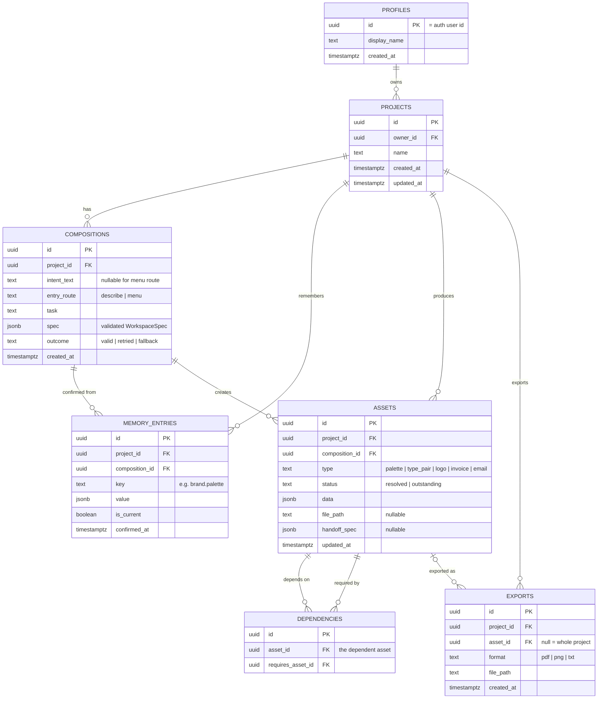

# Droplet: project context

This file gives Claude Code the full context of the Droplet project: what it is, who it is for, what the research found and what was pitched. It does not contain tasks. Tasks will be given in the prompt.

Writing conventions for all code comments, UI copy and docs in this repo: British English spelling, no em dashes, factual and plain tone, no marketing fluff.

**Git and GitHub:** never add `Co-Authored-By` trailers or any other co-author, attribution or "Generated with" lines to commit messages, pull request descriptions, issues or any other GitHub content. This overrides any default attribution behaviour.

**Testing:** never test features in a browser yourself (no browser pane, no Chrome, no screenshots or scripted pointer events to check how something looks or behaves). Rikus reviews every feature by hand. Verify with the type checker (`npx tsc -b`), the linter (`npx oxlint`) and the unit tests (`npm test`), write unit tests for new logic, and say plainly that the visual and interactive behaviour has not been checked.

---

## 1. What this project is

Droplet is a final-year student project by Rikus Pretorius (Bachelor of Creative Technologies, Open Window, Pretoria). One build serves two briefs:

| Brief | What it assesses | Key dates |
|---|---|---|
| **DV300** Interactive Development 300, Theme 4: AI-driven application | A working AI-driven web app, built Agile with progress milestones. AI must be core, not bolted on. The pitch (submitted 21 Sep 2026) is the plan this repo implements. | Milestones per lecturer |
| **UX300** Term 4 Capstone ("Manifesto in Motion", lecturer Laudette Sass) | Research, persona, flows, annotated wireframes, final UI, interactive prototype, video, case study. Must visibly apply Rikus's design manifesto. | Full submission Sun 25 Oct 2026, 22:00. Presentations 28/29 Oct. |

The UX work (research, persona, flows) feeds this codebase. The coded app is the DV deliverable and can also act as the UX interactive prototype.

---

## 2. The concept

**One line:** Droplet is an AI workspace that reads what a small business owner is trying to do and assembles the interface for it, so professional decisions stop requiring a professional.

**Tagline:** Software that takes the shape of the work.

**Thesis:** Every tool has a fixed shape and asks the user to translate their task into it. A canvas is a canvas whether or not you need one; a chat window is a chat window whether you are naming a business or chasing an invoice. Droplet has no fixed shape. It reads the intent behind a request and assembles the workspace that task needs from a bounded library of pre-built components, then reassembles it when the intent changes.

**What makes it different from a chatbot:** the AI does not reply with prose. It returns a validated structure (a `WorkspaceSpec`) that names components from a fixed library and fills them with content. The app renders that as a working interface: adjustable swatches with live contrast checks, a line-item editor with computed totals, a document preview, side-by-side email drafts. A colour palette is a bad conversational output; it is a good interface.

**Social impact framing (DV focus area):** a funded business buys judgement: a designer picks the typefaces, a bookkeeper knows what a compliant invoice contains, a copywriter knows how firmly to chase payment. An unfunded owner gets their own guess, made at night, with no way to check it. Free tools will describe a good palette to anyone; what is scarce is the ability to act on the description. Droplet puts the instrument of the decision, not just the advice, within reach.

**Supervisor framing question (UX300, from Laudette):**
> How might an interface adapt around a small-business owner's immediate intent while remaining predictable, controllable and honest about its limitations?

Laudette approved the direction with strict scope: Droplet assembles only from predefined, tested components, is as clear about what it cannot do as what it can, and should show a few complete journeys including misunderstanding, recovery and handoff, rather than unlimited AI capability.

---

## 3. Primary user: Megan Swart (fictional, research-based persona)

- 25, Pretoria East. BCom Business Management. Junior administrator at a logistics firm.
- Building **Kindred Gifting** (curated corporate gift boxes for Pretoria firms, sourced from local makers) at night. Not launched. No registered company, brand or website. Tested with two friendly clients.
- Budget about R2 000/month from her salary. Works on a **laptop**; phone for messages.
- Uses Google Docs, free Canva, ChatGPT, WhatsApp, a spreadsheet from university.
- Core gap: her degree taught her **what** a business needs (positioning, pricing, a brand that signals quality, clean records), not **how** to make those things. She can explain brand consistency in an exam; she cannot pair two typefaces, and she knows it.

Her week maps onto the five journeys: Monday deciding what to sell (ideation), Tuesday asking ChatGPT for a palette and pasting hex codes into Canva without knowing which pairs have contrast (brand), Wednesday a R6 000 logo quote she cannot afford (logo), Thursday an invoice in Google Docs in the wrong green because the hex code is lost in a chat (invoice), Friday rewriting a pitch email four times and sending none (correspondence).

**Not for:** survivalist traders (spaza shops, street vendors) who never issue invoices; owners who already pay professionals; teams; and, until the component library is tested with them, people relying on screen readers or with limited fine motor control (declared openly, per manifesto principle 1).

**Secondary users:** solo service-business owners already trading (caterer, electrician, pet sitter) who quote and invoice often and cannot pay for professionals. Copy must work for someone who never studied business.

Droplet is **frontier software, laptop-first, not phone-first.** It should stay usable on a phone for checking and approving.

---

## 4. What the research proves (summary)

### Secondary research, key points
- Many South Africans start businesses, fewer reach maturity; experts rate access to commercial and professional support as insufficient and falling (GEM South Africa).
- Professional design is out of reach for a starting budget: an independent logo commonly costs several thousand rand upward.
- Small business owners lose significant time each day to juggling tools (Slack/Salesforce survey).
- SA SMEs face real barriers to AI adoption: cost, skills, trust (Chasaya & Ayandibu 2025).
- Chat is not always the right interface for AI; outcome-oriented, generative UI with real controls (buttons, checkboxes) is the emerging alternative (NN/g 2024 to 2026; Google Research generative UI 2025).
- Scope AI features tightly and make limits visible (NN/g, "Scope in generative AI features"). Human-AI interaction guidelines: make clear what the system can do, support efficient correction and dismissal, explain why it acted (Amershi et al. 2019). Design against overreliance (Microsoft, Passi & Vorvoreanu 2022).
- Competitors are either fixed-shape tools or chat: Canva AI 2.0, Notion AI, Gamma, v0, ChatGPT, Looka, Zoho Invoice. None composes a task-specific interface from intent while remembering prior brand decisions across tasks.

### Primary research: four interviews (24 to 30 Sep 2026)
Participants: co-founder of a small software studio; owner of a pet-sitting business; co-owner of an online plant nursery; co-runner of a rage-room business. All Pretoria. Anonymise them in anything user-facing.

| Finding | Evidence | What it means for the build |
|---|---|---|
| **Invoices are the most avoided task.** | Two of four named invoices as the task they'd remove forever or put off longest. One spent ~45 min per invoice in Zoho because it asked for business details again on every login. A revised invoice got a new number, which embarrassed her in front of a client. | Invoice is the priority journey. Business details entered once and remembered. Invoice numbers must stay stable across revisions. |
| **Brand assets are scattered or locked away.** | Colours locked in a cancelled Canva subscription; exact colours only known by a colleague; fonts unknown; logo exists as one file with a background. Only the design studio had a proper style guide. | Confirmed brand memory is the core value. Handoff spec must list formats and variants (light/dark, transparent). |
| **Logos get outsourced.** | Three of four would outsource or could not make a logo themselves. | Validates naming the boundary and handing off rather than generating logos. |
| **A good handoff explains itself.** | "What was done, what still needs to be done, and the direction behind the decisions." | Handoff card carries reasoning and outstanding status, not just a link. |
| **Client details get lost between apps.** | Named by three of four (WhatsApp, notes app, email, Shopify, spreadsheets). | Client details belong in project memory, entered once. |
| **Everyone wants manual control.** | Edit what it made, ignore the wrong part, revert and retry. The designer wanted to point at and change things directly because text is a poor way to describe layout. | Every component is directly editable. Undo/revert matters. AI output is a starting point, never locked. |
| **Prediction is the weak point.** | The developer interviewed said predicting intent is what would "break first". | Bounded component library, clarifying questions when unsure, validated fallback, and the familiar task menu always available. |
| **Adaptive UI is welcome if it saves time.** | Three were positive; all four would learn a new way of working if it is clearly faster. | Speed and obvious payoff in the first session matter more than novelty. |
| **Trust stops at money and client data.** | Two refuse to give AI client or financial details; one asked for local storage, transparency and deletion. | Send the model only what a task needs. Be explicit about what is stored, where, and how to delete it. |
| **Consistency is the main AI worry.** | The designer avoided AI because it does not keep things consistent. | Visual consistency comes from the design system and memory, never from the model. |
| **Delivery happens on WhatsApp.** | Invoices sent via WhatsApp by two of four; payment tracked in banking apps, notes or sheets. | Export must produce a file that is easy to share from a phone (PDF). |

Note: one interviewee runs the business mainly from a phone. This sits against the laptop-first persona. The pitch keeps laptop-first; keep the phone view usable for review and approval.

---

## 5. What was pitched to DV300

### Scope: five journeys, three priority flows

The pitch commits to five journeys, run in the order a founder starting from scratch meets them. Laudette's sign-off narrows the UX capstone to three, so those three are the **priority core** and must be complete, including failure and recovery states.

| # | Journey | Workspace contains | Depends on | Priority |
|---|---|---|---|---|
| 1 | Business ideation | Offer options compared side by side against her budget and time; naming shortlist with rationale | Nothing | |
| 2 | **Brand system** (hero moment) | Split view: palette swatches with live contrast, type pairings with sample text, preview on a real document | 1 (name) | **Core** |
| 3 | **Logo handoff** (unsupported request) | Handoff card naming the boundary, copyable spec panel (palette, fonts, formats, sizes), link-out in a new tab, import slot | 2 | **Core** |
| 4 | **Invoice** | Line-item editor, totals computed in code, brand applied, missing fields flagged before export | 2, and 3 if logo resolved | **Core** |
| 5 | Client correspondence + review/export | Firmer and softer email drafts side by side; then review of all assets and export | 1 to 4 | |

### Must have
Account and sign-in · Projects (one per business) · Intent input · Composition engine · Component library (core set) · Validation and fallback · Project memory · Confirm step (nothing saved without it) · Specialist handoff (link-out, not embedded) · Dependency tracking (resolved/outstanding) · Guided start, the familiar path · Review and export (invoice PDF, one-page brand sheet).

### Nice to have
Memory panel with edit/delete · Undo for composition · Quotes as well as invoices · Brand applied to email signature · Light and dark theme · Reduced-motion mode.

### Future (explicitly out of scope)
Sending email/invoices from Droplet · Xero/Sage integrations · Embedded specialist tools · Teams and roles · Payments/subscriptions · Afrikaans and isiZulu UI.

### The familiar path
Every new project opens on a start screen with **two equal ways in**, side by side, no default, no nudge:
- **Describe what you need:** one plain-language field; Droplet reads intent and assembles the workspace.
- **Choose a task:** a conventional menu: *Shape the business idea*, *Build the brand*, *Get a logo*, *Make an invoice*, *Write to a client*. Opens that task's fixed layout.

Both routes use the same components, memory and export. The task menu stays one click away in every workspace. The fixed task layouts are also the AI fallback.

### User role and screens
One role: **the founder**. She owns her projects and confirms every decision. The AI is a service she directs, not a role; it can propose but never commit to memory.

| Screen | Purpose |
|---|---|
| Landing | What Droplet is; before/after strip (chat reply vs assembled workspace); sign-up |
| Sign up / sign in | Email/password or Google. Standard on purpose |
| Projects | Project cards: name, last task, count of outstanding assets; New project |
| Project start | The two equal ways in |
| Workspace | The one composed screen hosting all journeys |
| Handoff | Overlay in the workspace: boundary explanation, copyable specs, link-out, import slot |
| Review and export | Every asset with status; export per asset and all. Outstanding items never block exporting finished ones |
| Account | Profile, sign out, **Delete account and data** as a visible action |

### Workspace frame (fixed, so users keep orientation)
- **Intent bar:** top, full width. Current request plus task-menu toggle.
- **Canvas:** centre, 12-column grid. Assembled components appear here.
- **Project rail:** right, collapsible. Confirmed memory (name, palette, type, business details) and dependencies with status.
- **Action bar:** bottom of canvas. *Confirm* (primary), *Ask for something else*, and a quiet note of what confirming will save.

### Component library (the only pieces the model may use)

| Component | Used in | States |
|---|---|---|
| Option comparison | Ideation | 2, 3, 4 options; one selected |
| Name shortlist | Ideation | List with rationale; one selected |
| Swatch grid | Brand | Default; one swatch being adjusted |
| Contrast readout *(computed)* | Brand | Pass; fail with failing pair named |
| Type pairing | Brand | Heading and body sample; alternative selected |
| Document preview | Brand, invoice | Empty; brand applied; logo-outstanding placeholder |
| Handoff card + spec panel | Logo | Before opening tool; waiting; asset imported |
| Import slot *(part of handoff card)* | Logo | Empty; rejected with reason; accepted |
| Line-item editor | Invoice | Empty; filled; required field missing |
| Draft pair | Correspondence | Firmer and softer; one chosen |
| Asset list *(computed)* | Review | Mixed resolved and outstanding |
| Loading and fallback | All | Composing; fallback layout with "a simpler view was used" note |

Computed components (contrast readout, totals, asset list) and child parts (spec panel, import slot) are added by the renderer, never supplied by the model.

### User stories (each with its acceptance check)
1. Choose between typing and picking from a task list. *Start screen shows both with equal weight.*
2. Compare offer options against budget and time. *Ideation returns 2 to 4 options tied to her constraints.*
3. See palettes and type pairs on a real document with contrast shown. *Brand workspace shows swatches, ratios, live preview; confirming stores the choice.*
4. Be told plainly when Droplet cannot make something, and be handed off. *Logo task shows handoff card, copyable specs, link-out; logo marked outstanding.*
5. Have the brand applied when making an invoice. *New invoice opens with confirmed palette and type, no restating.*
6. Be warned about missing invoice details. *Export blocked, missing fields named, until required fields are filled.*
7. See a firmer and softer client email side by side. *Two drafts built from the real invoice and client details.*
8. See everything produced and what is outstanding. *Review lists every asset with status and exports finished ones.*

---

## 6. AI integration (as pitched)

**The AI's one job:** read what the founder is trying to do and decide what workspace that task needs. It chooses and fills the interface. It never draws it.

| The AI does | The AI does not |
|---|---|
| Classify intent into a supported task, or flag out of scope | Invent tasks or components outside the library |
| Choose components and their arrangement | Decide how anything looks (colour, spacing, type, motion belong to the design system) |
| Fill components with content: options, names with rationale, palettes, type pairs, line-item suggestions, email drafts | Write to project memory (only the founder's confirm does) |
| Read confirmed project memory | See anything beyond the current project |
| Recognise specialist tasks and return a handoff | Generate logos or images |
| Explain each component in one line (`reason`) | Calculate totals, VAT or contrast. Anything with one right answer is computed in code |

**Service:** Google Gemini API via Google AI Studio, **Flash tier**, model ID **pinned** at the start of the build and only changed after re-running a fixed set of test requests. Chosen for JSON response schemas with enums (the API itself restricts the model to library component names), speed for interactive use, and a free development tier. Alternatives considered: OpenAI mini tier, Claude Haiku, self-hosted open model.

**Key handling:** the Gemini key lives only in a server-side function, never in the browser bundle. (Same pattern as Rikus's earlier project Cardinal, which kept its Gemini key in a Cloud Function.)

### The output contract
Defined once in Zod and used to generate the JSON response schema sent to Gemini, so the two cannot drift.

```ts
type WorkspaceSpec = {
  task: "ideation" | "brand" | "logo" | "invoice" | "correspondence" | "out_of_scope";
  layout: "single" | "split" | "main_with_side";
  components: Array<{
    type:
      | "option_comparison" | "name_shortlist"
      | "swatch_grid" | "type_pairing" | "document_preview"
      | "handoff_card" | "line_item_editor" | "draft_pair";
    region: "main" | "side" | "bottom";
    props: Record<string, unknown>; // validated per component type
    reason: string;                 // one line: why this component is here
  }>;
  memoryUsed: string[];      // which confirmed decisions were applied
  proposedMemory?: {         // what confirming would save; never saved automatically
    key: string;
    value: unknown;
  }[];
  outOfScopeMessage?: string; // plain answer when task is out_of_scope
};
```

**Validation, in order:** (1) parses and matches schema; (2) each component's `props` match that component's own Zod schema (e.g. swatch grid has 3 to 8 valid hex colours); (3) business rules pass (e.g. a line item has quantity and unit price).
**On failure:** one retry with the validation error included in the prompt. Second failure: fixed fallback layout for the nearest task (same layout as the task menu), opened empty and editable, with a one-line note.
**Layout control:** three fixed layout templates on a 12-column grid. The model picks a template and regions, never positions.

### The composition loop
Founder states intent or picks a task → client sends task, intent and current memory → Edge Function adds key and response schema → Gemini returns `WorkspaceSpec` → validated in the Edge Function (retry, then fallback) → valid spec logged to `compositions` → client re-checks with the same Zod schema and renders → founder adjusts directly in components → **Confirm** writes to memory; *Ask for something else* recomposes; leaving saves nothing.

Three rules: the model never draws; invalid output never reaches the screen; nothing is remembered without consent.

### If the AI is removed
Droplet stops being Droplet. What remains is the task menu: five fixed layouts filled by hand, a competent template tool in the same row as Canva. Lost: the adaptive interface, the judgement in the content, and continuity with meaning (deciding which remembered decisions apply to a new task). The familiar path survives on purpose as the floor of the product, not the product.

### Handoff and dependencies
Logo request → handoff card explains why Droplet stops here → spec panel (palette, fonts, formats, sizes, each copyable) → external tool opens in a new tab → logo recorded as an **outstanding** asset. On return, the import slot validates format and size with a clear rejection reason. Later, an invoice opens with a placeholder and a note that the logo is outstanding: resolve now, or continue with the business name set in the brand type. Outstanding assets flag dependent tasks; they never block them.

---

## 7. Technical plan (as pitched)

Laptop-first web app. Not Electron (embedded webviews break Google sign-in for tools like Canva, so handoff is link-out). Not Next.js (no need for SSR with Supabase as backend).

| Layer | Choice | Why |
|---|---|---|
| Language | TypeScript | Component library, Zod schemas and renderer share one definition of every component |
| Framework | React + Vite | Workspace is a component tree chosen at runtime |
| Validation | Zod | Validates every model response; generates the Gemini JSON schema |
| State | Zustand | Current workspace spec, unconfirmed edits, project memory |
| Motion | Framer Motion | Layout animation makes recomposition legible; respects reduced motion |
| Backend | Supabase | Postgres, Auth, Storage, Edge Functions; RLS keeps each founder's data hers |
| AI | Gemini API, Flash tier | See section 6 |
| Server function | Supabase Edge Function `compose` | Only place the key exists. Builds prompt, calls model, validates, retries, falls back, rate-limits, logs |
| PDF export | @react-pdf/renderer | Invoice and brand sheet render from the same data as the preview |
| Hosting | Vercel | Static Vite build, preview deployment per branch for testing sessions |

### Backend responsibilities
- Accounts and sessions: Supabase Auth, email or Google.
- Projects, confirmed memory, assets, dependencies, composition history: Postgres.
- Data isolation: RLS on every table keyed to the signed-in user.
- Model access: Edge Function `compose`. The client never calls Gemini directly.
- Rate limiting: `compose` counts the user's `compositions` rows in the last hour before calling Gemini.
- Files (imported logos, exports): Supabase Storage, private bucket per user.
- Account deletion: one Edge Function cascading through every table and bucket.

### Data model



- `profiles` is minimal on purpose: display name only.
- Every table hangs off `projects`, so RLS is one ownership check.
- `compositions` doubles as an honest log of retry/fallback rates (manifesto principle 5).
- `memory_entries`: superseded decisions kept with `is_current = false`, so changes are visible and undo is possible. Partial unique index: one current entry per project and key.
- `dependencies`: unique on (`asset_id`, `requires_asset_id`); an asset cannot depend on itself.
- All foreign keys cascade on delete.

### Pitched technical risks
1. Inconsistent model output: enums, per-component Zod, contrast and totals in code, one retry, fixed fallback.
2. Layouts that clash: three templates, 12-column grid, every component designed for each region size.
3. Latency: Flash tier, send only current memory, show frame and skeleton immediately, render once when the validated spec arrives. Streaming partial output rejected (would show unvalidated content).
4. Model version churn: pinned model ID, fixed test requests re-run before any change.
5. Cost and abuse: key only server-side, per-user rate limit.
6. Handoff return unreliable: import checks format and size; outstanding never blocks.
7. Memory going stale: confirm before save, each workspace lists memory used, superseded entries kept.
8. Scope for one developer: Must-have list fixed, Nice-to-have cut first.

### Pitched build approach
Build the fixed task-menu layouts first. They are the familiar path and the AI fallback, so a working, testable product exists before the composition engine is added on top.

---

## 8. Design principles that are build rules

From Rikus's UX300 design manifesto. Several are direct implementation constraints.

| Principle | In Droplet |
|---|---|
| 1. Declare what you exclude | State openly who Droplet does not serve yet (e.g. untested with screen readers). |
| 2. Replace what you remove | No fixed navigation in the canvas, so the intent bar, task menu and rail must be visible and always there. |
| 3. Label the arbitrary | Each component shows its one-line `reason`. Users can see why it appeared. |
| 4. Assume there is another way | Treat apparent constraints as hypotheses; drop a mechanic if testing shows users carry its cost. |
| 5. Measure what happened | Log valid/retried/fallback honestly in `compositions`. |
| 6. Never design against the user | Key server-side; minimal personal data; delete account and data is visible and complete. |
| 7. Friction where it counts | The confirm step before memory and the export check for missing invoice fields. Nothing else gated. |
| 8. Offer the familiar path | Task menu equal to the intent field at the entrance and always one click away. |

---

## 9. Open design questions (from Laudette's sign-off)

Not yet fully resolved. Implementation decisions should be checked against them.

- When should Droplet ask a clarifying question instead of acting?
- How does the user know why something appeared? (partly answered: `reason` per component)
- Can users manually add or remove components?
- What happens when Droplet misreads the request, and can every action be undone?
- What is automatically temporary, and what needs explicit confirmation before saving?
- How does the user return to previous work, and what happens when two tasks become part of one project?
- What exactly counts as an unsupported request, and what does a good handoff include?
- How does the changing interface stay accessible and predictable, and what stays fixed on screen?
- How will we test that the adaptive interface is easier than a conventional menu, and what if a user just prefers the menu?

---

## 10. Source material (outside this repo)

- Pitch stage docs (Claude Docs): Stage 1 Positioning, 2 Problem and Research, 3 Competitors, 4 Target Audience, 5 Features and Scope, 6 Flows and Wireframes, 7 AI Integration, 8 Technical Planning.
- Research folder on Rikus's Mac: `Documents/Research (UX300T4)`: secondary sources (PDFs), `References (APA 7).md`, interview transcripts and an anonymised compilation.
- Briefs: DV300 Project Pitch brief; UX300 Theme 4 Capstone brief.
- Supervisor feedback: "Droplet: Supervisor Approval & Scope Feedback" (Laudette Sass, 22 Sep 2026).

---

## 11. Visual design: tokens, type, icons and references

Design direction: **minimalist with subtle glassmorphism**. Calm, pale surfaces, large radii, soft shadows, almost no decoration. The interface must never compete with the content the AI assembles. Visual consistency comes from these tokens and the design system, never from the model (see section 6).

References for how components should look live in `docs/ui-references/` (see its `README.md` for what to take from each image). Wireframes live in `docs/wireframes/`. **Check both before designing or changing any component.**

### Colour palette

All colour comes from CSS custom properties in `src/styles/tokens.css`. Never hard-code a hex value in a component. **Components use the semantic tokens below (`--text`, `--bg`, `--accent` and so on), never the raw palette tokens (`--ink`, `--mist` and so on).** Raw palette tokens are for `tokens.css` and illustrations only. Contrast ratios were calculated with the WCAG 2.x formula. AA requires 4.5:1 for body text and 3:1 for large text and non-text UI such as borders, focus rings and icons.

| Token | Hex | Role | Contrast | Use |
|---|---|---|---|---|
| Ink | `#0E1A2B` | Primary text | 17.48 on white, 16.37 on Mist | All body and heading text |
| Deep Water | `#0B4F8A` | Primary brand, buttons | 8.40 on white; white text on it 8.40 | Primary buttons, links, selected states |
| Droplet Blue | `#1F8FE0` | Accent, ripple | 3.46 on white | Focus rings, ripple animation, icons, large display text only. Fails AA for body text, so never used for small text |
| Ripple | `#CFE9FB` | Tint surface | Ink on it 13.90; Deep Water on it 6.68 | Selected cards, highlighted regions, the project rail |
| Mist | `#F4F8FB` | App background | Ink on it 16.37 | Canvas and page background |
| Slate | `#4A5A70` | Secondary text | 7.03 on white, 6.58 on Mist | Labels, captions, the one-line component reasons |
| Outstanding | `#B45309` | Status: outstanding | 5.02 on white, 4.70 on Mist | Outstanding assets, always paired with an icon and the word |
| Resolved | `#15803D` | Status: resolved | 5.02 on white, 4.70 on Mist | Resolved assets, always paired with an icon and the word |

Status is never shown by colour alone: every resolved or outstanding marker carries an icon and a text label. In the UI (`StatusMark.tsx`) the word comes first in the normal text colour and the icon follows it on the right, and the icon sits inside a filled circle in the status colour (a tick for resolved, an hourglass for outstanding), which makes the colour easy to see. The icon inside the circle uses `--on-status`: white in light, Ink in dark, because white on Mint or Amber would fail contrast.

### Themes: light, dark and system

Every component supports light and dark from the start. The theme is the `data-theme` attribute on `<html>`, set by `src/store/theme.ts` (preference: `light`, `dark` or `system`, saved in `localStorage` under `droplet-theme`) and applied by an inline script in `index.html` before first paint so there is no flash. `system` follows the operating system live. The switcher is in the sidebar (`ThemeSwitcher.tsx`).

**Rule for new components:** use semantic tokens only, then view the component in both themes before calling it done. If a new component needs a colour that no semantic token provides, add a semantic token to both the light block and the `:root[data-theme='dark']` block in `tokens.css`. Do not branch on the theme inside components, except to swap artwork (as `Wordmark.tsx` does).

| Semantic token | Light | Dark | Use |
|---|---|---|---|
| `--bg` | Mist `#F4F8FB` | Night `#0A1320` | Page background |
| `--text` | Ink `#0E1A2B` | Mist `#F4F8FB` | Primary text, active markers |
| `--text-muted` | Slate `#4A5A70` | Haze `#A9B8CB` | Secondary text, captions, placeholders |
| `--accent` | Deep Water `#0B4F8A` | Sky `#7CC0F5` | Links, selected text and icons |
| `--accent-tint` / `--accent-tint-soft` | Ripple, Ripple at 60% | Droplet Blue at 26% / 16% | Selected and hover fills, avatar and badge fills |
| `--button` / `--on-button` | Deep Water / white | Droplet Blue / Ink | Primary buttons and their text |
| `--focus` | Droplet Blue `#1F8FE0` | Droplet Blue `#1F8FE0` | Focus rings |
| `--status-resolved` | `#15803D` | Mint `#4ADE80` | Resolved marker circle |
| `--status-outstanding` | `#B45309` | Amber `#FBBF24` | Outstanding marker circle |
| `--on-status` | White | Ink | Icon inside a status circle (5.02 on both light fills, about 10 on the dark fills) |
| `--bubble-top` / `--bubble-bottom` / `--bubble-highlight` / `--on-bubble` | Droplet Blue 40% into Deep Water, Deep Water, white at 22%, white | Droplet Blue 44% into Deep Water, Deep Water, white at 20%, white | The founder's chat bubbles: a deep blue gradient lit from above, with a thin light edge along the top. White text is 5.8 to 8.4 on it |
| `--overlay-06` / `--overlay-10` | Ink at 6% / 10% | White at 7% / 12% | Quiet fills, hairlines |
| `--raised` | White at 95% | White at 16% | A control sitting on a quiet fill, such as the selected segment |
| `--glass-*`, `--shadow-*`, `--scrim` | Light glass, soft shadows | Dark glass, deeper shadows | Surfaces, elevation, drawer scrim |

Dark contrast, calculated with the WCAG 2.x formula on the screen surface (Ink): Mist text 15.47, Haze 8.66, Sky 8.92, Mint 10.03, Amber 10.47, Droplet Blue focus ring 5.05. Droplet Blue with Ink text on a button is 5.05. On Night, Mist text is 16.49.

### Glass surfaces

Glass is subtle and used for floating or layered UI only (menus and the intent bar). Not for body text blocks or large areas.

- Translucent white fill (about 60 to 70 percent), `backdrop-filter` blur, a 1px light border and a soft low-contrast shadow. Use the shared `.glass` class and the `--glass-*` tokens.
- Text on glass must still meet the contrast ratios above against the lightest and darkest thing that can sit behind it.
- Provide an opaque fallback where `backdrop-filter` is unsupported.

### Typography

- **Urbanist** (variable, bundled via `@fontsource-variable/urbanist`). One family, weights 100 to 900.
- Build hierarchy with size and weight, not extra families. Do not use Droplet Blue for small text.
- Headings and the wordmark sit at weight 500 to 600. Body is 400 to 500.

### Icons

- **Solar icon set only**, via `@solar-icons/react`, **linear** style: `import { AddIcon } from '@solar-icons/react/linear'`.
- **Never use Lucide** or any other icon set. Do not install another one.
- One deliberate exception: illustrated, three-dimensional object icons for things the user owns, such as the project folder (`src/components/FolderIcon.tsx`). They are drawn as inline SVG from palette tokens (layered gradients, a soft blue drop shadow) and are not taken from any icon library. Use this style sparingly, only for objects, never for actions.
- Colour with `currentColor` (ink or slate). Decorative icons get `aria-hidden`; icon-only buttons get an `aria-label`.

### Brand assets

Logos live in `src/assets/brand/`. Import them from there; do not recolour or redraw them.

| File | What it is | Use on |
|---|---|---|
| `wordmark-dark.svg` / `wordmark-light.svg` | The lowercase "droplet" lettering | Headers and nav. The Home header swaps between them by theme. |
| `icon-dark.svg` / `icon-light.svg` | The mark on its own | Square or tight spaces: favicon, avatars, loading states |
| `logo-dark.svg` / `logo-light.svg` | Mark and lettering together as a lockup | Landing hero, exports, anywhere the brand is the focus |

"Dark" files are black and go on light surfaces. "Light" files are white and go on dark surfaces. `Wordmark.tsx` renders both and CSS shows the one for the active theme. The artboards carry built-in margin around the artwork, so trim it with negative margins in CSS rather than editing the SVGs. `public/favicon.svg` is the icon with a dark-mode colour switch.

**The droplet loader** (`DropletLoader.tsx`) is the mark animated, used for the thinking state. It is only the logo: the mark's own outline (split into the blob and the hole, so each moves on its own), with nothing added around it, no ripples and no drops. It hops. The mark crouches, springs up stretched, flips like a coin at the top of the hop (the hole slides across it as it turns edge-on), lands with a squash while the hole pinches, wobbles like jelly and rests, in a 2.4 second loop. Each movement is its own layer, and each turns about a fixed point in the artboard so nothing drifts. It is small (a 1.9rem artboard, so the mark is about 22px), follows `--text`, is decoration (`aria-hidden`, the word "Thinking" says what is happening) and holds still with reduced motion. A **temporary preview** (`LoaderPreview.tsx`: a large copy, the real-size chat bubble and a slow-motion toggle) shows on the Home screen until the first message, so the animation can be judged without sending one. Remove it, and its one line in `pages/Home.tsx`, once the animation is approved.

### Shape, space and motion

- Controls are pills (fully rounded). Panels use 20 to 32px radii. Nested surfaces use a smaller radius than their parent.
- Focus is always visible: a 2px `--focus` (Droplet Blue) ring. It meets 3:1 non-text contrast in both themes.
- Motion is small and quick (about 150 to 250ms, a few pixels of travel). Framer Motion is configured with `reducedMotion="user"`, so it respects the system setting.

### App shell

The page is a sidebar on the left and the working screen on the right. The sidebar sits directly on the page background. The working screen is a slightly smaller, rounded, near-white box (`.home__screen`, 32px radius) inset beside it. Reference: `docs/ui-references/07-sidebar-navigation.png`.

The sidebar (`src/components/Sidebar.tsx`) holds the project switcher, Home, the five tasks (the familiar path, always one click away), an expandable Assets group showing resolved and outstanding status, and Review and export with an outstanding count. It also holds the theme switcher (Light, Dark, System) and, beneath it, the **account section** (`AccountMenu.tsx`): the avatar and name of whoever is signed in, with a menu that opens upwards for Account and Sign out. There is no account control in the working screen's header. When the sidebar is collapsed only the avatar shows, and the name is the button's label. It collapses to icons on desktop and becomes a slide-over drawer on narrow screens.

### Conversation: chat first, then a side panel

The Home screen starts as a **conversation**. The thread of chat bubbles fills the working screen (`.home__conversation`, centred and readable, `ChatThread.tsx`, a `role="log"` list that follows the newest message) with the intent bar beneath it, and Droplet answers like any helpful assistant until it is asked to build something. Once a workspace exists, the same thread **moves out of the rounded box into a panel on the right** (`.home__chat`, 18.5rem), straight on the page background like the sidebar, with the intent bar at its foot, so a long thread can scroll beside the workspace. The founder's messages are tinted bubbles on the right; Droplet's replies are light grey bubbles on the left, and a reply still being worked on shows the **droplet loader** beside the word "Thinking". The task menu opens upwards. The first time a workspace opens the sidebar steps back to icons to leave the grid room (it can be reopened). Under 64rem there is no room beside the workspace, so the panel goes beneath it. The thread is session state for now; it is not saved.

### Workspace layout: a toolbar of tools, and windows on an invisible grid

Work happens on a **canvas**: a white space (`--canvas`). There are two kinds of component. **Tools** are compact controls that act on the selection (colour picker, role, generate). They sit side by side in one **toolbar fixed under the header** (`ToolShelf.tsx`), always in the same place. **Windows** are things to look at and work in (the palette canvas, the document preview, later a colour wheel, font pairing and invoices). They sit on a **24-column grid with rows** (cells 40px tall, `GridWorkspace.tsx`) that is **never drawn**: it only decides where windows can sit, so edges line up. A nested split tree (drop on an edge to split) was tried and dropped for the grid, which is more reliable and is what the founder prefers. **Drag a tool down out of the toolbar and it becomes its own bigger window** (the small colour picker becomes a colour wheel with every colour on it, role becomes four role cards, generate becomes four harmony cards with a preview of each). Drag the window back over the toolbar and it returns to being a tool. A tool has one compact form in the toolbar and one big form as a window; there are no sizes in between.

- **Moving windows:** every window has a grip handle on its top edge. Drag it anywhere on the grid: the right column can go beneath the left, the canvas can move, any formation works. The arrow keys move a focused handle (sideways by a column, up or down past the neighbour) and the move is announced.
- **While dragging:** a **lifted copy** of the window (a picture of it, scaled to 1.03 with a deeper shadow) follows the pointer from where it was picked up, the real one stays put, dimmed, and the box it will land in is outlined, moving between spots on a spring. Drops snap to a cell row and a column, then stacking closes up tight. On release the copy flies into the new place (300ms) while the other components glide aside on springs with no bounce (Framer Motion `layout`, position only, and only when a place changes, so resizing the window never makes things swim). The drag (shared helper `src/lib/lift.ts`) is tracked on the window, so it always ends: on release anywhere (even outside the page), when the next move shows the button is already up, and it cancels on Escape, window blur, right-click or pointer cancel. Reduced motion skips the springs and the flight. **Reset layout** glides the same way.
- **Sizing:** a **window fills the columns it is given** and is **resized by hand**: drag the grip on its right edge to any width on the grid, from 6 columns to the full width, or use the arrow keys (a column at a time; Home and End for the smallest and largest). Windows keep their own height, so a short window does not stretch. Nothing about a window is rounded to a preset.
- **Settling:** a drop that lands a column or two inside a neighbour slides sideways (up to 3 columns) to sit flush beside it, instead of one item being pushed down and the two ending up staggered (`settle`). If no nearby spot is better, the usual push-down applies.
- **Layout rules** (`src/lib/gridLayout.ts`, tested): items never overlap and always rise as far as they can (vertical compaction). A dropped item pushes whatever it lands on downwards. Heights are measured from the content, so expanding a component pushes the ones beneath it down.
- **Narrow containers** (under 940px of workspace width) cannot hold two windows side by side, so windows stack in a fixed order and cannot be moved. The toolbar is unaffected.
- **Save to project:** the **Save** button saves the palette and the layout to the project. Nothing is saved until the founder saves (principle 7); a short note beside the button says where things stand: "Not saved yet" before the first save, "Unsaved changes" after a change, "All changes saved" once saved. The button goes back to Save from Saved on any change. For now it is stored per project in this browser (`src/lib/projectStore.ts`, validated with Zod) as a stand-in for Supabase `memory_entries`. Reset layout only resets positions, never colours.
- Components arrive with `Emerge.tsx`: blurred and small, easing into focus, staggered by `delay` with a different `distance` each, so they emerge from different depths. Reduced motion gets a plain fade.
- **The toolbar** (`ToolShelf.tsx`): one glass bar, centred under the header, with a segment per tool and a thin **divider between segments**, so a colour picker and a contrast checker are separate in the eye as well as in the code. Each tool is exactly as wide as its controls, with nothing spare inside it. Its **icon is its handle and its label**: drag it to move the tool (a lifted copy follows the pointer, the other tools make room live and glide on springs, and the copy settles into place), use the left and right arrow keys on a focused icon to move it one place, and hover or focus for a tooltip with its name and its one-line reason (manifesto principle 3). The **+** button at the end of the bar adds and removes tools (the same show and hide actions the AI uses). The windows menu in the header (`Windows`) does the same for windows. The order is saved with Save (`tools` in the saved palette). On a narrow workspace the bar wraps onto a second line. Reference: `docs/ui-references/08-toolbars.png`. Detail opens on demand instead of always showing: the colour picker shows the current colour and its hex value, and clicking the colour opens the full spectrum (saturation and brightness area, hue slider, RGB fields) as a popover. The role tool is a menu, to save width. The bar's glass is drawn on a pseudo-element behind it, not on the bar, because an element with a backdrop blur makes everything inside it blur only what is inside it, which would leave the menus and tooltips that open from a tool with only a lower opacity. **Pulling a tool out:** carry a tool's icon more than about 24px below the bar and it leaves the bar (the others close the gap), the grid outlines where its window would land (as for any window, pushing down whatever it lands on), and on release the copy grows and fades as the window arrives (`expand_tool`). **Putting it back:** carry such a window over the toolbar, which lights up, and let go: it goes into the bar where it is dropped (`collapse_tool`). Both are one undo step, the AI has the same two actions, and which tools are windows is saved with Save (`expanded`).
- **Every tool has a title and a reason**, shown as a tooltip from its icon (for example "Colour picker"), passed to `ToolShelf` from the task's workspace component.
- **The reason line** (manifesto principle 3) lives in a small info button beside a window's title (`ReasonTip`), and in the tooltip of a tool's icon. It shows on hover or focus and is read out as the control's description.
- Each component does one job (the contrast checker is separate from the picker). Grips show on hover or focus, and always on touch screens.
- **Hex fields:** while typing, only a complete six-digit value changes the colour (`#1F8` is valid short hex but is usually the start of `#1F8FE0`); short forms apply on Enter or blur. Palette blocks have a Copy action and a trash button (remove the colour, down to a minimum of 2) that appear on hover or focus. Removing the selected colour selects the one that takes its place, and focus follows it.
- Default layout: the three tools in the toolbar (colour picker, role, generate), and the white canvas (14 columns) beside the document preview (10 columns) on the grid. The three tools also have a place on the grid, kept for when they are dragged out. Reset layout returns the windows, the tool order and any expanded tools (they go back to the toolbar) to this.
- **Colour roles:** each colour can be given a role (primary, accent, background, text) from the Role toolbar, which acts on the selected colour. A role belongs to one colour, so choosing it moves it; choosing the role a colour already has clears it. Roles are saved with Save. Any role the founder has not chosen is suggested from the colours (`resolveRoles` in `src/lib/palette.ts`: lightest as background, the best-reading colour as text, the most vivid two as primary and accent), and the interface says "suggested" while it is.
- **Generate** (`GenerateToolbar.tsx`, `src/lib/harmony.ts`): fills in every colour that is not the selected one and not kept, using a harmony (analogous, complementary, triad, monochrome) worked out by hue turns from the selected colour. Colours are given alternating pale and deep tones so a palette always has a background and a text candidate. Asking again rotates the tones, so it gives a different arrangement. Each colour has a lock button ("keep") that stays visible while set; the button reads "All locked" and is disabled when there is nothing to fill in. The keep lock only affects Generate; it is separate from Save.
- **Export** (`ExportButton.tsx`, `src/lib/paletteExport.ts`, `src/export/brandSheet.tsx`): a button in the screen's fixed header, on the right beside the logo, after Save, not a toolbar. It downloads a one-page A4 brand sheet as a PDF: roles, every colour with its hex and RGB, the key text-on-background pair and a count of pairs that reach AA. The PDF library is loaded only when the button is pressed. The sheet uses the library's built-in Helvetica for now, not Urbanist. The button keeps one width whatever it says (Export, Preparing, Exported, Not exported). Each colour block still has its own Copy button.
- **Header controls:** the workspace's buttons sit in the screen's header (`.home__header`) on either side of the logo, not above the grid. Undo and redo, the Windows menu and Reset layout are at the left edge; Save and Export are at the right edge. `PaletteWorkspace` renders them into the two header slots with a portal (`headerSlots`), so they stay part of the workspace. Under about 74rem of header width the buttons keep their icons and the words stay for screen readers. A short status note sits beside Save (Not saved yet, Unsaved changes, All changes saved, Could not save).
- **Undo and redo** (`src/lib/history.ts`): in the header and on Ctrl or Cmd with Z (Shift or Y to redo, except inside a text field, which keeps its own). They cover changes to the colours: edits, roles, keeps, adding, removing and Generate. Quick edits to the same colour count as one step, so a drag across the spectrum is one undo. Layout has Reset layout instead.
- **Document preview** (`DocumentPreview.tsx`): a sample invoice drawn in the palette's roles, with made-up details and totals computed in whole cents (`src/lib/sampleInvoice.ts`). If the text on the background fails AA the preview says so, and still draws it as it would look.
- **Decided:** the spec carries which components appear and what is in them, never positions. The founder's grid, and the AI's relative moves (above, below, left of, right of another component), decide where things go. See "The AI composer" below.

### Screens built so far

| Screen | Route | Wireframe |
|---|---|---|
| Home | `/home` | `docs/wireframes/home.png` |
| Invoice workspace (on Home, from the task menu) | `/home` | none yet |

### The invoice workspace (all four milestones built)

The invoice is the priority journey (pitch: the task most avoided, so the one that has to save the most time). It is built in four milestones, and the founder reviews each one by hand: (1) foundations and a static workspace, filled in by hand, **done**; (2) live totals, the "ready to export?" checklist, the PDF, and export blocked with the missing fields named, **done**; (3) project memory: business details and clients entered once, stable invoice numbers, a confirm step before anything is saved, **done**; (4) the AI composer learns the invoice task (set the client, add lines, set terms; it never invents a price and never calculates a total), **done**.

- **One shell for every task.** The parts of a workspace that do not depend on the task (the toolbar, the grid of windows, dragging a tool out to be a window and back, hiding and showing, reset, undo shortcuts, the header controls) live in `WorkspaceShell.tsx` and `src/lib/arrangement.ts`. A task gives the shell a spec (its components and where they start) and its own state, and keeps the arrangement in its own state (`reduceArrangement`). The palette (`workspaceState.ts`) and the invoice (`invoiceState.ts`) both do. Shared styles are `workspace__*`.
- **Money and sums** (`src/lib/money.ts`, `src/lib/invoice.ts`, all in whole cents, tested): `parseMoney` reads what a person types ("R 1 234,50", "450,5"), `vatOf` is 15 percent to the cent (basis points, a half cent rounds up), `computeTotals` adds the lines and charges VAT only for a business registered for it, a line with no price counts as nothing and is flagged, `dueDateOf` works from the terms, `nextNumber` goes up by one and keeps its length. A quote has the same model (`kind`), with no screens yet.
- **One view-model** (`invoiceView.ts`) holds every string the document shows. The page on screen and (milestone 2) the PDF are both made from it, so they cannot drift apart. A part not filled in yet is a faded placeholder.
- **Tools and windows.** Tools in the toolbar: your business (name), client (name), terms (due-date menu and the date), VAT (a switch), total (a computed readout). Each becomes a window when dragged down: your business (address, contact, VAT number, bank details), client (contact, address, VAT number, their reference), invoice details (number, date, terms, a note), VAT (what the switch changes), totals (the working, line by line). Two windows are always there: the invoice document, drawn in the confirmed palette (the project's saved palette, or the starter palette until there is one), and the line item editor (description, quantity, price, amount computed, move up and down, remove; a line that is begun and missing something is marked and named; the last line is cleared, not removed).
- **Typing rules.** Quantity and price are typed as text and read when they make sense, so a half-typed number is never rewritten under the cursor, and the field shows the number as understood when it is left. A quantity has at most two decimals and is more than nothing.
- **Ready to export?** (`invoiceReadiness.ts`, `ReadyPanel.tsx`): the sixth tool. `checkInvoice` works out in code what stands in the way and names each thing. **Required** (blocks the export): business name; client name; invoice number, date and due date; at least one line, and every line that is begun having a description, a quantity and a price (named by its line number); a total that is more than nothing; and for a business registered for VAT, a ten-digit VAT number and a business address, plus the client's address when the tax invoice is for more than R 5 000 (SARS). **Recommended** (never blocks): your address if not registered, an email or phone number, bank details, the client's address. Each item says which part of the workspace fixes it, and its Fix button turns that tool into a window (or brings it back if it was hidden) and focuses the first thing to do. The tool shows "Ready to export" or "N things to fix" as a word and an icon; its window lists the required items, then the suggestions.
- **Export** (`ExportButton.tsx`, `exportInvoice.ts`, `src/export/invoicePdf.tsx`): the header button makes the invoice PDF on A4 from the same view-model as the page, in the confirmed palette (the page background is the palette's background colour), in the PDF library's built-in Helvetica for now. The library is loaded only when the button is pressed. While the invoice is not ready the button is not hidden or switched off: it stays pressable, says how many things need fixing (aloud as well), and opens the checklist. The file is named like "Invoice INV-0007 Pretoria Print Works.pdf". The PDF is tested in Node (`invoicePdf.test.tsx`): a complete invoice, a barely begun one, and a long one that runs onto a second page.
- **Project memory** (`projectMemory.ts`, `memorySave.ts`, `memoryStore.ts`): per project, the founder's business, their clients and their invoices, so none is typed twice. It is a stand-in for the pitch's `memory_entries` (browser storage, validated with Zod, on this device only). **Nothing gets in unless the founder confirms it** (principle 7 and "the AI proposes, the founder confirms"). Pure functions do the sums, and the interface calls them only after a confirm: `businessStatus` and `clientStatus` say whether a thing is new, changed or already remembered; a client is found by name (capitals and spaces ignored) and replaces what was remembered, so one client is never remembered twice; an invoice confirmed again is a revision of the same invoice (same id, revision counted); `nextInvoiceNumber` goes on from the highest number in the founder's own style ("2026/12" carries on to "2026/13"), is never one already used, and a new invoice opens dated today with the remembered business already on it.
- **The confirm step** (`ConfirmSave.tsx`): in the invoice workspace Save does not save. It opens a note, "Save to {project}", listing exactly what would be remembered (your business details, the client, this invoice, each with a tick and a line saying whether it is new or replaces what is remembered), and only "Confirm and save" keeps anything. Cancel, Escape or clicking away keeps nothing. Only what is ticked is remembered. How the workspace is arranged is not a memory, so it is kept along with whatever is confirmed, and the note says so. The palette keeps its plain Save.
- **Invoices** (the first tool, `InvoicesPanel.tsx`): which invoice is open. The tool is a menu of the saved invoices and "New invoice"; its window lists each one with its total and where it stands (not exported yet, exported on a date, or changed since it was exported), and can open it (it keeps its number), start a new invoice from it ("Copy": next number, today's date, same client, lines and terms), or forget it. The workspace opens on the invoice confirmed most recently that has not been exported, else a new one. A successful export marks a confirmed, unchanged invoice as exported. Leaving an invoice with unsaved changes (opening, copying or starting another) asks first (`LeaveDialog.tsx`), with Stay as the safe choice in focus. An invoice nobody has touched is left without asking.
- **Clients.** The client tool offers the remembered clients as the name is typed (a `datalist`), and when the field is left on one of their names the rest of their details come with it, but only if nothing else has been typed for the client, so it never overwrites. The client window lists the saved clients (Use, Forget), and both the client and business windows say in a sentence whether they are remembered, with Forget behind a second press.
- **Numbers.** A number another invoice already has is a required item in the checklist ("The number INV-0007 is already used by another invoice"). A number can still be changed by hand.
- **The arrangement** (layout, tool order, which tools are windows, what is hidden) is saved per project on its own key (`invoiceStore.ts`) with each confirm. An invoice saved before the project had a memory is still read and opened, so nothing typed earlier is lost.
- **How it opens.** The task menu opens the workspace without asking the model, and the palette and invoice workspaces each keep their state while the other is shown. The AI cannot fill the invoice in yet and says so.
- **Compliance.** A business registered for VAT issues a "Tax invoice" and shows its VAT number; one that is not issues an "Invoice" with no VAT. The VAT rate is fixed at 15 percent.

- **The AI on the invoice** (milestone 4; `src/compose/invoice*.ts`). The composer works on the workspace that is on screen: the request carries `view` (`brand` or `invoice`) and that workspace's snapshot, and the reply is checked against that workspace's own schema, so each schema stays as small as the palette's was. In the invoice it can: `set_client` (only details the founder wrote), `use_saved_client` (by name, from the clients the project remembers, so their details come with them), `set_terms` (on receipt, 7, 14, 30 days, or a custom date), `set_date`, `set_note`, `set_vat_registered`, `add_line`, `update_line`, `remove_line`, `undo` and `redo`. It cannot save, export, change the invoice number, change the business or bank details, set an amount, or rearrange the workspace. A turn is one history step, so one Undo takes back everything it did, and it lands through the same reducer as a person's edits.
- **Prices are the founder's, enforced in code.** `unitPrice` is a string exactly as the founder wrote it ("450", "R 450,50"). `applyInvoiceTurnActions` accepts a price only if the same figure is in what the founder wrote in this request or earlier ones (`priceWasGiven`, `amountsIn`), never one that only Droplet said. Otherwise the action is refused with the reason, the model is asked again once, and a second failure changes nothing. A line the founder described with no price is added without one, marked, and counted as nothing. The model never calculates: the totals it is shown are the app's own sums, and it is told to quote them. This check runs on the server and again in the browser, so a wrong reply cannot reach the invoice. A figure that happens to equal a quantity (12 boxes, price R12) would pass; that is a known gap.
- **What it is sent** (`invoiceSnapshot.ts`, `invoiceContext.ts`): today's date; the number, dates, terms, due date (computed), note and VAT setting; the business name and only whether its address, contact and bank details are filled in; the client's name and whether their address is; the names of the remembered clients; the lines (description, quantity, price, amount); the totals (computed in code); and what still stands in the way of exporting, in the app's words. **Not sent:** any address, email, phone or bank detail, of the business or of a client (interviewees refused to give AI client or financial details). A test checks this.
- **Going to the other workspace** (`routedTo` in `spec.ts`, `Home.tsx`). The composer names the task of every request. If it names the invoice while the invoice is not on screen, or the brand while the invoice is, and it has nothing to do yet, the app opens that workspace and asks the same question again, once, with that workspace in front of the composer, so "invoice Pretoria Print Works for 12 boxes at R450" works from a blank start and from the palette. Only one workspace is shown at a time, and the one on screen leaves before the other arrives.

### The AI composer

The AI is **both an assistant and a user of the interface**. Every message goes to a server-side `compose` function and comes back as a **turn**: a `message` for the founder (an answer, advice, or what it did) plus `actions`. With no actions it is just a conversation. With actions, they are applied to the live workspace through the same reducer a person's clicks use, so the AI can do exactly what a person can do and nothing more.

- **One shared vocabulary** (`src/lib/workspaceState.ts`): `reduce(state, action)` handles select, set colour, set palette, add, remove, role, keep, generate, harmony, layout, resize, show, hide, reset layout, undo and redo. The interface dispatches them from its controls. The AI's actions (`src/compose/spec.ts`, counted from 1 in the order shown) are turned into the same actions by `src/compose/applyActions.ts`. A whole turn lands as **one history step**, so one Undo takes back everything the AI did. A person can show and hide components from the **Components** menu in the header (the canvas is always shown), so that is not an AI-only ability.
- **What the AI cannot do:** **save**. Only the founder's Save commits to memory (pitch: the AI proposes, the founder confirms). It can export the brand sheet, and it reminds the founder to Save.
- **What the AI sees** (`src/compose/context.ts`): the conversation so far, and the live workspace: the numbered colours with roles, kept colours and which is selected ("this colour" means the selected one), computed contrast figures (text on background, per-colour ratio, pairs reaching AA), the harmony, which components are on screen and at what size, their arrangement top to bottom, and whether Undo and Redo are available and whether there are unsaved changes. Contrast is computed in code, never guessed.
- **Moves are relative** (`placeRelative` in `gridLayout.ts`): "put the preview beside the palette" works out where a person would drop it. There is no room beside a full-width panel, so that move is refused with a reason and the model must narrow the panel first (`resize_component`), as a person would. Tools are different: `move_component` puts a tool `left_of` or `right_of` another tool, which reorders the toolbar, and refuses `above` and `below`, and any tool placed against a window. The AI sees the arrangement as the toolbar order plus the windows' rows.
- **Validation, in order** (`compose.ts`, `rules.ts`): the reply parses, matches the Zod schema, and every action can actually be done on the workspace the founder is looking at (numbers in range, 2 to 8 colours, roles used once, a pair that reaches AA must exist, components on screen for moves). On failure the reasons go back to the model once. A second failure uses the fixed fallback: with a workspace open it **changes nothing** and says so; with none open it offers the same starter palette the task menu opens. An error reaching the model (key, network, quota) is reported plainly and is not covered by the fallback. The client **re-checks** every response with the same schema and rules before applying it.
- **Where it runs:** `server/composePlugin.ts` serves `POST /api/compose` from the Vite dev server. The key is read there from `.env` or `.env.local` (names without a `VITE_` prefix, so it never reaches the browser). `server/composeService.ts` has no HTTP in it, so it moves into a Supabase Edge Function as it is. A local limit of 60 compositions an hour stands in for the pitch's per-user count. Every request is logged, on this machine only, to `.droplet/compositions.jsonl` (outcome valid, retried or fallback; manifesto principle 5).
- **The model** (`src/compose/gemini.ts`): Gemini through `generateContent`, ID in `GEMINI_MODEL` (default `gemini-3.8-flash`; the pitch pins it and changes it only after the fixed test requests are run again). The JSON schema is generated from the Zod contract. Array length limits are left out of it because the API refused the schema with them (checked against `gemini-3.8-flash`), and Zod enforces them afterwards. A 400 is retried once without the schema field, and a 503 once after a short wait. A 429 is read for what it is: a busy minute ("too many requests") or the **free daily quota for that model** used up (the message says so, and when it resets). Each model has its own quota, so when the main model's daily quota is used up, or it stays overloaded, requests go to `GEMINI_FALLBACK_MODEL` (default `gemini-3.5-flash-lite`, `none` turns it off), and the main model is not asked again until its quota resets. Which model answered is logged with every request. `GEMINI_THINKING_LEVEL` can lower how long it thinks. See `.env.example`.
- **The fixed test requests** (`src/compose/testRequests.ts`, run with `npm run eval:compose`): twenty-three requests, including seven for the invoice (a client who is remembered, a new client, a line with no price, advice, undo, a refusal, and being taken to the palette) (they use the main model only, so to run them on another model set `GEMINI_MODEL`) covering a palette request, chat, advice that must not act, acting on "this colour", layout moves, hiding, undo, a follow-up that needs the conversation, a task with no workspace yet, a request to save (refused) and a prompt injection. It prints pass or fail, how many were valid, retried or fell back, and saves the results to `.droplet/`.
- **The familiar path:** choosing "Build the brand" from the menu opens the fixed starter layout without asking the model. The other tasks have no workspace yet and say so.
- **Tasks the model can name:** ideation, brand, logo, invoice, correspondence, or `chat` for ordinary conversation. Brand and invoice have workspaces, so only a brand turn may carry palette actions and only an invoice turn may carry invoice actions, each on its own workspace.
