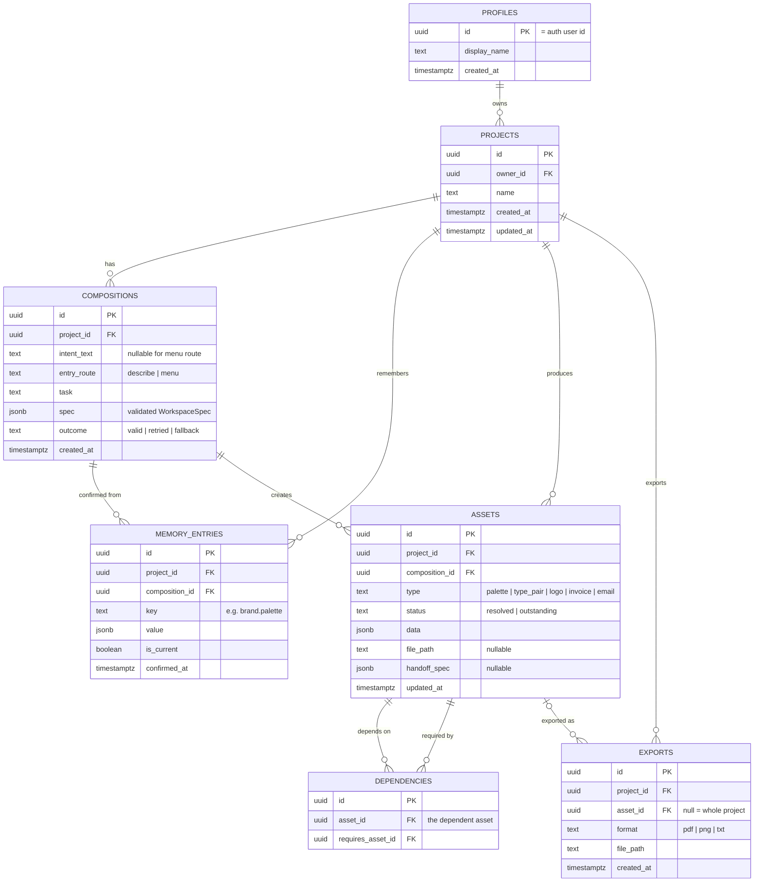

# Droplet: project context

This file gives Claude Code the full context of the Droplet project: what it is, who it is for, what the research found and what was pitched. It does not contain tasks. Tasks will be given in the prompt.

Writing conventions for all code comments, UI copy and docs in this repo: British English spelling, no em dashes, factual and plain tone, no marketing fluff.

**Git and GitHub:** never add `Co-Authored-By` trailers or any other co-author, attribution or "Generated with" lines to commit messages, pull request descriptions, issues or any other GitHub content. This overrides any default attribution behaviour.

---

## 1. What this project is

Droplet is a final-year student project by Rikus Pretorius (Bachelor of Creative Technologies, Open Window, Pretoria). One build serves two briefs:

| Brief | What it assesses | Key dates |
|---|---|---|
| **DV300** Interactive Development 300, Theme 4: AI-driven application | A working AI-driven web app, built Agile with progress milestones. AI must be core, not bolted on. The pitch (submitted 21 Sep 2026) is the plan this repo implements. | Milestones per lecturer |
| **UX300** Term 4 Capstone ("Manifesto in Motion", lecturer Laudette Sass) | Research, persona, flows, annotated wireframes, final UI, interactive prototype, video, case study. Must visibly apply Rikus's design manifesto. | Full submission Sun 25 Oct 2026, 22:00. Presentations 28/29 Oct. |

The UX work (research, persona, flows) feeds this codebase. The coded app is the DV deliverable and can also act as the UX interactive prototype.

---

## 2. The concept

**One line:** Droplet is an AI workspace that reads what a small business owner is trying to do and assembles the interface for it, so professional decisions stop requiring a professional.

**Tagline:** Software that takes the shape of the work.

**Thesis:** Every tool has a fixed shape and asks the user to translate their task into it. A canvas is a canvas whether or not you need one; a chat window is a chat window whether you are naming a business or chasing an invoice. Droplet has no fixed shape. It reads the intent behind a request and assembles the workspace that task needs from a bounded library of pre-built components, then reassembles it when the intent changes.

**What makes it different from a chatbot:** the AI does not reply with prose. It returns a validated structure (a `WorkspaceSpec`) that names components from a fixed library and fills them with content. The app renders that as a working interface: adjustable swatches with live contrast checks, a line-item editor with computed totals, a document preview, side-by-side email drafts. A colour palette is a bad conversational output; it is a good interface.

**Social impact framing (DV focus area):** a funded business buys judgement: a designer picks the typefaces, a bookkeeper knows what a compliant invoice contains, a copywriter knows how firmly to chase payment. An unfunded owner gets their own guess, made at night, with no way to check it. Free tools will describe a good palette to anyone; what is scarce is the ability to act on the description. Droplet puts the instrument of the decision, not just the advice, within reach.

**Supervisor framing question (UX300, from Laudette):**
> How might an interface adapt around a small-business owner's immediate intent while remaining predictable, controllable and honest about its limitations?

Laudette approved the direction with strict scope: Droplet assembles only from predefined, tested components, is as clear about what it cannot do as what it can, and should show a few complete journeys including misunderstanding, recovery and handoff, rather than unlimited AI capability.

---

## 3. Primary user: Megan Swart (fictional, research-based persona)

- 25, Pretoria East. BCom Business Management. Junior administrator at a logistics firm.
- Building **Kindred Gifting** (curated corporate gift boxes for Pretoria firms, sourced from local makers) at night. Not launched. No registered company, brand or website. Tested with two friendly clients.
- Budget about R2 000/month from her salary. Works on a **laptop**; phone for messages.
- Uses Google Docs, free Canva, ChatGPT, WhatsApp, a spreadsheet from university.
- Core gap: her degree taught her **what** a business needs (positioning, pricing, a brand that signals quality, clean records), not **how** to make those things. She can explain brand consistency in an exam; she cannot pair two typefaces, and she knows it.

Her week maps onto the five journeys: Monday deciding what to sell (ideation), Tuesday asking ChatGPT for a palette and pasting hex codes into Canva without knowing which pairs have contrast (brand), Wednesday a R6 000 logo quote she cannot afford (logo), Thursday an invoice in Google Docs in the wrong green because the hex code is lost in a chat (invoice), Friday rewriting a pitch email four times and sending none (correspondence).

**Not for:** survivalist traders (spaza shops, street vendors) who never issue invoices; owners who already pay professionals; teams; and, until the component library is tested with them, people relying on screen readers or with limited fine motor control (declared openly, per manifesto principle 1).

**Secondary users:** solo service-business owners already trading (caterer, electrician, pet sitter) who quote and invoice often and cannot pay for professionals. Copy must work for someone who never studied business.

Droplet is **frontier software, laptop-first, not phone-first.** It should stay usable on a phone for checking and approving.

---

## 4. What the research proves (summary)

### Secondary research, key points
- Many South Africans start businesses, fewer reach maturity; experts rate access to commercial and professional support as insufficient and falling (GEM South Africa).
- Professional design is out of reach for a starting budget: an independent logo commonly costs several thousand rand upward.
- Small business owners lose significant time each day to juggling tools (Slack/Salesforce survey).
- SA SMEs face real barriers to AI adoption: cost, skills, trust (Chasaya & Ayandibu 2025).
- Chat is not always the right interface for AI; outcome-oriented, generative UI with real controls (buttons, checkboxes) is the emerging alternative (NN/g 2024 to 2026; Google Research generative UI 2025).
- Scope AI features tightly and make limits visible (NN/g, "Scope in generative AI features"). Human-AI interaction guidelines: make clear what the system can do, support efficient correction and dismissal, explain why it acted (Amershi et al. 2019). Design against overreliance (Microsoft, Passi & Vorvoreanu 2022).
- Competitors are either fixed-shape tools or chat: Canva AI 2.0, Notion AI, Gamma, v0, ChatGPT, Looka, Zoho Invoice. None composes a task-specific interface from intent while remembering prior brand decisions across tasks.

### Primary research: four interviews (24 to 30 Sep 2026)
Participants: co-founder of a small software studio; owner of a pet-sitting business; co-owner of an online plant nursery; co-runner of a rage-room business. All Pretoria. Anonymise them in anything user-facing.

| Finding | Evidence | What it means for the build |
|---|---|---|
| **Invoices are the most avoided task.** | Two of four named invoices as the task they'd remove forever or put off longest. One spent ~45 min per invoice in Zoho because it asked for business details again on every login. A revised invoice got a new number, which embarrassed her in front of a client. | Invoice is the priority journey. Business details entered once and remembered. Invoice numbers must stay stable across revisions. |
| **Brand assets are scattered or locked away.** | Colours locked in a cancelled Canva subscription; exact colours only known by a colleague; fonts unknown; logo exists as one file with a background. Only the design studio had a proper style guide. | Confirmed brand memory is the core value. Handoff spec must list formats and variants (light/dark, transparent). |
| **Logos get outsourced.** | Three of four would outsource or could not make a logo themselves. | Validates naming the boundary and handing off rather than generating logos. |
| **A good handoff explains itself.** | "What was done, what still needs to be done, and the direction behind the decisions." | Handoff card carries reasoning and outstanding status, not just a link. |
| **Client details get lost between apps.** | Named by three of four (WhatsApp, notes app, email, Shopify, spreadsheets). | Client details belong in project memory, entered once. |
| **Everyone wants manual control.** | Edit what it made, ignore the wrong part, revert and retry. The designer wanted to point at and change things directly because text is a poor way to describe layout. | Every component is directly editable. Undo/revert matters. AI output is a starting point, never locked. |
| **Prediction is the weak point.** | The developer interviewed said predicting intent is what would "break first". | Bounded component library, clarifying questions when unsure, validated fallback, and the familiar task menu always available. |
| **Adaptive UI is welcome if it saves time.** | Three were positive; all four would learn a new way of working if it is clearly faster. | Speed and obvious payoff in the first session matter more than novelty. |
| **Trust stops at money and client data.** | Two refuse to give AI client or financial details; one asked for local storage, transparency and deletion. | Send the model only what a task needs. Be explicit about what is stored, where, and how to delete it. |
| **Consistency is the main AI worry.** | The designer avoided AI because it does not keep things consistent. | Visual consistency comes from the design system and memory, never from the model. |
| **Delivery happens on WhatsApp.** | Invoices sent via WhatsApp by two of four; payment tracked in banking apps, notes or sheets. | Export must produce a file that is easy to share from a phone (PDF). |

Note: one interviewee runs the business mainly from a phone. This sits against the laptop-first persona. The pitch keeps laptop-first; keep the phone view usable for review and approval.

---

## 5. What was pitched to DV300

### Scope: five journeys, three priority flows

The pitch commits to five journeys, run in the order a founder starting from scratch meets them. Laudette's sign-off narrows the UX capstone to three, so those three are the **priority core** and must be complete, including failure and recovery states.

| # | Journey | Workspace contains | Depends on | Priority |
|---|---|---|---|---|
| 1 | Business ideation | Offer options compared side by side against her budget and time; naming shortlist with rationale | Nothing | |
| 2 | **Brand system** (hero moment) | Split view: palette swatches with live contrast, type pairings with sample text, preview on a real document | 1 (name) | **Core** |
| 3 | **Logo handoff** (unsupported request) | Handoff card naming the boundary, copyable spec panel (palette, fonts, formats, sizes), link-out in a new tab, import slot | 2 | **Core** |
| 4 | **Invoice** | Line-item editor, totals computed in code, brand applied, missing fields flagged before export | 2, and 3 if logo resolved | **Core** |
| 5 | Client correspondence + review/export | Firmer and softer email drafts side by side; then review of all assets and export | 1 to 4 | |

### Must have
Account and sign-in · Projects (one per business) · Intent input · Composition engine · Component library (core set) · Validation and fallback · Project memory · Confirm step (nothing saved without it) · Specialist handoff (link-out, not embedded) · Dependency tracking (resolved/outstanding) · Guided start, the familiar path · Review and export (invoice PDF, one-page brand sheet).

### Nice to have
Memory panel with edit/delete · Undo for composition · Quotes as well as invoices · Brand applied to email signature · Light and dark theme · Reduced-motion mode.

### Future (explicitly out of scope)
Sending email/invoices from Droplet · Xero/Sage integrations · Embedded specialist tools · Teams and roles · Payments/subscriptions · Afrikaans and isiZulu UI.

### The familiar path
Every new project opens on a start screen with **two equal ways in**, side by side, no default, no nudge:
- **Describe what you need:** one plain-language field; Droplet reads intent and assembles the workspace.
- **Choose a task:** a conventional menu: *Shape the business idea*, *Build the brand*, *Get a logo*, *Make an invoice*, *Write to a client*. Opens that task's fixed layout.

Both routes use the same components, memory and export. The task menu stays one click away in every workspace. The fixed task layouts are also the AI fallback.

### User role and screens
One role: **the founder**. She owns her projects and confirms every decision. The AI is a service she directs, not a role; it can propose but never commit to memory.

| Screen | Purpose |
|---|---|
| Landing | What Droplet is; before/after strip (chat reply vs assembled workspace); sign-up |
| Sign up / sign in | Email/password or Google. Standard on purpose |
| Projects | Project cards: name, last task, count of outstanding assets; New project |
| Project start | The two equal ways in |
| Workspace | The one composed screen hosting all journeys |
| Handoff | Overlay in the workspace: boundary explanation, copyable specs, link-out, import slot |
| Review and export | Every asset with status; export per asset and all. Outstanding items never block exporting finished ones |
| Account | Profile, sign out, **Delete account and data** as a visible action |

### Workspace frame (fixed, so users keep orientation)
- **Intent bar:** top, full width. Current request plus task-menu toggle.
- **Canvas:** centre, 12-column grid. Assembled components appear here.
- **Project rail:** right, collapsible. Confirmed memory (name, palette, type, business details) and dependencies with status.
- **Action bar:** bottom of canvas. *Confirm* (primary), *Ask for something else*, and a quiet note of what confirming will save.

### Component library (the only pieces the model may use)

| Component | Used in | States |
|---|---|---|
| Option comparison | Ideation | 2, 3, 4 options; one selected |
| Name shortlist | Ideation | List with rationale; one selected |
| Swatch grid | Brand | Default; one swatch being adjusted |
| Contrast readout *(computed)* | Brand | Pass; fail with failing pair named |
| Type pairing | Brand | Heading and body sample; alternative selected |
| Document preview | Brand, invoice | Empty; brand applied; logo-outstanding placeholder |
| Handoff card + spec panel | Logo | Before opening tool; waiting; asset imported |
| Import slot *(part of handoff card)* | Logo | Empty; rejected with reason; accepted |
| Line-item editor | Invoice | Empty; filled; required field missing |
| Draft pair | Correspondence | Firmer and softer; one chosen |
| Asset list *(computed)* | Review | Mixed resolved and outstanding |
| Loading and fallback | All | Composing; fallback layout with "a simpler view was used" note |

Computed components (contrast readout, totals, asset list) and child parts (spec panel, import slot) are added by the renderer, never supplied by the model.

### User stories (each with its acceptance check)
1. Choose between typing and picking from a task list. *Start screen shows both with equal weight.*
2. Compare offer options against budget and time. *Ideation returns 2 to 4 options tied to her constraints.*
3. See palettes and type pairs on a real document with contrast shown. *Brand workspace shows swatches, ratios, live preview; confirming stores the choice.*
4. Be told plainly when Droplet cannot make something, and be handed off. *Logo task shows handoff card, copyable specs, link-out; logo marked outstanding.*
5. Have the brand applied when making an invoice. *New invoice opens with confirmed palette and type, no restating.*
6. Be warned about missing invoice details. *Export blocked, missing fields named, until required fields are filled.*
7. See a firmer and softer client email side by side. *Two drafts built from the real invoice and client details.*
8. See everything produced and what is outstanding. *Review lists every asset with status and exports finished ones.*

---

## 6. AI integration (as pitched)

**The AI's one job:** read what the founder is trying to do and decide what workspace that task needs. It chooses and fills the interface. It never draws it.

| The AI does | The AI does not |
|---|---|
| Classify intent into a supported task, or flag out of scope | Invent tasks or components outside the library |
| Choose components and their arrangement | Decide how anything looks (colour, spacing, type, motion belong to the design system) |
| Fill components with content: options, names with rationale, palettes, type pairs, line-item suggestions, email drafts | Write to project memory (only the founder's confirm does) |
| Read confirmed project memory | See anything beyond the current project |
| Recognise specialist tasks and return a handoff | Generate logos or images |
| Explain each component in one line (`reason`) | Calculate totals, VAT or contrast. Anything with one right answer is computed in code |

**Service:** Google Gemini API via Google AI Studio, **Flash tier**, model ID **pinned** at the start of the build and only changed after re-running a fixed set of test requests. Chosen for JSON response schemas with enums (the API itself restricts the model to library component names), speed for interactive use, and a free development tier. Alternatives considered: OpenAI mini tier, Claude Haiku, self-hosted open model.

**Key handling:** the Gemini key lives only in a server-side function, never in the browser bundle. (Same pattern as Rikus's earlier project Cardinal, which kept its Gemini key in a Cloud Function.)

### The output contract
Defined once in Zod and used to generate the JSON response schema sent to Gemini, so the two cannot drift.

```ts
type WorkspaceSpec = {
  task: "ideation" | "brand" | "logo" | "invoice" | "correspondence" | "out_of_scope";
  layout: "single" | "split" | "main_with_side";
  components: Array<{
    type:
      | "option_comparison" | "name_shortlist"
      | "swatch_grid" | "type_pairing" | "document_preview"
      | "handoff_card" | "line_item_editor" | "draft_pair";
    region: "main" | "side" | "bottom";
    props: Record<string, unknown>; // validated per component type
    reason: string;                 // one line: why this component is here
  }>;
  memoryUsed: string[];      // which confirmed decisions were applied
  proposedMemory?: {         // what confirming would save; never saved automatically
    key: string;
    value: unknown;
  }[];
  outOfScopeMessage?: string; // plain answer when task is out_of_scope
};
```

**Validation, in order:** (1) parses and matches schema; (2) each component's `props` match that component's own Zod schema (e.g. swatch grid has 3 to 8 valid hex colours); (3) business rules pass (e.g. a line item has quantity and unit price).
**On failure:** one retry with the validation error included in the prompt. Second failure: fixed fallback layout for the nearest task (same layout as the task menu), opened empty and editable, with a one-line note.
**Layout control:** three fixed layout templates on a 12-column grid. The model picks a template and regions, never positions.

### The composition loop
Founder states intent or picks a task → client sends task, intent and current memory → Edge Function adds key and response schema → Gemini returns `WorkspaceSpec` → validated in the Edge Function (retry, then fallback) → valid spec logged to `compositions` → client re-checks with the same Zod schema and renders → founder adjusts directly in components → **Confirm** writes to memory; *Ask for something else* recomposes; leaving saves nothing.

Three rules: the model never draws; invalid output never reaches the screen; nothing is remembered without consent.

### If the AI is removed
Droplet stops being Droplet. What remains is the task menu: five fixed layouts filled by hand, a competent template tool in the same row as Canva. Lost: the adaptive interface, the judgement in the content, and continuity with meaning (deciding which remembered decisions apply to a new task). The familiar path survives on purpose as the floor of the product, not the product.

### Handoff and dependencies
Logo request → handoff card explains why Droplet stops here → spec panel (palette, fonts, formats, sizes, each copyable) → external tool opens in a new tab → logo recorded as an **outstanding** asset. On return, the import slot validates format and size with a clear rejection reason. Later, an invoice opens with a placeholder and a note that the logo is outstanding: resolve now, or continue with the business name set in the brand type. Outstanding assets flag dependent tasks; they never block them.

---

## 7. Technical plan (as pitched)

Laptop-first web app. Not Electron (embedded webviews break Google sign-in for tools like Canva, so handoff is link-out). Not Next.js (no need for SSR with Supabase as backend).

| Layer | Choice | Why |
|---|---|---|
| Language | TypeScript | Component library, Zod schemas and renderer share one definition of every component |
| Framework | React + Vite | Workspace is a component tree chosen at runtime |
| Validation | Zod | Validates every model response; generates the Gemini JSON schema |
| State | Zustand | Current workspace spec, unconfirmed edits, project memory |
| Motion | Framer Motion | Layout animation makes recomposition legible; respects reduced motion |
| Backend | Supabase | Postgres, Auth, Storage, Edge Functions; RLS keeps each founder's data hers |
| AI | Gemini API, Flash tier | See section 6 |
| Server function | Supabase Edge Function `compose` | Only place the key exists. Builds prompt, calls model, validates, retries, falls back, rate-limits, logs |
| PDF export | @react-pdf/renderer | Invoice and brand sheet render from the same data as the preview |
| Hosting | Vercel | Static Vite build, preview deployment per branch for testing sessions |

### Backend responsibilities
- Accounts and sessions: Supabase Auth, email or Google.
- Projects, confirmed memory, assets, dependencies, composition history: Postgres.
- Data isolation: RLS on every table keyed to the signed-in user.
- Model access: Edge Function `compose`. The client never calls Gemini directly.
- Rate limiting: `compose` counts the user's `compositions` rows in the last hour before calling Gemini.
- Files (imported logos, exports): Supabase Storage, private bucket per user.
- Account deletion: one Edge Function cascading through every table and bucket.

### Data model



- `profiles` is minimal on purpose: display name only.
- Every table hangs off `projects`, so RLS is one ownership check.
- `compositions` doubles as an honest log of retry/fallback rates (manifesto principle 5).
- `memory_entries`: superseded decisions kept with `is_current = false`, so changes are visible and undo is possible. Partial unique index: one current entry per project and key.
- `dependencies`: unique on (`asset_id`, `requires_asset_id`); an asset cannot depend on itself.
- All foreign keys cascade on delete.

### Pitched technical risks
1. Inconsistent model output: enums, per-component Zod, contrast and totals in code, one retry, fixed fallback.
2. Layouts that clash: three templates, 12-column grid, every component designed for each region size.
3. Latency: Flash tier, send only current memory, show frame and skeleton immediately, render once when the validated spec arrives. Streaming partial output rejected (would show unvalidated content).
4. Model version churn: pinned model ID, fixed test requests re-run before any change.
5. Cost and abuse: key only server-side, per-user rate limit.
6. Handoff return unreliable: import checks format and size; outstanding never blocks.
7. Memory going stale: confirm before save, each workspace lists memory used, superseded entries kept.
8. Scope for one developer: Must-have list fixed, Nice-to-have cut first.

### Pitched build approach
Build the fixed task-menu layouts first. They are the familiar path and the AI fallback, so a working, testable product exists before the composition engine is added on top.

---

## 8. Design principles that are build rules

From Rikus's UX300 design manifesto. Several are direct implementation constraints.

| Principle | In Droplet |
|---|---|
| 1. Declare what you exclude | State openly who Droplet does not serve yet (e.g. untested with screen readers). |
| 2. Replace what you remove | No fixed navigation in the canvas, so the intent bar, task menu and rail must be visible and always there. |
| 3. Label the arbitrary | Each component shows its one-line `reason`. Users can see why it appeared. |
| 4. Assume there is another way | Treat apparent constraints as hypotheses; drop a mechanic if testing shows users carry its cost. |
| 5. Measure what happened | Log valid/retried/fallback honestly in `compositions`. |
| 6. Never design against the user | Key server-side; minimal personal data; delete account and data is visible and complete. |
| 7. Friction where it counts | The confirm step before memory and the export check for missing invoice fields. Nothing else gated. |
| 8. Offer the familiar path | Task menu equal to the intent field at the entrance and always one click away. |

---

## 9. Open design questions (from Laudette's sign-off)

Not yet fully resolved. Implementation decisions should be checked against them.

- When should Droplet ask a clarifying question instead of acting?
- How does the user know why something appeared? (partly answered: `reason` per component)
- Can users manually add or remove components?
- What happens when Droplet misreads the request, and can every action be undone?
- What is automatically temporary, and what needs explicit confirmation before saving?
- How does the user return to previous work, and what happens when two tasks become part of one project?
- What exactly counts as an unsupported request, and what does a good handoff include?
- How does the changing interface stay accessible and predictable, and what stays fixed on screen?
- How will we test that the adaptive interface is easier than a conventional menu, and what if a user just prefers the menu?

---

## 10. Source material (outside this repo)

- Pitch stage docs (Claude Docs): Stage 1 Positioning, 2 Problem and Research, 3 Competitors, 4 Target Audience, 5 Features and Scope, 6 Flows and Wireframes, 7 AI Integration, 8 Technical Planning.
- Research folder on Rikus's Mac: `Documents/Research (UX300T4)`: secondary sources (PDFs), `References (APA 7).md`, interview transcripts and an anonymised compilation.
- Briefs: DV300 Project Pitch brief; UX300 Theme 4 Capstone brief.
- Supervisor feedback: "Droplet: Supervisor Approval & Scope Feedback" (Laudette Sass, 22 Sep 2026).

---

## 11. Visual design: tokens, type, icons and references

Design direction: **minimalist with subtle glassmorphism**. Calm, pale surfaces, large radii, soft shadows, almost no decoration. The interface must never compete with the content the AI assembles. Visual consistency comes from these tokens and the design system, never from the model (see section 6).

References for how components should look live in `docs/ui-references/` (see its `README.md` for what to take from each image). Wireframes live in `docs/wireframes/`. **Check both before designing or changing any component.**

### Colour palette

All colour comes from CSS custom properties in `src/styles/tokens.css`. Never hard-code a hex value in a component. **Components use the semantic tokens below (`--text`, `--bg`, `--accent` and so on), never the raw palette tokens (`--ink`, `--mist` and so on).** Raw palette tokens are for `tokens.css` and illustrations only. Contrast ratios were calculated with the WCAG 2.x formula. AA requires 4.5:1 for body text and 3:1 for large text and non-text UI such as borders, focus rings and icons.

| Token | Hex | Role | Contrast | Use |
|---|---|---|---|---|
| Ink | `#0E1A2B` | Primary text | 17.48 on white, 16.37 on Mist | All body and heading text |
| Deep Water | `#0B4F8A` | Primary brand, buttons | 8.40 on white; white text on it 8.40 | Primary buttons, links, selected states |
| Droplet Blue | `#1F8FE0` | Accent, ripple | 3.46 on white | Focus rings, ripple animation, icons, large display text only. Fails AA for body text, so never used for small text |
| Ripple | `#CFE9FB` | Tint surface | Ink on it 13.90; Deep Water on it 6.68 | Selected cards, highlighted regions, the project rail |
| Mist | `#F4F8FB` | App background | Ink on it 16.37 | Canvas and page background |
| Slate | `#4A5A70` | Secondary text | 7.03 on white, 6.58 on Mist | Labels, captions, the one-line component reasons |
| Outstanding | `#B45309` | Status: outstanding | 5.02 on white, 4.70 on Mist | Outstanding assets, always paired with an icon and the word |
| Resolved | `#15803D` | Status: resolved | 5.02 on white, 4.70 on Mist | Resolved assets, always paired with an icon and the word |

Status is never shown by colour alone: every resolved or outstanding marker carries an icon and a text label. In the UI (`StatusMark.tsx`) the word comes first in the normal text colour and the icon follows it on the right, and the icon sits inside a filled circle in the status colour (a tick for resolved, an hourglass for outstanding), which makes the colour easy to see. The icon inside the circle uses `--on-status`: white in light, Ink in dark, because white on Mint or Amber would fail contrast.

### Themes: light, dark and system

Every component supports light and dark from the start. The theme is the `data-theme` attribute on `<html>`, set by `src/store/theme.ts` (preference: `light`, `dark` or `system`, saved in `localStorage` under `droplet-theme`) and applied by an inline script in `index.html` before first paint so there is no flash. `system` follows the operating system live. The switcher is in the sidebar (`ThemeSwitcher.tsx`).

**Rule for new components:** use semantic tokens only, then view the component in both themes before calling it done. If a new component needs a colour that no semantic token provides, add a semantic token to both the light block and the `:root[data-theme='dark']` block in `tokens.css`. Do not branch on the theme inside components, except to swap artwork (as `Wordmark.tsx` does).

| Semantic token | Light | Dark | Use |
|---|---|---|---|
| `--bg` | Mist `#F4F8FB` | Night `#0A1320` | Page background |
| `--text` | Ink `#0E1A2B` | Mist `#F4F8FB` | Primary text, active markers |
| `--text-muted` | Slate `#4A5A70` | Haze `#A9B8CB` | Secondary text, captions, placeholders |
| `--accent` | Deep Water `#0B4F8A` | Sky `#7CC0F5` | Links, selected text and icons |
| `--accent-tint` / `--accent-tint-soft` | Ripple, Ripple at 60% | Droplet Blue at 26% / 16% | Selected and hover fills, avatar and badge fills |
| `--button` / `--on-button` | Deep Water / white | Droplet Blue / Ink | Primary buttons and their text |
| `--focus` | Droplet Blue `#1F8FE0` | Droplet Blue `#1F8FE0` | Focus rings |
| `--status-resolved` | `#15803D` | Mint `#4ADE80` | Resolved marker circle |
| `--status-outstanding` | `#B45309` | Amber `#FBBF24` | Outstanding marker circle |
| `--on-status` | White | Ink | Icon inside a status circle (5.02 on both light fills, about 10 on the dark fills) |
| `--overlay-06` / `--overlay-10` | Ink at 6% / 10% | White at 7% / 12% | Quiet fills, hairlines |
| `--raised` | White at 95% | White at 16% | A control sitting on a quiet fill, such as the selected segment |
| `--glass-*`, `--shadow-*`, `--scrim` | Light glass, soft shadows | Dark glass, deeper shadows | Surfaces, elevation, drawer scrim |

Dark contrast, calculated with the WCAG 2.x formula on the screen surface (Ink): Mist text 15.47, Haze 8.66, Sky 8.92, Mint 10.03, Amber 10.47, Droplet Blue focus ring 5.05. Droplet Blue with Ink text on a button is 5.05. On Night, Mist text is 16.49.

### Glass surfaces

Glass is subtle and used for floating or layered UI only (menus, the intent bar, the account pill). Not for body text blocks or large areas.

- Translucent white fill (about 60 to 70 percent), `backdrop-filter` blur, a 1px light border and a soft low-contrast shadow. Use the shared `.glass` class and the `--glass-*` tokens.
- Text on glass must still meet the contrast ratios above against the lightest and darkest thing that can sit behind it.
- Provide an opaque fallback where `backdrop-filter` is unsupported.

### Typography

- **Urbanist** (variable, bundled via `@fontsource-variable/urbanist`). One family, weights 100 to 900.
- Build hierarchy with size and weight, not extra families. Do not use Droplet Blue for small text.
- Headings and the wordmark sit at weight 500 to 600. Body is 400 to 500.

### Icons

- **Solar icon set only**, via `@solar-icons/react`, **linear** style: `import { AddIcon } from '@solar-icons/react/linear'`.
- **Never use Lucide** or any other icon set. Do not install another one.
- One deliberate exception: illustrated, three-dimensional object icons for things the user owns, such as the project folder (`src/components/FolderIcon.tsx`). They are drawn as inline SVG from palette tokens (layered gradients, a soft blue drop shadow) and are not taken from any icon library. Use this style sparingly, only for objects, never for actions.
- Colour with `currentColor` (ink or slate). Decorative icons get `aria-hidden`; icon-only buttons get an `aria-label`.

### Brand assets

Logos live in `src/assets/brand/`. Import them from there; do not recolour or redraw them.

| File | What it is | Use on |
|---|---|---|
| `wordmark-dark.svg` / `wordmark-light.svg` | The lowercase "droplet" lettering | Headers and nav. The Home header swaps between them by theme. |
| `icon-dark.svg` / `icon-light.svg` | The mark on its own | Square or tight spaces: favicon, avatars, loading states |
| `logo-dark.svg` / `logo-light.svg` | Mark and lettering together as a lockup | Landing hero, exports, anywhere the brand is the focus |

"Dark" files are black and go on light surfaces. "Light" files are white and go on dark surfaces. `Wordmark.tsx` renders both and CSS shows the one for the active theme. The artboards carry built-in margin around the artwork, so trim it with negative margins in CSS rather than editing the SVGs. `public/favicon.svg` is the icon with a dark-mode colour switch.

### Shape, space and motion

- Controls are pills (fully rounded). Panels use 20 to 32px radii. Nested surfaces use a smaller radius than their parent.
- Focus is always visible: a 2px `--focus` (Droplet Blue) ring. It meets 3:1 non-text contrast in both themes.
- Motion is small and quick (about 150 to 250ms, a few pixels of travel). Framer Motion is configured with `reducedMotion="user"`, so it respects the system setting.

### App shell

The page is a sidebar on the left and the working screen on the right. The sidebar sits directly on the page background. The working screen is a slightly smaller, rounded, near-white box (`.home__screen`, 32px radius) inset beside it. Reference: `docs/ui-references/07-sidebar-navigation.png`.

The sidebar (`src/components/Sidebar.tsx`) holds the project switcher, Home, the five tasks (the familiar path, always one click away), an expandable Assets group showing resolved and outstanding status, and Review and export with an outstanding count. It also holds the theme switcher (Light, Dark, System). It collapses to icons on desktop and becomes a slide-over drawer on narrow screens.

### Workspace layout: an arrangeable grid around a white canvas

Work happens on a **canvas**: a white space (`--canvas`). Components dock around it and can all be moved. `GridWorkspace.tsx` lays everything out on a **24-column grid with rows** (cells 40px tall). The grid is **only drawn while something is being dragged**; at rest the canvas is clean.

- **Moving things:** every item (the canvas and each component) has a grip handle on its top edge. Drag it anywhere: the right column can go beneath the left, the canvas can move, any formation works. The arrow keys move a focused handle (sideways by a column, up or down past the neighbour) and the move is announced.
- **While dragging:** the real component stays put, dimmed. A plain **grey box with the component's icon** is what follows the pointer, and a dashed outline in the grid shows where it will land. Drops snap to a cell row, then stacking closes up tight. The drag is tracked on the window, so it always ends: on release anywhere (even outside the page), when the next move shows the button is already up, and it cancels on Escape, window blur, right-click or pointer cancel. On drop the real component glides from its old position to the new one (650ms, Web Animations API, skipped for reduced motion). **Reset layout** animates the same way.
- **Sizing:** every item fills whole grid blocks, so its edges always sit on grid lines. A toolbar is given the fewest whole columns its title and tools need (measured through `data-intrinsic`). The title sits at the left with the info button beside it, and the tools are **centred** in the space that remains, so any spare room is shared equally on both sides. The canvas fills its columns. The default layout starts the second toolbar where the first ends (`AUTO_COL`), so neighbours are exactly one grid gap apart. The landing outline is the item's real column span, height and corner radius, drawn thin and dashed.
- **No overflow:** a toolbar's `min-width` is its contents' width, so nothing can spill out of a pill, even in the frame after the available width changes and before the new column count is drawn.
- **Settling:** a drop that lands a column or two inside a neighbour slides sideways (up to 3 columns) to sit flush beside it, instead of one item being pushed down and the two ending up staggered (`settle`). If no nearby spot is better, the usual push-down applies.
- **Layout rules** (`src/lib/gridLayout.ts`, tested): items never overlap and always rise as far as they can (vertical compaction). A dropped item pushes whatever it lands on downwards. Heights are measured from the content, so expanding a component pushes the ones beneath it down.
- **Narrow containers** (under 940px of workspace width) cannot hold three columns, so items stack in a fixed order and cannot be moved.
- **Save to project:** the **Lock in** button saves the palette and the layout to the project. Nothing is saved until the founder locks in (principle 7), and the toolbar says so. After locking in, any change shows "Changes since you locked in are not saved". For now it is stored per project in this browser (`src/lib/projectStore.ts`, validated with Zod) as a stand-in for Supabase `memory_entries`. Reset layout only resets positions, never colours.
- Components arrive with `Emerge.tsx`: blurred and small, easing into focus, staggered by `delay` with a different `distance` each, so they emerge from different depths. Reduced motion gets a plain fade.
- **Components are compact toolbars**, not large panels (reference: `docs/ui-references/08-toolbars.png`). `Toolbar.tsx` provides the pill (which fills its grid columns, with the tools centred), a divider and a round icon button style. Detail opens on demand instead of always showing: the colour picker toolbar shows the current colour and its hex value, and clicking the colour opens the full spectrum (saturation and brightness area, hue slider, RGB fields) as a popover.
- **Every toolbar has a title** at the left inside the pill (for example "Colour picker", "Contrast"), passed to `Toolbar` with its `reason`.
- **The reason line** (manifesto principle 3) lives in a small info button beside the title. The reason shows on hover or focus and is read out as the button's description (`ReasonTip`).
- Each component does one job (the contrast checker is separate from the picker). Grips show on hover or focus, and always on touch screens.
- **Hex fields:** while typing, only a complete six-digit value changes the colour (`#1F8` is valid short hex but is usually the start of `#1F8FE0`); short forms apply on Enter or blur. Palette blocks have a Copy action that appears on hover or focus.
- Default layout: the two toolbars across the top and the white canvas full width beneath. A popover or tooltip raises its item above its neighbours.
- Open question for the composition engine: the `WorkspaceSpec` in section 6 names regions `main`, `side` and `bottom`. This workspace uses grid placements (`col`, `row`, `w`). Decide what the spec carries before it is built.

### Screens built so far

| Screen | Route | Wireframe |
|---|---|---|
| Home | `/home` | `docs/wireframes/home.png` |

**Temporary test:** typing "colour palette" (or "color palette") in the Home intent bar shows the palette workspace (`PaletteWorkspace.tsx`): a canvas of 4 colour blocks (up to 8) with the colour picker and contrast checker as toolbars, plus Reset layout and Lock in. The keyword match in `src/lib/testIntents.ts` is a stand-in for the composition engine and will be removed.
