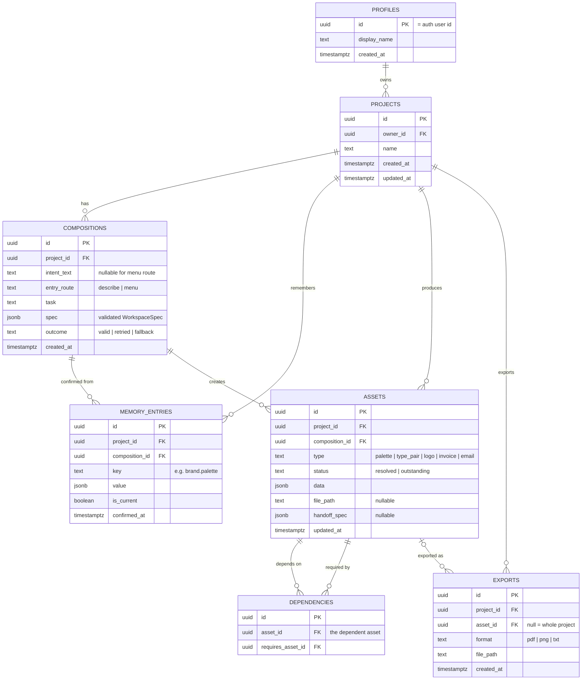

# Droplet: project context

This file gives Claude Code the full context of the Droplet project: what it is, who it is for, what the research found and what was pitched. It does not contain tasks. Tasks will be given in the prompt.

Writing conventions for all code comments, UI copy and docs in this repo: British English spelling, no em dashes, factual and plain tone, no marketing fluff.

**Git and GitHub:** never add `Co-Authored-By` trailers or any other co-author, attribution or "Generated with" lines to commit messages, pull request descriptions, issues or any other GitHub content. This overrides any default attribution behaviour.

**Testing:** never test features in a browser yourself (no browser pane, no Chrome, no screenshots or scripted pointer events to check how something looks or behaves). Rikus reviews every feature by hand. Verify with the type checker (`npx tsc -b`), the linter (`npx oxlint`) and the unit tests (`npm test`), write unit tests for new logic, and say plainly that the visual and interactive behaviour has not been checked.

---

## 1. What this project is

Droplet is a final-year student project by Rikus Pretorius (Bachelor of Creative Technologies, Open Window, Pretoria). One build serves two briefs:

| Brief | What it assesses | Key dates |
|---|---|---|
| **DV300** Interactive Development 300, Theme 4: AI-driven application | A working AI-driven web app, built Agile with progress milestones. AI must be core, not bolted on. The pitch (submitted 21 Sep 2026) is the plan this repo implements. | Milestones per lecturer |
| **UX300** Term 4 Capstone ("Manifesto in Motion", lecturer Laudette Sass) | Research, persona, flows, annotated wireframes, final UI, interactive prototype, video, case study. Must visibly apply Rikus's design manifesto. | Full submission Sun 25 Oct 2026, 22:00. Presentations 28/29 Oct. |

The UX work (research, persona, flows) feeds this codebase. The coded app is the DV deliverable and can also act as the UX interactive prototype.

---

## 2. The concept

**One line:** Droplet is an AI workspace that reads what a small business owner is trying to do and assembles the interface for it, so professional decisions stop requiring a professional.

**Tagline:** Software that takes the shape of the work.

**Thesis:** Every tool has a fixed shape and asks the user to translate their task into it. A canvas is a canvas whether or not you need one; a chat window is a chat window whether you are naming a business or chasing an invoice. Droplet has no fixed shape. It reads the intent behind a request and assembles the workspace that task needs from a bounded library of pre-built components, then reassembles it when the intent changes.

**What makes it different from a chatbot:** the AI does not reply with prose. It returns a validated structure (a `WorkspaceSpec`) that names components from a fixed library and fills them with content. The app renders that as a working interface: adjustable swatches with live contrast checks, a line-item editor with computed totals, a document preview, side-by-side email drafts. A colour palette is a bad conversational output; it is a good interface.

**Social impact framing (DV focus area):** a funded business buys judgement: a designer picks the typefaces, a bookkeeper knows what a compliant invoice contains, a copywriter knows how firmly to chase payment. An unfunded owner gets their own guess, made at night, with no way to check it. Free tools will describe a good palette to anyone; what is scarce is the ability to act on the description. Droplet puts the instrument of the decision, not just the advice, within reach.

**Supervisor framing question (UX300, from Laudette):**
> How might an interface adapt around a small-business owner's immediate intent while remaining predictable, controllable and honest about its limitations?

Laudette approved the direction with strict scope: Droplet assembles only from predefined, tested components, is as clear about what it cannot do as what it can, and should show a few complete journeys including misunderstanding, recovery and handoff, rather than unlimited AI capability.

---

## 3. Primary user: Megan Swart (fictional, research-based persona)

- 25, Pretoria East. BCom Business Management. Junior administrator at a logistics firm.
- Building **Kindred Gifting** (curated corporate gift boxes for Pretoria firms, sourced from local makers) at night. Not launched. No registered company, brand or website. Tested with two friendly clients.
- Budget about R2 000/month from her salary. Works on a **laptop**; phone for messages.
- Uses Google Docs, free Canva, ChatGPT, WhatsApp, a spreadsheet from university.
- Core gap: her degree taught her **what** a business needs (positioning, pricing, a brand that signals quality, clean records), not **how** to make those things. She can explain brand consistency in an exam; she cannot pair two typefaces, and she knows it.

Her week maps onto the five journeys: Monday deciding what to sell (ideation), Tuesday asking ChatGPT for a palette and pasting hex codes into Canva without knowing which pairs have contrast (brand), Wednesday a R6 000 logo quote she cannot afford (logo), Thursday an invoice in Google Docs in the wrong green because the hex code is lost in a chat (invoice), Friday rewriting a pitch email four times and sending none (correspondence).

**Not for:** survivalist traders (spaza shops, street vendors) who never issue invoices; owners who already pay professionals; teams; and, until the component library is tested with them, people relying on screen readers or with limited fine motor control (declared openly, per manifesto principle 1).

**Secondary users:** solo service-business owners already trading (caterer, electrician, pet sitter) who quote and invoice often and cannot pay for professionals. Copy must work for someone who never studied business.

Droplet is **frontier software, laptop-first, not phone-first.** It should stay usable on a phone for checking and approving.

---

## 4. What the research proves (summary)

### Secondary research, key points
- Many South Africans start businesses, fewer reach maturity; experts rate access to commercial and professional support as insufficient and falling (GEM South Africa).
- Professional design is out of reach for a starting budget: an independent logo commonly costs several thousand rand upward.
- Small business owners lose significant time each day to juggling tools (Slack/Salesforce survey).
- SA SMEs face real barriers to AI adoption: cost, skills, trust (Chasaya & Ayandibu 2025).
- Chat is not always the right interface for AI; outcome-oriented, generative UI with real controls (buttons, checkboxes) is the emerging alternative (NN/g 2024 to 2026; Google Research generative UI 2025).
- Scope AI features tightly and make limits visible (NN/g, "Scope in generative AI features"). Human-AI interaction guidelines: make clear what the system can do, support efficient correction and dismissal, explain why it acted (Amershi et al. 2019). Design against overreliance (Microsoft, Passi & Vorvoreanu 2022).
- Competitors are either fixed-shape tools or chat: Canva AI 2.0, Notion AI, Gamma, v0, ChatGPT, Looka, Zoho Invoice. None composes a task-specific interface from intent while remembering prior brand decisions across tasks.

### Primary research: four interviews (24 to 30 Sep 2026)
Participants: co-founder of a small software studio; owner of a pet-sitting business; co-owner of an online plant nursery; co-runner of a rage-room business. All Pretoria. Anonymise them in anything user-facing.

| Finding | Evidence | What it means for the build |
|---|---|---|
| **Invoices are the most avoided task.** | Two of four named invoices as the task they'd remove forever or put off longest. One spent ~45 min per invoice in Zoho because it asked for business details again on every login. A revised invoice got a new number, which embarrassed her in front of a client. | Invoice is the priority journey. Business details entered once and remembered. Invoice numbers must stay stable across revisions. |
| **Brand assets are scattered or locked away.** | Colours locked in a cancelled Canva subscription; exact colours only known by a colleague; fonts unknown; logo exists as one file with a background. Only the design studio had a proper style guide. | Confirmed brand memory is the core value. Handoff spec must list formats and variants (light/dark, transparent). |
| **Logos get outsourced.** | Three of four would outsource or could not make a logo themselves. | Validates naming the boundary and handing off rather than generating logos. |
| **A good handoff explains itself.** | "What was done, what still needs to be done, and the direction behind the decisions." | Handoff card carries reasoning and outstanding status, not just a link. |
| **Client details get lost between apps.** | Named by three of four (WhatsApp, notes app, email, Shopify, spreadsheets). | Client details belong in project memory, entered once. |
| **Everyone wants manual control.** | Edit what it made, ignore the wrong part, revert and retry. The designer wanted to point at and change things directly because text is a poor way to describe layout. | Every component is directly editable. Undo/revert matters. AI output is a starting point, never locked. |
| **Prediction is the weak point.** | The developer interviewed said predicting intent is what would "break first". | Bounded component library, clarifying questions when unsure, validated fallback, and the familiar task menu always available. |
| **Adaptive UI is welcome if it saves time.** | Three were positive; all four would learn a new way of working if it is clearly faster. | Speed and obvious payoff in the first session matter more than novelty. |
| **Trust stops at money and client data.** | Two refuse to give AI client or financial details; one asked for local storage, transparency and deletion. | Send the model only what a task needs. Be explicit about what is stored, where, and how to delete it. |
| **Consistency is the main AI worry.** | The designer avoided AI because it does not keep things consistent. | Visual consistency comes from the design system and memory, never from the model. |
| **Delivery happens on WhatsApp.** | Invoices sent via WhatsApp by two of four; payment tracked in banking apps, notes or sheets. | Export must produce a file that is easy to share from a phone (PDF). |

Note: one interviewee runs the business mainly from a phone. This sits against the laptop-first persona. The pitch keeps laptop-first; keep the phone view usable for review and approval.

---

## 5. What was pitched to DV300

### Scope: five journeys, three priority flows

The pitch commits to five journeys, run in the order a founder starting from scratch meets them. Laudette's sign-off narrows the UX capstone to three, so those three are the **priority core** and must be complete, including failure and recovery states.

| # | Journey | Workspace contains | Depends on | Priority |
|---|---|---|---|---|
| 1 | Business ideation | Offer options compared side by side against her budget and time; naming shortlist with rationale | Nothing | |
| 2 | **Brand system** (hero moment) | Split view: palette swatches with live contrast, type pairings with sample text, preview on a real document | 1 (name) | **Core** |
| 3 | **Logo handoff** (unsupported request) | Handoff card naming the boundary, copyable spec panel (palette, fonts, formats, sizes), link-out in a new tab, import slot | 2 | **Core** |
| 4 | **Invoice** | Line-item editor, totals computed in code, brand applied, missing fields flagged before export | 2, and 3 if logo resolved | **Core** |
| 5 | Client correspondence + review/export | Firmer and softer email drafts side by side; then review of all assets and export | 1 to 4 | |

### Must have
Account and sign-in · Projects (one per business) · Intent input · Composition engine · Component library (core set) · Validation and fallback · Project memory · Confirm step (nothing saved without it) · Specialist handoff (link-out, not embedded) · Dependency tracking (resolved/outstanding) · Guided start, the familiar path · Review and export (invoice PDF, one-page brand sheet).

### Nice to have
Memory panel with edit/delete · Undo for composition · Quotes as well as invoices · Brand applied to email signature · Light and dark theme · Reduced-motion mode.

### Future (explicitly out of scope)
Sending email/invoices from Droplet · Xero/Sage integrations · Embedded specialist tools · Teams and roles · Payments/subscriptions · Afrikaans and isiZulu UI.

### The familiar path
Every new project opens on a start screen with **two equal ways in**, side by side, no default, no nudge:
- **Describe what you need:** one plain-language field; Droplet reads intent and assembles the workspace.
- **Choose a task:** a conventional menu: *Shape the business idea*, *Build the brand*, *Get a logo*, *Make an invoice*, *Write to a client*. Opens that task's fixed layout.

Both routes use the same components, memory and export. The task menu stays one click away in every workspace. The fixed task layouts are also the AI fallback.

### User role and screens
One role: **the founder**. She owns her projects and confirms every decision. The AI is a service she directs, not a role; it can propose but never commit to memory.

| Screen | Purpose |
|---|---|
| Landing | What Droplet is; before/after strip (chat reply vs assembled workspace); sign-up |
| Sign up / sign in | Email/password or Google. Standard on purpose |
| Projects | Project cards: name, last task, count of outstanding assets; New project |
| Project start | The two equal ways in |
| Workspace | The one composed screen hosting all journeys |
| Handoff | Overlay in the workspace: boundary explanation, copyable specs, link-out, import slot |
| Review and export | Every asset with status; export per asset and all. Outstanding items never block exporting finished ones |
| Account | Profile, sign out, **Delete account and data** as a visible action |

### Workspace frame (fixed, so users keep orientation)
- **Intent bar:** top, full width. Current request plus task-menu toggle.
- **Canvas:** centre, 12-column grid. Assembled components appear here.
- **Project rail:** right, collapsible. Confirmed memory (name, palette, type, business details) and dependencies with status.
- **Action bar:** bottom of canvas. *Confirm* (primary), *Ask for something else*, and a quiet note of what confirming will save.

### Component library (the only pieces the model may use)

| Component | Used in | States |
|---|---|---|
| Option comparison | Ideation | 2, 3, 4 options; one selected |
| Name shortlist | Ideation | List with rationale; one selected |
| Swatch grid | Brand | Default; one swatch being adjusted |
| Contrast readout *(computed)* | Brand | Pass; fail with failing pair named |
| Type pairing | Brand | Heading and body sample; alternative selected |
| Document preview | Brand, invoice | Empty; brand applied; logo-outstanding placeholder |
| Handoff card + spec panel | Logo | Before opening tool; waiting; asset imported |
| Import slot *(part of handoff card)* | Logo | Empty; rejected with reason; accepted |
| Line-item editor | Invoice | Empty; filled; required field missing |
| Draft pair | Correspondence | Firmer and softer; one chosen |
| Asset list *(computed)* | Review | Mixed resolved and outstanding |
| Loading and fallback | All | Composing; fallback layout with "a simpler view was used" note |

Computed components (contrast readout, totals, asset list) and child parts (spec panel, import slot) are added by the renderer, never supplied by the model.

### User stories (each with its acceptance check)
1. Choose between typing and picking from a task list. *Start screen shows both with equal weight.*
2. Compare offer options against budget and time. *Ideation returns 2 to 4 options tied to her constraints.*
3. See palettes and type pairs on a real document with contrast shown. *Brand workspace shows swatches, ratios, live preview; confirming stores the choice.*
4. Be told plainly when Droplet cannot make something, and be handed off. *Logo task shows handoff card, copyable specs, link-out; logo marked outstanding.*
5. Have the brand applied when making an invoice. *New invoice opens with confirmed palette and type, no restating.*
6. Be warned about missing invoice details. *Export blocked, missing fields named, until required fields are filled.*
7. See a firmer and softer client email side by side. *Two drafts built from the real invoice and client details.*
8. See everything produced and what is outstanding. *Review lists every asset with status and exports finished ones.*

---

## 6. AI integration (as pitched)

**The AI's one job:** read what the founder is trying to do and decide what workspace that task needs. It chooses and fills the interface. It never draws it.

| The AI does | The AI does not |
|---|---|
| Classify intent into a supported task, or flag out of scope | Invent tasks or components outside the library |
| Choose components and their arrangement | Decide how anything looks (colour, spacing, type, motion belong to the design system) |
| Fill components with content: options, names with rationale, palettes, type pairs, line-item suggestions, email drafts | Write to project memory (only the founder's confirm does) |
| Read confirmed project memory | See anything beyond the current project |
| Recognise specialist tasks and return a handoff | Generate logos or images |
| Explain each component in one line (`reason`) | Calculate totals, VAT or contrast. Anything with one right answer is computed in code |

**Service:** Google Gemini API via Google AI Studio, **Flash tier**, model ID **pinned** at the start of the build and only changed after re-running a fixed set of test requests. Chosen for JSON response schemas with enums (the API itself restricts the model to library component names), speed for interactive use, and a free development tier. Alternatives considered: OpenAI mini tier, Claude Haiku, self-hosted open model.

**Key handling:** the Gemini key lives only in a server-side function, never in the browser bundle. (Same pattern as Rikus's earlier project Cardinal, which kept its Gemini key in a Cloud Function.)

### The output contract
Defined once in Zod and used to generate the JSON response schema sent to Gemini, so the two cannot drift.

```ts
type WorkspaceSpec = {
  task: "ideation" | "brand" | "logo" | "invoice" | "correspondence" | "out_of_scope";
  layout: "single" | "split" | "main_with_side";
  components: Array<{
    type:
      | "option_comparison" | "name_shortlist"
      | "swatch_grid" | "type_pairing" | "document_preview"
      | "handoff_card" | "line_item_editor" | "draft_pair";
    region: "main" | "side" | "bottom";
    props: Record<string, unknown>; // validated per component type
    reason: string;                 // one line: why this component is here
  }>;
  memoryUsed: string[];      // which confirmed decisions were applied
  proposedMemory?: {         // what confirming would save; never saved automatically
    key: string;
    value: unknown;
  }[];
  outOfScopeMessage?: string; // plain answer when task is out_of_scope
};
```

**Validation, in order:** (1) parses and matches schema; (2) each component's `props` match that component's own Zod schema (e.g. swatch grid has 3 to 8 valid hex colours); (3) business rules pass (e.g. a line item has quantity and unit price).
**On failure:** one retry with the validation error included in the prompt. Second failure: fixed fallback layout for the nearest task (same layout as the task menu), opened empty and editable, with a one-line note.
**Layout control:** three fixed layout templates on a 12-column grid. The model picks a template and regions, never positions.

### The composition loop
Founder states intent or picks a task → client sends task, intent and current memory → Edge Function adds key and response schema → Gemini returns `WorkspaceSpec` → validated in the Edge Function (retry, then fallback) → valid spec logged to `compositions` → client re-checks with the same Zod schema and renders → founder adjusts directly in components → **Confirm** writes to memory; *Ask for something else* recomposes; leaving saves nothing.

Three rules: the model never draws; invalid output never reaches the screen; nothing is remembered without consent.

### If the AI is removed
Droplet stops being Droplet. What remains is the task menu: five fixed layouts filled by hand, a competent template tool in the same row as Canva. Lost: the adaptive interface, the judgement in the content, and continuity with meaning (deciding which remembered decisions apply to a new task). The familiar path survives on purpose as the floor of the product, not the product.

### Handoff and dependencies
Logo request → handoff card explains why Droplet stops here → spec panel (palette, fonts, formats, sizes, each copyable) → external tool opens in a new tab → logo recorded as an **outstanding** asset. On return, the import slot validates format and size with a clear rejection reason. Later, an invoice opens with a placeholder and a note that the logo is outstanding: resolve now, or continue with the business name set in the brand type. Outstanding assets flag dependent tasks; they never block them.

---

## 7. Technical plan (as pitched)

Laptop-first web app. Not Electron (embedded webviews break Google sign-in for tools like Canva, so handoff is link-out). Not Next.js (no need for SSR with Supabase as backend).

| Layer | Choice | Why |
|---|---|---|
| Language | TypeScript | Component library, Zod schemas and renderer share one definition of every component |
| Framework | React + Vite | Workspace is a component tree chosen at runtime |
| Validation | Zod | Validates every model response; generates the Gemini JSON schema |
| State | Zustand | Current workspace spec, unconfirmed edits, project memory |
| Motion | Framer Motion | Layout animation makes recomposition legible; respects reduced motion |
| Backend | Supabase | Postgres, Auth, Storage, Edge Functions; RLS keeps each founder's data hers |
| AI | Gemini API, Flash tier | See section 6 |
| Server function | Supabase Edge Function `compose` | Only place the key exists. Builds prompt, calls model, validates, retries, falls back, rate-limits, logs |
| PDF export | @react-pdf/renderer | Invoice and brand sheet render from the same data as the preview |
| Hosting | Vercel | Static Vite build, preview deployment per branch for testing sessions |

### Backend responsibilities
- Accounts and sessions: Supabase Auth, email or Google.
- Projects, confirmed memory, assets, dependencies, composition history: Postgres.
- Data isolation: RLS on every table keyed to the signed-in user.
- Model access: Edge Function `compose`. The client never calls Gemini directly.
- Rate limiting: `compose` counts the user's `compositions` rows in the last hour before calling Gemini.
- Files (imported logos, exports): Supabase Storage, private bucket per user.
- Account deletion: one Edge Function cascading through every table and bucket.

### Data model



- `profiles` is minimal on purpose: display name only.
- Every table hangs off `projects`, so RLS is one ownership check.
- `compositions` doubles as an honest log of retry/fallback rates (manifesto principle 5).
- `memory_entries`: superseded decisions kept with `is_current = false`, so changes are visible and undo is possible. Partial unique index: one current entry per project and key.
- `dependencies`: unique on (`asset_id`, `requires_asset_id`); an asset cannot depend on itself.
- All foreign keys cascade on delete.

### Pitched technical risks
1. Inconsistent model output: enums, per-component Zod, contrast and totals in code, one retry, fixed fallback.
2. Layouts that clash: three templates, 12-column grid, every component designed for each region size.
3. Latency: Flash tier, send only current memory, show frame and skeleton immediately, render once when the validated spec arrives. Streaming partial output rejected (would show unvalidated content).
4. Model version churn: pinned model ID, fixed test requests re-run before any change.
5. Cost and abuse: key only server-side, per-user rate limit.
6. Handoff return unreliable: import checks format and size; outstanding never blocks.
7. Memory going stale: confirm before save, each workspace lists memory used, superseded entries kept.
8. Scope for one developer: Must-have list fixed, Nice-to-have cut first.

### Pitched build approach
Build the fixed task-menu layouts first. They are the familiar path and the AI fallback, so a working, testable product exists before the composition engine is added on top.

---

## 8. Design principles that are build rules

From Rikus's UX300 design manifesto. Several are direct implementation constraints.

| Principle | In Droplet |
|---|---|
| 1. Declare what you exclude | State openly who Droplet does not serve yet (e.g. untested with screen readers). |
| 2. Replace what you remove | No fixed navigation in the canvas, so the intent bar, task menu and rail must be visible and always there. |
| 3. Label the arbitrary | Each component shows its one-line `reason`. Users can see why it appeared. |
| 4. Assume there is another way | Treat apparent constraints as hypotheses; drop a mechanic if testing shows users carry its cost. |
| 5. Measure what happened | Log valid/retried/fallback honestly in `compositions`. |
| 6. Never design against the user | Key server-side; minimal personal data; delete account and data is visible and complete. |
| 7. Friction where it counts | The confirm step before memory and the export check for missing invoice fields. Nothing else gated. |
| 8. Offer the familiar path | Task menu equal to the intent field at the entrance and always one click away. |

---

## 9. Open design questions (from Laudette's sign-off)

Not yet fully resolved. Implementation decisions should be checked against them.

- When should Droplet ask a clarifying question instead of acting?
- How does the user know why something appeared? (partly answered: `reason` per component)
- Can users manually add or remove components?
- What happens when Droplet misreads the request, and can every action be undone?
- What is automatically temporary, and what needs explicit confirmation before saving?
- How does the user return to previous work, and what happens when two tasks become part of one project?
- What exactly counts as an unsupported request, and what does a good handoff include?
- How does the changing interface stay accessible and predictable, and what stays fixed on screen?
- How will we test that the adaptive interface is easier than a conventional menu, and what if a user just prefers the menu?

---

## 10. Source material (outside this repo)

- Pitch stage docs (Claude Docs): Stage 1 Positioning, 2 Problem and Research, 3 Competitors, 4 Target Audience, 5 Features and Scope, 6 Flows and Wireframes, 7 AI Integration, 8 Technical Planning.
- Research folder on Rikus's Mac: `Documents/Research (UX300T4)`: secondary sources (PDFs), `References (APA 7).md`, interview transcripts and an anonymised compilation.
- Briefs: DV300 Project Pitch brief; UX300 Theme 4 Capstone brief.
- Supervisor feedback: "Droplet: Supervisor Approval & Scope Feedback" (Laudette Sass, 22 Sep 2026).

---

## 11. Visual design: tokens, type, icons and references

Design direction: **minimalist with subtle glassmorphism**. Calm, pale surfaces, large radii, soft shadows, almost no decoration. The interface must never compete with the content the AI assembles. Visual consistency comes from these tokens and the design system, never from the model (see section 6).

References for how components should look live in `docs/ui-references/` (see its `README.md` for what to take from each image). Wireframes live in `docs/wireframes/`. **Check both before designing or changing any component.**

### Colour palette

All colour comes from CSS custom properties in `src/styles/tokens.css`. Never hard-code a hex value in a component. **Components use the semantic tokens below (`--text`, `--bg`, `--accent` and so on), never the raw palette tokens (`--ink`, `--mist` and so on).** Raw palette tokens are for `tokens.css` and illustrations only. Contrast ratios were calculated with the WCAG 2.x formula. AA requires 4.5:1 for body text and 3:1 for large text and non-text UI such as borders, focus rings and icons.

| Token | Hex | Role | Contrast | Use |
|---|---|---|---|---|
| Ink | `#0E1A2B` | Primary text | 17.48 on white, 16.37 on Mist | All body and heading text |
| Deep Water | `#0B4F8A` | Primary brand, buttons | 8.40 on white; white text on it 8.40 | Primary buttons, links, selected states |
| Droplet Blue | `#1F8FE0` | Accent, ripple | 3.46 on white | Focus rings, ripple animation, icons, large display text only. Fails AA for body text, so never used for small text |
| Ripple | `#CFE9FB` | Tint surface | Ink on it 13.90; Deep Water on it 6.68 | Selected cards, highlighted regions, the project rail |
| Mist | `#F4F8FB` | App background | Ink on it 16.37 | Canvas and page background |
| Slate | `#4A5A70` | Secondary text | 7.03 on white, 6.58 on Mist | Labels, captions, the one-line component reasons |
| Outstanding | `#B45309` | Status: outstanding | 5.02 on white, 4.70 on Mist | Outstanding assets, always paired with an icon and the word |
| Resolved | `#1F8FE0` (Droplet Blue) | Status: resolved | White tick on it 3.46 (enough for an icon), Ink tick on it 5.05 in dark | The circle behind a tick: resolved assets, completed toolbar steps, a passing contrast. Always paired with an icon, and the word where there is room |

Status is never shown by colour alone: every resolved or outstanding marker carries an icon and a text label. **In the sidebar's asset list the label is not drawn** (`StatusMark`, icon only): the word is read out by a screen reader (", Outstanding" after the asset's name) and shown in a tooltip from the icon on hover, and on focus of the button it sits in, with a sentence on what it means. The tooltip is drawn on the page (a portal into `document.body`, `position: fixed`, z-index 1000), to the right of the icon over the canvas, so the sidebar's scrolling list cannot clip it and nothing is above it; it goes on Escape, on scroll and on resize. An asset that is still to do is a quiet grey (`--status-pending`, icon `--on-pending`, 5.0 on the grey), since orange reads as a warning and a task not yet done is not one. The orange `--status-outstanding` stays for real warnings (a field to fix, a failing contrast, the checklist). In the UI (`StatusMark.tsx`) the word comes first in the normal text colour and the icon follows it on the right, and the icon sits inside a filled circle in the status colour (a tick for resolved, a dash for outstanding in the asset list), which makes the colour easy to see. The icon inside the circle uses `--on-status`: white in light, Ink in dark, because white on Mint or Amber would fail contrast.

### Themes: light, dark and system

Every component supports light and dark from the start. The theme is the `data-theme` attribute on `<html>`, set by `src/store/theme.ts` (preference: `light`, `dark` or `system`, saved in `localStorage` under `droplet-theme`) and applied by an inline script in `index.html` before first paint so there is no flash. `system` follows the operating system live. The switcher is in the sidebar (`ThemeSwitcher.tsx`).

**Rule for new components:** use semantic tokens only, then view the component in both themes before calling it done. If a new component needs a colour that no semantic token provides, add a semantic token to both the light block and the `:root[data-theme='dark']` block in `tokens.css`. Do not branch on the theme inside components, except to swap artwork (as `Wordmark.tsx` does).

| Semantic token | Light | Dark | Use |
|---|---|---|---|
| `--bg` | Mist `#F4F8FB` | Night `#18191C` (neutral charcoal) | Page background |
| `--text` | Ink `#0E1A2B` | Mist `#F4F8FB` | Primary text, active markers |
| `--text-muted` | Slate `#4A5A70` | Haze `#A9ADB5` (neutral grey) | Secondary text, captions, placeholders |
| `--accent` | Deep Water `#0B4F8A` | Sky `#7CC0F5` | Links, selected text and icons |
| `--accent-tint` / `--accent-tint-soft` | Ripple, Ripple at 60% | White at 12% / 7% (neutral: a blue wash tinted every dark component) | Selected and hover fills, avatar and badge fills |
| `--button` / `--on-button` | Deep Water / white | Droplet Blue / Ink | Primary buttons and their text |
| `--focus` | Droplet Blue `#1F8FE0` | Droplet Blue `#1F8FE0` | Focus rings |
| `--status-resolved` | Droplet Blue `#1F8FE0` | Droplet Blue `#1F8FE0` | Resolved marker circle (a tick on it) |
| `--status-outstanding` | `#B45309` | Amber `#FBBF24` | Outstanding marker circle |
| `--on-status` | White | Ink | Icon inside a status circle (5.02 on both light fills, about 10 on the dark fills) |
| `--overlay-06` / `--overlay-10` | Ink at 6% / 10% | White at 7% / 12% | Quiet fills, hairlines |
| `--raised` | White at 95% | White at 16% | A control sitting on a quiet fill, such as the selected segment |
| `--glass-*`, `--shadow-*`, `--scrim` | White glass, soft shadows | Neutral grey glass (`rgb(46 48 53)`, no blue), deeper shadows | Surfaces, elevation, drawer scrim |

Dark mode has no blue in its surfaces: the shell and page `#18191C`, the screen `#232529`, windows (`--canvas`) `#2A2C31`, glass `rgb(46 48 53)`. Contrast on the darkest and lightest of these (WCAG 2.x): Mist text 16.46 to 13.08, Haze 7.81 to 6.21, Sky 8.97 to 7.13, Amber 10.53 to 8.37, the Droplet Blue focus ring 5.08 to 4.03. Droplet Blue with Ink text on a button is 5.05.

### Glass surfaces

Glass is subtle and used for floating or layered UI only (menus and the intent bar). Not for body text blocks or large areas.

- Translucent white fill (about 60 to 70 percent), `backdrop-filter` blur, a 1px light border and a soft low-contrast shadow. Use the shared `.glass` class and the `--glass-*` tokens.
- Text on glass must still meet the contrast ratios above against the lightest and darkest thing that can sit behind it.
- Provide an opaque fallback where `backdrop-filter` is unsupported.

### Typography

- **Google Sans** (variable, bundled via `@fontsource-variable/google-sans`, SIL Open Font License). One family, weights 400 to 700 only, so never ask for a lighter or heavier weight than that.
- Build hierarchy with size and weight, not extra families. Do not use Droplet Blue for small text.
- Headings and the wordmark sit at weight 500 to 600. Body is 400 to 500.

### Icons

- **Solar icon set only**, via `@solar-icons/react`, **linear** style: `import { AddIcon } from '@solar-icons/react/linear'`.
- **Never use Lucide** or any other icon set. Do not install another one.
- One deliberate exception: illustrated, three-dimensional object icons for things the user owns, such as the folder in the introduction (`src/components/FolderIcon.tsx`). The project switcher no longer uses it: it shows the Solar `LibraryIcon` (linear), since the folder looked heavy and dated beside the other icons. They are drawn as inline SVG from palette tokens (layered gradients, a soft blue drop shadow) and are not taken from any icon library. Use this style sparingly, only for objects, never for actions.
- Colour with `currentColor` (ink or slate). Decorative icons get `aria-hidden`; icon-only buttons get an `aria-label`.

### Brand assets

Logos live in `src/assets/brand/`. Import them from there; do not recolour or redraw them.

| File | What it is | Use on |
|---|---|---|
| `wordmark-dark.svg` / `wordmark-light.svg` | The lowercase "droplet" lettering | Headers and nav. The Home header swaps between them by theme. |
| `icon-dark.svg` / `icon-light.svg` | The mark on its own | Square or tight spaces: favicon, avatars, loading states |
| `logo-dark.svg` / `logo-light.svg` | Mark and lettering together as a lockup | Landing hero, exports, anywhere the brand is the focus |

"Dark" files are black and go on light surfaces. "Light" files are white and go on dark surfaces. `Wordmark.tsx` renders both and CSS shows the one for the active theme. The artboards carry built-in margin around the artwork, so trim it with negative margins in CSS rather than editing the SVGs. `public/favicon.svg` is the icon with a dark-mode colour switch.

**The thinking indicator** in the chat is `JellyLoader.tsx`: two blobs that squeeze together and apart, merged by an SVG filter (adapted from dovatgabriel on Uiverse.io), in `--loader` (pure black on a light screen, pure white on a dark one), a fixed 28 by 14px (the filter's blur is in pixels, so it is scaled with the size in the component), decoration (`aria-hidden`), still with reduced motion. Each one draws its own filter with a generated id. It replaced `ThinkingDots.tsx` (four pulsing circles) and the droplet loader below in `ChatThread.tsx`; both are kept (and tested), and swapping the import back brings either one back.

**The droplet loader** (`DropletLoader.tsx`) is the mark animated, formerly used for the thinking state. It is only the logo: the mark's own outline (the blob and the hole), with nothing added around it. It does not hop, spin or scale. It ripples, stops, ripples, stops: a wave runs down the whole mark and it settles back to its own shape, in a 2.8 second loop (about 62 percent rippling, the rest still). The mark is cut into 32 thin horizontal bands, each sliding sideways by `amplitude * sin(band * 17deg - phase)`; `--loader-amp` swells from nothing, peaks and falls back to nothing, and `--loader-phase` only grows, so the wave travels down. Both are registered with `@property` so CSS can animate them. It is small (a 1.9rem artboard, so the mark is about 22px), follows `--text`, is decoration (`aria-hidden`, the word "Thinking" says what is happening) and holds still with reduced motion.

### Shape, space and motion

- Controls are pills (fully rounded). Panels use 20 to 32px radii. Nested surfaces use a smaller radius than their parent.
- Focus is always visible: a 2px `--focus` (Droplet Blue) ring. It meets 3:1 non-text contrast in both themes.
- Motion is small and quick (about 150 to 250ms, a few pixels of travel). Framer Motion is configured with `reducedMotion="user"`, so it respects the system setting.

### App shell

The page is a sidebar on the left and the working screen on the right. **Everything outside the working screen is the shell** (`--shell`): white (`--white`, so the screen is told apart from it only by its shadow) on a light screen and dark charcoal (`#18191C`, darker than the dark screen) on a dark one. It is the page, the sidebar and the docked chat. The working screen is a rounded, opaque box (`.home__screen`, 16px radius `--radius-screen`, 6px of shell round it, `--screen`: white on a light screen, charcoal `#232529` on a dark one) inset beside it. What sits on the shell carries the class `.on-shell`, which sets `--bg` to the shell; its text and fills use the theme's own tokens (the dark block in `tokens.css` is `:root[data-theme='dark']` alone), so the sidebar and the docked chat read on the shell in either theme. A new part placed on the shell must sit inside an `.on-shell` element. Other pages (sign-in, account, the introduction) keep the page background. Reference: `docs/ui-references/07-sidebar-navigation.png`.

The sidebar (`src/components/Sidebar.tsx`) **has no menu of places to go**: what to work on is decided in the conversation with Droplet, so the old Home, the five tasks, the Assets group and Review and export were taken out (the familiar path is still one press away in the message bar: the plus and the tip open the task menu, so manifesto principle 8 stands). It holds the project switcher (its menu also makes a new project and renames the current one, see "New project and Rename project" under Accounts), then the selected project's own rows directly under it (`sidebar__project`, a group named "This project"): **Project brief** (opens the brief) and **Library**; then a divider, **New chat**, (see "The library" below; a folder icon, marked as the current page while it is shown, kept as an icon when collapsed), the **Recent** chats (the 8 most recent, `RECENT_CHATS`, pinned ones first, the open one marked; the whole row lights up on hover, and a vertical three-dot button on it opens a menu, drawn on the page with a portal and marked `data-layer` so it does not close a dialog beneath it, with **Pin** or **Unpin** and **Delete**, which asks a second time). The open chat keeps its place in the list until the founder sends something in it (`lastActive`: the time of the founder's newest message); opening a chat does not move it, **See all chats** (only when there are more than 8) which opens a dialog of every chat with a search (`ChatHistoryDialog.tsx`, portal, Escape or a press outside closes it, opening a chat closes it), the theme switcher and, beneath it, the **account section** (`AccountMenu.tsx`): the avatar and name of whoever is signed in, with a menu that opens upwards for Account and Sign out. There is no account control in the working screen's header. Collapsed to icons the sidebar shows New chat, Library, a Chat history icon (which opens the same dialog) and the avatar. It becomes a slide-over drawer on narrow screens. The list is `ChatList.tsx`, shared by the sidebar and the dialog. The sidebar is compact, as in Claude or ChatGPT on the web: 16rem wide (3.75rem collapsed), 14px text (`font-size` on `.sidebar`, inherited by its rows), rows about 34px tall with `--radius-sm` corners, 18px icons, a 28px avatar and 12px captions. The sidebar's asset status marks and the outstanding count are gone with it; `StatusMark` remains for the invoice checklist.

### Conversation: chat first, then a side panel

The Home screen starts as a **conversation**. The thread of chat bubbles fills the working screen (`.home__conversation`, centred and readable, `ChatThread.tsx`, a `role="log"` list that follows the newest message) with the intent bar beneath it, and Droplet answers like any helpful assistant until it is asked to build something. Once a workspace exists, the same thread **moves out of the rounded box into a panel on the right** (`.home__chat`, a quarter of the window: `clamp(20rem, 26vw, 26rem)`), straight on the page background like the sidebar, with the intent bar at its foot, so a long thread can scroll beside the workspace. The founder's messages are on the right in **the message bar's own style** (`--intent-fill`, a `--intent-edge` hairline and `--intent-shadow`, the `glass` class, corners of `--radius-lg`; there are no blue bubbles or `--bubble-*` tokens any more); Droplet's replies have no bubble: they are plain text on the left, as in most assistants, kept to about 36rem so a line is easy to read (`thread__message--droplet`), and a reply still being worked on shows the **jelly loader** (`JellyLoader`) beside the word "Thinking". The task menu opens upwards. The first time a workspace opens the sidebar steps back to icons to leave the grid room (it can be reopened). Under 64rem there is no room beside the workspace, so the panel goes beneath it. The thread is session state for now; it is not saved. **Choosing a task says nothing in the thread.** A **divider** (a line across the thread with "Switched workspace to Invoice" on it, `thread__divider`) marks a move to another workspace, and only when a message is sent in the new one: Home remembers the workspace the last message was sent in, and compares it with the one the founder is in when they send the next. So moving about without a word leaves no divider, moving and coming back leaves none, and several moves before one message leave one. The first message has nothing to have moved from, so it has none. If the composer takes the founder to another workspace, no divider is owed for that. A divider is not part of the conversation and is never sent to the composer. A task with no workspace yet (ideation, logo, client email) changes where the next message counts as being sent, and nothing else on screen.

**No wave behind the conversation:** the blue wave and its grain were taken out of the chat screen. Pictures and grainy backdrops were tried behind the empty chat and dropped; what is there now is a soft glow (see "The glow" below). The `--wave-*` and `--grain` tokens stay for the introduction's stage. `data-start` on `.home` still marks a chat with nothing said yet.

**The conversation's controls**: with a workspace open, the side panel has **Back to the full chat** at its top (`ChatBar.tsx`; with nothing to offer it draws nothing). Starting a chat and finding an earlier one are in the sidebar (see App shell). The tip below the intent bar ("Show me a menu of available workspaces") shows only before the founder has said anything (`showTip`); the plus beside the field still opens the menu. The tip and the message bar are nearly solid white on a light screen (`--intent-fill`, 94%; the dark screen keeps its glass) and the tip carries the same arrow as the send button.

- **The greeting** (`src/lib/greeting.ts`, `ChatGreeting.tsx`, tested): over a chat with nothing in it (`thread.length === 0`), a title chosen from the time on the founder's clock and the first word of their name: before 05:00 "Late night sesh?", 05:00 to 06:59 "Early bird?", then "Good morning, Megan" (to 11:59), "Good afternoon, Megan" (to 16:59), "Good evening, Megan" (to 20:59), and from 21:00 "Working late?". It is drawn just above the message bar inside the footer, and while the chat is empty the footer (the bar, with the tip under it) sits out of the flow at 36 percent down the screen (`.home[data-start] .home__footer`), a little above the middle, on the plain screen. When the first message is sent the footer goes back into the flow at the bottom, and it glides there (`motion.footer` with `layout="position"`, a spring; none with reduced motion); starting a new chat glides it back. The title comes in with a short blur and rise (none with reduced motion), is chosen once when it appears and goes when the first message is sent. It is a heading, says nothing about the founder's work and is never sent to the composer.
- **The glow** (`ChatGlow.tsx`, `ChatGlow.css`, the `--glow-core`, `--glow-halo` and `--glow-accent` tokens; tested): behind a chat with nothing said in it, a soft glow of Droplet blue, in the manner of a quiet assistant's start screen. Three large orbs (a wide pale halo, a brighter core, both centred a little above the middle and a little left so they stay round the greeting and the bar, and a small accent that wanders the upper right) drift slowly on closed paths of 27, 19 and 23 seconds, so the loop has no seam and never falls into one rhythm. **Built to cost almost nothing:** the orbs move only by `transform` (nothing is repainted), nothing is blurred or filtered, one container is clipped to the working screen, each orb falls off over nine eased steps so a soft gradient shows no rings, and while a workspace or the library is open the glow is hidden and its motion paused. Light: Droplet Blue at 25 percent over a Ripple halo (Ink on the strongest point 11.4, Slate 4.6). Dark: Deep Water as a deep navy core with a Droplet Blue halo (Mist 8.3, Haze 3.9, which only the greeting and bar are near, and neither is Haze). Strong while nothing has been said (`data-start`), a quiet wash (40 percent) once something has, gone with a workspace or the library. Reduced motion: the glow stays, still. The look and the motion have not been checked by hand.
- **A sent message comes out of the bar** (`src/lib/flight.ts`, `FlyingMessage.tsx`, `ChatThread` `flight`, `IntentBar` `from`, `Home` `flight`; tested). When a message is typed in the bar and sent, the bar's place is passed up, the message goes into the thread at once but is not shown (`data-flying`, `visibility: hidden`, so the thread's layout is final from the first frame and nothing jumps), and a copy of it drawn like the message (the same classes, over everything, in a portal, `aria-hidden`) carries it there in 680 ms. It starts as a thin sliver across the top of the bar, a little narrower than it, with only what is above the bar's top edge drawn (a `clip-path`), so it rises out of the bar; then it grows into the message as it travels, its corners go from a pill to the message's own, its words fade in from a fifth of the way, and it goes a little past its place and settles (an ease-out with a 10 percent overshoot), as a soft, liquid shape. It is moved by script each frame towards where the real message is *at that moment*, and below the bar's top edge *as it is at that moment*, since in an empty chat the bar is gliding down to the bottom at the same time and the thread is scrolling. The words are laid out at the finished width from the first frame, so they never reflow. When it arrives (or after at most 1.28 seconds, whatever happens, or if the real message cannot be found or has no size) the copy goes and the real message is shown in the same frame. **Not done:** for a tapped reply (no bar to come from), with reduced motion, or in a test (a bar with no size); the message just appears. The look and the motion have not been checked by hand.
- **Times and copy** (`ChatThread.tsx`): every message keeps when it was sent or arrived (`at`, saved with the chat). Pointing at or focusing a message shows the time just under it ("Today, 14:05"); Droplet's replies also have a copy button there, which copies the words and the question as plain text. A reply keeps a short row free under it for these. On a touch screen the copy button always shows and the time does not.
- **History** (`src/lib/chatStore.ts`, tested): every conversation the founder has said something in is kept for its project, in this browser, validated with Zod (up to 40 chats of up to 300 messages; a chat that cannot be read is left out and the rest kept). It is a list of each chat's name, in the sidebar (the 8 most recent) and, with when it last changed ("Today, 14:05") and "Open now" on the open one, in the full list; pressing one opens it and carries on in the same entry, and each has a delete behind a second press. A reply still being worked on and the buttons a message carried are not kept. Another project starts with a new conversation. Nothing is written for a conversation with no words from the founder, unless something was finished in it (a guided invoice's card, `chatHasBegun`); such a chat is named after what was finished ("Invoice INV-0007") until the composer names it.
- **Back to the full chat** closes the workspaces (what was saved stays; anything else is lost) and gives the conversation the whole screen, with the sidebar open again. A workspace nobody has changed closes at once. If there is unsaved work (`src/lib/leaveCheck.ts`, tested: a starter palette or a fresh invoice nobody has touched is not work, and opening a window is not a change when nothing is saved), Droplet asks first, **in the thread**, with buttons: *Save the palette* (saves it there and then), *Review and save the invoice* (opens the invoice's own note of what would be remembered, which the founder confirms: the confirm step is not skipped), *Leave without saving*, *Keep working*. When the last thing is saved the workspace closes and the message says so; if the invoice note is cancelled, the question stays. The question is a note from the app (`local`), so it is never sent to the composer. Only one question is open at a time.

### Workspace layout: a toolbar of tools, and windows on an invisible grid

Work happens on a **canvas**: a white space (`--canvas`). There are two kinds of component. **Tools** are compact controls that act on the selection (colour picker, role, generate). They sit side by side in one **toolbar fixed under the header** (`ToolShelf.tsx`), always in the same place. **Windows** are things to look at and work in (the palette canvas, the document preview, later a colour wheel, font pairing and invoices). They sit on a **24-column grid with rows** (cells 40px tall, `GridWorkspace.tsx`) that is **never drawn**: it only decides where windows can sit, so edges line up. A nested split tree (drop on an edge to split) was tried and dropped for the grid, which is more reliable and is what the founder prefers. **Drag a tool down out of the toolbar and it becomes its own bigger window** (the small colour picker becomes a colour wheel with every colour on it, role becomes four role cards, generate becomes four harmony cards with a preview of each). Drag the window back over the toolbar and it returns to being a tool. A tool has one compact form in the toolbar and one big form as a window; there are no sizes in between.

- **Moving windows:** every window has a grip handle on its top edge. Drag it anywhere on the grid: the right column can go beneath the left, the canvas can move, any formation works. The arrow keys move a focused handle (sideways by a column, up or down past the neighbour) and the move is announced.
- **While dragging:** a **lifted copy** of the window (a picture of it, scaled to 1.03 with a deeper shadow) follows the pointer from where it was picked up, the real one stays put, dimmed, and the box it will land in is outlined, moving between spots on a spring. Drops snap to a cell row and a column, then stacking closes up tight. On release the copy flies into the new place (300ms) while the other components glide aside on springs with no bounce (Framer Motion `layout`, position only, and only when a place changes, so resizing the window never makes things swim). The drag (shared helper `src/lib/lift.ts`) is tracked on the window, so it always ends: on release anywhere (even outside the page), when the next move shows the button is already up, and it cancels on Escape, window blur, right-click or pointer cancel. Reduced motion skips the springs and the flight. **Reset layout** glides the same way.
- **Sizing:** a **window fills the columns it is given** and is **resized by hand**: drag the grip on its right edge to any width on the grid, from 6 columns to the full width, or use the arrow keys (a column at a time; Home and End for the smallest and largest). Windows keep their own height, so a short window does not stretch. Nothing about a window is rounded to a preset.
- **Settling:** a drop that lands a column or two inside a neighbour slides sideways (up to 3 columns) to sit flush beside it, instead of one item being pushed down and the two ending up staggered (`settle`). If no nearby spot is better, the usual push-down applies.
- **Layout rules** (`src/lib/gridLayout.ts`, tested): items never overlap and always rise as far as they can (vertical compaction). A dropped item pushes whatever it lands on downwards. Heights are measured from the content, so expanding a component pushes the ones beneath it down.
- **Narrow containers** (under 940px of workspace width) cannot hold two windows side by side, so windows stack in a fixed order and cannot be moved. The toolbar is unaffected.
- **Save to project:** the **Save** button saves the palette and the layout to the project. Nothing is saved until the founder saves (principle 7); a short note beside the button says where things stand: "Not saved yet" before the first save, "Unsaved changes" after a change, "All changes saved" once saved. The button goes back to Save from Saved on any change. For now it is stored per project in this browser (`src/lib/projectStore.ts`, validated with Zod) as a stand-in for Supabase `memory_entries`. Reset layout only resets positions, never colours.
- Components arrive with `Emerge.tsx`: blurred and small, easing into focus, staggered by `delay` with a different `distance` each, so they emerge from different depths. Reduced motion gets a plain fade.
- **The toolbar** (`ToolShelf.tsx`) **is one component and one look for every workspace, and for every toolbar to come: a slim, semi-transparent, blurred pill** (`--glass-fill` at about 66 percent with `--glass-blur`, a hairline `--glass-border` edge, a soft shadow; radius 2rem, so one row is a full pill and a wrapped bar is a softly rounded one), centred under the header, only as wide as its tools, with the same padding on every side (0.375rem above and below, 0.625rem at the sides), a minimum height of 2.5rem for every tool, and 0.75rem above it and 1.5rem at each side (`.home__shelf`), so it never touches the edges of the screen. No workspace restyles it: a new toolbar is a `ToolShelf` in the shelf slot, never its own bar. It is one glass bar, centred under the header, with a segment per tool and a thin **divider between segments**, so a colour picker and a contrast checker are separate in the eye as well as in the code. Each tool is exactly as wide as its controls, with nothing spare inside it. Its **icon is its handle and its label**: drag it to move the tool (a lifted copy follows the pointer, the other tools make room live and glide on springs, and the copy settles into place), use the left and right arrow keys on a focused icon to move it one place, and hover or focus for a tooltip with its name and its one-line reason (manifesto principle 3). The **+** button at the end of the bar adds and removes tools (the same show and hide actions the AI uses). The windows menu in the header (`Windows`) does the same for windows. The order is saved with Save (`tools` in the saved palette). On a narrow workspace the bar wraps onto a second line. Reference: `docs/ui-references/08-toolbars.png`. Detail opens on demand instead of always showing: the colour picker shows the current colour and its hex value, and clicking the colour opens the full spectrum (saturation and brightness area, hue slider, RGB fields) as a popover. The role tool is a menu, to save width. The bar's glass is drawn on a pseudo-element behind it, not on the bar, because an element with a backdrop blur makes everything inside it blur only what is inside it, which would leave the menus and tooltips that open from a tool with only a lower opacity. **Pulling a tool out:** carry a tool's icon more than about 24px below the bar and it leaves the bar (the others close the gap), the grid outlines where its window would land (as for any window, pushing down whatever it lands on), and on release the copy grows and fades as the window arrives (`expand_tool`). **Putting it back:** carry such a window over the toolbar, which lights up, and let go: it goes into the bar where it is dropped (`collapse_tool`). Both are one undo step, the AI has the same two actions, and which tools are windows is saved with Save (`expanded`).
- **Every tool has a title and a reason**, shown as a tooltip from its icon (for example "Colour picker"), passed to `ToolShelf` from the task's workspace component.
- **The reason line** (manifesto principle 3) lives in a small info button beside a window's title (`ReasonTip`), and in the tooltip of a tool's icon. It shows on hover or focus and is read out as the control's description.
- Each component does one job (the contrast checker is separate from the picker). Grips show on hover or focus, and always on touch screens.
- **Hex fields:** while typing, only a complete six-digit value changes the colour (`#1F8` is valid short hex but is usually the start of `#1F8FE0`); short forms apply on Enter or blur. Palette blocks have a Copy action and a trash button (remove the colour, down to a minimum of 2) that appear on hover or focus. Removing the selected colour selects the one that takes its place, and focus follows it.
- Default layout: the three tools in the toolbar (colour picker, role, generate), and the white canvas (14 columns) beside the document preview (10 columns) on the grid. The three tools also have a place on the grid, kept for when they are dragged out. Reset layout returns the windows, the tool order and any expanded tools (they go back to the toolbar) to this.
- **Colour roles:** each colour can be given a role (primary, accent, background, text) from the Role toolbar, which acts on the selected colour. A role belongs to one colour, so choosing it moves it; choosing the role a colour already has clears it. Roles are saved with Save. Any role the founder has not chosen is suggested from the colours (`resolveRoles` in `src/lib/palette.ts`: lightest as background, the best-reading colour as text, the most vivid two as primary and accent), and the interface says "suggested" while it is.
- **Generate** (`GenerateToolbar.tsx`, `src/lib/harmony.ts`): fills in every colour that is not the selected one and not kept, using a harmony (analogous, complementary, triad, monochrome) worked out by hue turns from the selected colour. Colours are given alternating pale and deep tones so a palette always has a background and a text candidate. Asking again rotates the tones, so it gives a different arrangement. Each colour has a lock button ("keep") that stays visible while set; the button reads "All locked" and is disabled when there is nothing to fill in. The keep lock only affects Generate; it is separate from Save.
- **Export** (`ExportButton.tsx`, `src/lib/paletteExport.ts`, `src/export/brandSheet.tsx`): a button in the screen's fixed header, on the right beside the logo, after Save, not a toolbar. It downloads a one-page A4 brand sheet as a PDF: roles, every colour with its hex and RGB, the key text-on-background pair and a count of pairs that reach AA. The PDF library is loaded only when the button is pressed. The sheet uses the library's built-in Helvetica for now, not Google Sans. The button keeps one width whatever it says (Export, Preparing, Exported, Not exported). Each colour block still has its own Copy button.
- **Header controls:** the workspace's buttons sit in the screen's header (`.home__header`) on either side of the logo, not above the grid. Undo and redo, the Windows menu and Reset layout are at the left edge; Save and Export are at the right edge. `PaletteWorkspace` renders them into the two header slots with a portal (`headerSlots`), so they stay part of the workspace. Under about 74rem of header width the buttons keep their icons and the words stay for screen readers. A short status note sits beside Save (Not saved yet, Unsaved changes, All changes saved, Could not save).
- **Undo and redo** (`src/lib/history.ts`): in the header and on Ctrl or Cmd with Z (Shift or Y to redo, except inside a text field, which keeps its own). They cover changes to the colours: edits, roles, keeps, adding, removing and Generate. Quick edits to the same colour count as one step, so a drag across the spectrum is one undo. Layout has Reset layout instead.
- **Document preview** (`DocumentPreview.tsx`): a sample invoice drawn in the palette's roles, with made-up details and totals computed in whole cents (`src/lib/sampleInvoice.ts`). If the text on the background fails AA the preview says so, and still draws it as it would look.
- **Decided:** the spec carries which components appear and what is in them, never positions. The founder's grid, and the AI's relative moves (above, below, left of, right of another component), decide where things go. See "The AI composer" below.

### Screens built so far

| Screen | Route | Wireframe |
|---|---|---|
| Home | `/home` | `docs/wireframes/home.png` |
| Invoice workspace (on Home, from the task menu) | `/home` | none yet |
| Business-idea board (on Home, from the task menu: "Shape the business idea") | `/home` | none yet |
| Library (on Home, from the sidebar) | `/home` | none yet |
| Landing (open to everyone) | `/` | none yet |
| Introduction (once after making an account) | `/welcome` | none yet |
| Account | `/account` | none yet |

### The invoice workspace (all four milestones built)

The invoice is the priority journey (pitch: the task most avoided, so the one that has to save the most time). It is built in four milestones, and the founder reviews each one by hand: (1) foundations and a static workspace, filled in by hand, **done**; (2) live totals, the "ready to export?" checklist, the PDF, and export blocked with the missing fields named, **done**; (3) project memory: business details and clients entered once, stable invoice numbers, a confirm step before anything is saved, **done**; (4) the AI composer learns the invoice task (set the client, add lines, set terms; it never invents a price and never calculates a total), **done**.

- **One shell for every task.** The parts of a workspace that do not depend on the task (the toolbar, the grid of windows, dragging a tool out to be a window and back, hiding and showing, reset, undo shortcuts, the header controls) live in `WorkspaceShell.tsx` and `src/lib/arrangement.ts`. A task gives the shell a spec (its components and where they start) and its own state, and keeps the arrangement in its own state (`reduceArrangement`). The palette (`workspaceState.ts`) and the invoice (`invoiceState.ts`) both do. Shared styles are `workspace__*`.
- **Money and sums** (`src/lib/money.ts`, `src/lib/invoice.ts`, all in whole cents, tested): `parseMoney` reads what a person types ("R 1 234,50", "450,5"), `vatOf` is 15 percent to the cent (basis points, a half cent rounds up), `computeTotals` adds the lines and charges VAT only for a business registered for it, a line with no price counts as nothing and is flagged, `dueDateOf` works from the terms, `nextNumber` goes up by one and keeps its length. A quote has the same model (`kind`), with no screens yet.
- **The page is the print view** (`InvoiceDocument.css`): while editing, the document is laid out as the PDF prints, on A4 (595 by 842 points) with the PDF's own margins, type sizes and column widths. Every size is `calc(N * var(--pt))`, where `--pt` is one PDF point as a share of the window's width (`cqw`, the window is the container), so the page looks the same at any width and only gets smaller or larger. A longer invoice makes the page taller, as the PDF runs onto a second page. The page keeps Google Sans on screen where the PDF uses Helvetica, so line breaks can differ slightly. The document starts at 14 columns beside the line items at 10, so the type is readable by default.
- **One view-model** (`invoiceView.ts`) holds every string the document shows. The page on screen and (milestone 2) the PDF are both made from it, so they cannot drift apart. A part not filled in yet is a faded placeholder.
- **Tools and windows: the toolbar is a row of steps.** In the invoice the toolbar shows no controls (`WorkspaceShell` `toolbar="steps"`, `ToolShelf` `steps`). Each tool is its Solar icon and its name, with a mark beside it: an empty ring until its part is complete, then a filled blue circle with a tick (a slot of the same size, so the bar never shifts). Pressing a step opens its window on the grid, and pressing it again closes it; dragging it down out of the bar opens it where it is let go (a step that is already open cannot be pulled out again, and carrying it below the bar changes nothing). Drag it sideways, or use the arrow keys, to reorder. A step stays in the bar while its window is open and is tinted. A press that ends a drag is not a click. Windows: your business (name, address, contact, VAT number, bank details), client (the saved clients, then name, contact, address, VAT number, their reference), invoice details (number, date, terms, a note), VAT (the switch, what it changes, and the VAT number), totals (the working, line by line), invoices (the saved ones), and the checklist. The palette workspace still shows each tool's own controls in the bar.
- **The ticks** (`stepsDone` in `invoiceReadiness.ts`, tested): a step is complete when nothing *required* of its part is outstanding, from the same `checkInvoice` the export uses. Business: name (and address for a VAT business). Client: name (and address on a large tax invoice). Terms: number, date, due date, and a number no other invoice has. VAT: a valid VAT number when registered (a business that is not registered has nothing to add, so it is complete). Total: every begun line is whole and the sum is more than nothing. Ready to export?: the whole invoice. Invoices has no tick. Recommended items never hold a step back. So a new invoice opens with Terms and VAT ticked, because they are filled in already. Opening or closing a window is an undo step, as dragging one out always was. Two windows are always there: the invoice document, drawn in the confirmed palette (the project's saved palette, or the starter palette until there is one), and the line item editor (description, quantity, price, amount computed, move up and down, remove; a line that is begun and missing something is marked and named; the last line is cleared, not removed).
- **Typing rules.** Quantity and price are typed as text and read when they make sense, so a half-typed number is never rewritten under the cursor, and the field shows the number as understood when it is left. A quantity has at most two decimals and is more than nothing.
- **Ready to export?** (`invoiceReadiness.ts`, `ReadyPanel.tsx`): the sixth tool. `checkInvoice` works out in code what stands in the way and names each thing. **Required** (blocks the export): business name; client name; invoice number, date and due date; at least one line, and every line that is begun having a description, a quantity and a price (named by its line number); a total that is more than nothing; and for a business registered for VAT, a ten-digit VAT number and a business address, plus the client's address when the tax invoice is for more than R 5 000 (SARS). **Recommended** (never blocks): your address if not registered, an email or phone number, bank details, the client's address. Each item says which part of the workspace fixes it, and its Fix button opens that tool as a window (or brings it back if it was hidden) and focuses the first thing to do. The Ready step is ticked when nothing is required; its window lists the required items, then the suggestions.
- **Export** (`ExportButton.tsx`, `exportInvoice.ts`, `src/export/invoicePdf.tsx`): the header button makes the invoice PDF on A4 from the same view-model as the page, in the confirmed palette (the page background is the palette's background colour), in the PDF library's built-in Helvetica for now. The library is loaded only when the button is pressed. While the invoice is not ready the button is not hidden or switched off: it stays pressable, says how many things need fixing (aloud as well), and opens the checklist. The file is named like "Invoice INV-0007 Pretoria Print Works.pdf". The PDF is tested in Node (`invoicePdf.test.tsx`): a complete invoice, a barely begun one, and a long one that runs onto a second page.
- **Project memory** (`projectMemory.ts`, `memorySave.ts`, `memoryStore.ts`): per project, the founder's business, their clients and their invoices, so none is typed twice. It is a stand-in for the pitch's `memory_entries` (browser storage, validated with Zod, on this device only). **Nothing gets in unless the founder confirms it** (principle 7 and "the AI proposes, the founder confirms"). Pure functions do the sums, and the interface calls them only after a confirm: `businessStatus` and `clientStatus` say whether a thing is new, changed or already remembered; a client is found by name (capitals and spaces ignored) and replaces what was remembered, so one client is never remembered twice; an invoice confirmed again is a revision of the same invoice (same id, revision counted); `nextInvoiceNumber` goes on from the highest number in the founder's own style ("2026/12" carries on to "2026/13"), is never one already used, and a new invoice opens dated today with the remembered business already on it.
- **The confirm step** (`ConfirmSave.tsx`): in the invoice workspace Save does not save. It opens a note, "Save to {project}", listing exactly what would be remembered (your business details, the client, this invoice, each with a tick and a line saying whether it is new or replaces what is remembered), and only "Confirm and save" keeps anything. Cancel, Escape or clicking away keeps nothing. Only what is ticked is remembered. How the workspace is arranged is not a memory, so it is kept along with whatever is confirmed, and the note says so. The palette keeps its plain Save.
- **Invoices** (the first step, `InvoicesPanel.tsx`): which invoice is open. Its window has "New invoice" and lists each saved invoice with its total and where it stands (not exported yet, exported on a date, or changed since it was exported), and can open it (it keeps its number), start a new invoice from it ("Copy": next number, today's date, same client, lines and terms), or forget it. The workspace opens on the invoice confirmed most recently that has not been exported, else a new one. A successful export marks a confirmed, unchanged invoice as exported. Leaving an invoice with unsaved changes (opening, copying or starting another) asks first (`LeaveDialog.tsx`), with Stay as the safe choice in focus. An invoice nobody has touched is left without asking.
- **Clients.** The client window lists the saved clients (Use fills in all their details, Forget), and both the client and business windows say in a sentence whether they are remembered, with Forget behind a second press.
- **Numbers.** A number another invoice already has is a required item in the checklist ("The number INV-0007 is already used by another invoice"). A number can still be changed by hand.
- **The arrangement** (layout, tool order, which tools are windows, what is hidden) is saved per project on its own key (`invoiceStore.ts`) with each confirm. An invoice saved before the project had a memory is still read and opened, so nothing typed earlier is lost.
- **How it opens.** The task menu opens the workspace without asking the model, and the palette and invoice workspaces each keep their state while the other is shown. The AI can fill the invoice in (see below).
- **While Droplet acts** (`ActingOverlay.tsx`, `ActingOverlay.css`, `src/lib/acting.ts`, tested). Nothing goes over the workspace while Droplet only thinks or talks: the thread's "Thinking" says it is working. Only when a reply will change the workspace on screen (the palette, the invoice, the guided invoice or the board; not a palette the reply opens, and not a switch, close or export) does the whole working screen go soft (a 6px backdrop blur behind a thin veil of `--screen`, nearly opaque where there is no backdrop blur) with a loader in the middle: nine 10px squares in a 3 by 3 grid that light up one after another (adapted from JkHuger on Uiverse.io), in `--loader` (black on a light screen, white on a dark one). The changes are worked out first; the overlay shows for 900 ms (400 ms with reduced motion, when the squares hold still; none in tests), the changes are worked out again if the workspace moved meanwhile, and they land as the overlay clears (a 200 ms fade), so the arrival sequence plays as the blur lifts. It takes presses while it is there, so nothing is changed under it, and is decoration (`aria-hidden`). It is cleared when the request ends, whatever happens. The blue orbs (`RippleGlow.tsx`) and the blur ripple of the windows (`useRipple.ts`, `src/lib/ripple.ts`), which used to show for every message, are no longer used; both are kept, with their tests, to bring back.
- **Compliance.** A business registered for VAT issues a "Tax invoice" and shows its VAT number; one that is not issues an "Invoice" with no VAT. The VAT rate is fixed at 15 percent.

- **The AI on the invoice** (milestone 4; `src/compose/invoice*.ts`). The composer works on the workspace that is on screen: the request carries `view` (`brand` or `invoice`) and that workspace's snapshot, and the reply is checked against that workspace's own schema, so each schema stays as small as the palette's was. In the invoice it can: `set_client` (only details the founder wrote), `use_saved_client` (by name, from the clients the project remembers, so their details come with them), `set_terms` (on receipt, 7, 14, 30 days, or a custom date), `set_date`, `set_note`, `set_vat_registered`, `add_line`, `update_line`, `remove_line`, `undo` and `redo`. It cannot save, export, change the invoice number, change the business or bank details, set an amount, or rearrange the workspace. A turn is one history step, so one Undo takes back everything it did, and it lands through the same reducer as a person's edits.
- **Prices are the founder's, enforced in code.** `unitPrice` is a string exactly as the founder wrote it ("450", "R 450,50"). `applyInvoiceTurnActions` accepts a price only if the same figure is in what the founder wrote in this request or earlier ones (`priceWasGiven`, `amountsIn`), never one that only Droplet said. Otherwise the action is refused with the reason, the model is asked again once, and a second failure changes nothing. A line the founder described with no price is added without one, marked, and counted as nothing. The model never calculates: the totals it is shown are the app's own sums, and it is told to quote them. This check runs on the server and again in the browser, so a wrong reply cannot reach the invoice. A figure that happens to equal a quantity (12 boxes, price R12) would pass; that is a known gap.
- **What it is sent** (`invoiceSnapshot.ts`, `invoiceContext.ts`): today's date; the number, dates, terms, due date (computed), note and VAT setting; the business name and only whether its address, contact and bank details are filled in; the client's name and whether their address is; the names of the remembered clients; the lines (description, quantity, price, amount); the totals (computed in code); and what still stands in the way of exporting, in the app's words. **Not sent:** any address, email, phone or bank detail, of the business or of a client (interviewees refused to give AI client or financial details). A test checks this.
- **Going to the other workspace** (`routedTo` in `spec.ts`, `Home.tsx`). A workspace opens only when the founder asked for it or agreed to an offer, which the reply says in `opens` (see "Guiding the founder" below). The composer still names the task of every request. If the reply names the invoice, the brand or ideation (the board) while that workspace is not on screen, has `opens` and has nothing to do yet, the app opens that workspace and asks the same question again, once, with it in front of the composer, so "invoice Pretoria Print Works for 12 boxes at R450" works from a blank start and from the palette. Without `opens` a reply is a conversation, whatever task it names. Only one workspace is shown at a time, and the one on screen leaves before the other arrives. **A message that is exactly an Open phrase skips this round trip** (see "Open, switch and close" below).

### The business-idea board (all five chunks built: the board, sticky notes, shapes, text, frames, arrows, templates, the AI on the board, export and the confirmed name and offer; the board fills the screen)

"Shape the business idea" is a FigJam-style board. It is built in five chunks, each reviewed by hand: (1) the board and sticky notes, **done**; (2) shapes that hold text, text labels, frames and arrows, **done**; (3) editable templates that guide the layout, **done**; (4) the AI on the board (pink notes, only when asked), **done**; (5) export (PNG or PDF) and the confirmed name and offer in project memory, **done** (split out of chunk 4 so that it stayed reviewable). Decisions: no freehand drawing; the board is a fixed 4800 by 3200 area with a drawn edge (not infinite); frames are one level, with no nesting; the AI's notes are always pink and are written only when the founder asks, never live or in the background; positions, sizes and colours are never the model's to decide.

- **One shell again, and the board fills the screen.** The board uses `WorkspaceShell` (toolbar, header controls, undo and redo, reset layout, Save) with its own state (`boardState.ts`), as the palette and invoice do, but it is **not a window on the grid**: it has no box, no title and no card round it. `BoardCanvas.tsx` is drawn over the **whole working screen**, behind the header and the toolbar, and its view scrolls under them (`.home__canvas--board` and `.home__component--board` are absolute and inset to the screen, with the screen's rounded corners; `.board-stage` and `.board`). `Home` wraps the header and the toolbar in `.home__top` and measures its height (`ResizeObserver`), and passes it down as `topInset`: the board starts that far down in its scrolling view (`PAD + topInset`), so its top edge can be scrolled clear of the chrome, and what "the middle of the view", Fit and reveal mean is the middle of what can be seen below the chrome. While the board is shown (`data-immersive` on `.home__screen`) the chrome is lit from below by a **gradual blur**: two layers (`.home__top::before`, 5px, with a soft tint of the canvas; `::after`, 14px), each faded out by a mask, reaching 3rem below the toolbar, so notes scrolling under it blur out smoothly. The empty grid beside it takes no presses. Because there is no window title, the board's reason (manifesto principle 3) is a small **Board** label with an info button in the bottom-left corner (its tip opens upwards). With no window that can be taken away the header has no Windows menu. Its seven tools are in the toolbar (select, sticky note, shape, text, frame, arrow, templates). A tool can be `fixed` (`ShelfTool.fixed`): it can be moved along the bar but has no bigger form to be dragged out into, and the board's tools are fixed.
- **State** (`boardTypes.ts`, `boardState.ts`, tested): `BoardDoc` is the arrangement plus `items`, in the order they are drawn (see Layers). An item is one of five kinds, each saying what it is: a **note** (`text`, `colour`, `author`), a **shape** (`rectangle`, `rounded`, `ellipse` or `diamond`, `text`, `colour`), a **text** label (`text`, `size` body or title), a **frame** (`title`, `colour`) and a **connector** (an arrow: `from` and `to`, each an end, `style` straight or elbow, `head` end, both or none, and a `text` label). The first four are rectangles; an arrow is not. An **end** is `{ item }`, on a thing, which it follows, or `{ x, y }`, a point of its own. `BoardState` holds the history of the document and, outside it, the selection, the tool in hand (`select`, `sticky`, `shape`, `text`, `frame` or `connector`) and the settings of the tools (the colour of the next note, the kind of the next shape, the line of the next arrow), so undo takes back what was done to the board, not what was selected. One reducer, `reduceBoard`: `add_note`, `add_shape`, `add_text`, `add_frame`, `add_connector`, `move`, `resize_item` (`resize` is a window's width, from the arrangement), `set_text` (a note, shape or text label's words, or an arrow's label; one step for everything typed in one thing), `set_title` (a frame's), `set_colour`, `set_shape`, `set_text_size`, `set_connector` (style, arrowheads, either end), `reorder`, `delete`, `select` (replace, add, toggle), `select_all`, the tool actions, the arrangement actions, `undo`, `redo` and `batch` (one step, for the AI later). At most 500 items. Sizes: note 200 by 180 (120 by 100 to 600 by 600), shape 200 by 140 (a diamond 220 by 180), text 240 by 60, frame 480 by 360 (up to the whole board); each snaps to the grid and is held inside the board.
- **Frames hold what is inside them, derived, never stored.** A note, shape or text label is in a frame if its middle is inside it (the frame on top if they overlap; the left and top edges count, the right and bottom do not, so a thing exactly on the line between two frames is in one). So moving a frame moves what is inside it (`planMove`, shared by the reducer and by the board as it shows the move), dropping something on a frame puts it in, and moving it out takes it out, with nothing to keep in step. Resizing a frame changes what it holds. **Frames do not nest**: a frame inside a frame is not held by it. Deleting a frame leaves what is inside it, and the board says so; taking the contents too is a separate step that asks first (`contents: true`, "Delete with contents", then "Delete all"). An arrow goes with either of the things it is on, in the same undo step.
- **Arrows** (`boardConnectors.ts`, tested): straight, from the outline of one thing (a rectangle, an ellipse or a diamond, each met on its own curve) towards the other; or elbow, out of the side that faces the other and into the side that faces back, with one step across in the middle (straight when the two overlap, since there is no room). An arrow with an end on nothing keeps that point. It is drawn from the arrow tool, or from the four dots on a selected thing (no tool needed), by pulling from a thing to another thing or to empty board; the thing it would land on is outlined as it is pulled. A frame is a target only on its border (16 units), so an arrow let go inside a frame is not taken for one to the frame. Select an arrow and handles at its two ends can be dragged to another thing or to a point. Two selected things are joined from the bar ("Join the two with an arrow", from the first selected to the second, which is also the way without a pointer). The same arrow twice between the same two things, an arrow from a thing to itself, and one to another arrow are refused. An arrow is selected by pressing its line (drawn 3 wide, pressed 28 wide), is not dragged as a thing, has a label (double-click, or Enter), and has no pink.
- **Templates** (`boardTemplates.ts`, tested): a starting layout for a kind of thinking, put on the board for the founder to fill in. **A template is nothing but ordinary things** (frames, notes, shapes and arrows), so everything that can be done to anything on the board can be done to it, and nothing about it is locked: write in it, move or resize or recolour or retitle or reorder or delete any part, draw more between its things. Seven: *Brain dump*, *Customer and problem* (three frames in a line, each leading to the next), *Offer comparison* (three offers side by side, and a "My limits" frame under them; nothing in it is worked out for the founder), *Name ideas* (every name, then a shortlist), *Pros and cons* (a decision, and the case for and against), *Assumptions to test* (each assumption paired with a cheap test) and *Business model canvas* (the nine boxes, laid out as usual). Each is drawn from (0, 0) on the 20 unit grid, with its first frames `TITLE_SPACE` (60) down, which is room for their titles; every note is inside a frame (so a frame takes its prompts when it moves); nothing of its own kind overlaps; every arrow is on things in it.
- **Prompts are hints.** A prompt is a note (or shape) with **nothing written in it and a `hint`**, a faint line shown while it is empty (`data-guide`: dashed and a little faded, so it reads as a place to write, not as something said). Writing in it makes it an ordinary note and the hint goes; clearing it brings the hint back; while it is written in the hint is the field's placeholder. A screen reader hears "Empty note, Who is it for?". `hint` (up to 120) and `group` (up to 80) are optional on every kind and are saved.
- **Putting one on** (`placeTemplate`, `freeAreaNear`): from the Templates menu in the toolbar (each with a small drawing of its frames and a line on what it is for), near the **middle of the view**, in the **nearest clear place** on the board, with 64 units clear round it so that a title does not run into the frame above. If there is no clear place it goes over what is there, near the middle, and says so. The view moves to show it, zooming out if it is bigger than the view. It is added with `add_items` (all of it or none; one undo step; nothing selected), after which the tool goes back to select. Two uses of one template are two groups.
- **Reset a template.** Everything one use of a template put on the board has the same `group` (`<template id>:<number>`). Select any of it (everything selected from one group) and the bar offers *Reset template*, which asks first (what was written is lost), and then `replace_group` takes off everything in the group (and the arrows on it) and puts the template back, **where its top-left corner is now** (so a template that was moved is reset where it is), as one undo step. What is not in the group (the founder's own notes, and another use of the same template) is not touched.
- **The AI on the board** (`src/compose/boardSpec.ts`, `boardSnapshot.ts`, `boardActions.ts`, `src/lib/boardPlacement.ts`, all tested). The composer works on the board when it is on screen (`view: 'board'`, `board` in the request, its own prompt and JSON schema). **It acts only when the founder asks**: nothing in the app calls it in the background, and the board is sent to it only when a message is sent. **It never chooses where anything goes, how big it is or what colour it is**: the schema carries no position, size or colour, and the app finds the place (`boardPlacement`), makes the note pink (`author: 'ai'`) and puts "Droplet" on it. **It can only add**: no edit, recolour, delete, move (apart from gathering notes into a group when asked) or save, and `fill_note` refuses a note that has words in it, so the founder's own are never written over. Its actions: `add_note` (one short note, up to 140 characters, `in` a frame, `near` a thing, or neither and it goes near what the founder is looking at, with `connect` to draw an arrow from the thing it is near), `fill_prompt` (words, up to 100 characters, into an empty prompt, which becomes a pink note in the same place), `cluster` (a title and at least two things, which are moved into a new frame laid out in a grid, in the nearest clear place), `add_template` (one per reply, with an optional `fill` of words for its prompts in the order the system prompt lists them, made from the templates themselves), `connect` (an arrow, with an optional label), `undo` and `redo` (on their own). At most 12 notes, 4 groups and 12 arrows in a reply, and 24 actions. **A summary is a message, not an action**: asked where the founder has got to, it answers in the chat as a short list (**Decided**, **Still open**, **Next**) with no actions, from what is on the board and never inventing a decision, figure or fact. **It cannot remember a name or an offer for the project**: there is no such action, and the prompt says so.
- **How it names things.** Each thing gets a short **reference** (`f1` a frame, `n3` a note, `s1` a shape, `t1` text, `a2` an arrow, counted from 1 in drawing order, per kind), worked out the same way on both sides (`refsOf`), and the model refers to things only by those. The references mean what they meant when the board was shown all the way through a reply, even after things are moved. The model is shown the board in words (`describeBoard`): the frames and what each holds, the things with who wrote them (the founder, or Droplet), which are in which frame, the empty prompts with their hints, what is selected, and how many things are not shown. **It is not told where anything is.** The request carries the snapshot with places (the server needs them to check where things would go), capped at 120 things (frames first, then what is selected, then the rest in drawing order, with a count of those not shown), with words cut to 160 characters.
- **The reply is checked in code, on the server and again in the browser.** `checkBoardTurn` rebuilds a board from the snapshot (`stateOfBoardSnapshot`, with the references as ids) and tries the actions on it through the same code that applies them: a reference that is not on the board (the reply says what is), a thing of the wrong kind, a frame with no room (and how many would fit), no clear space for a template or a group, a second template, a thing in two groups, too many notes: each is sent back to the model once with the reason, and a second failure changes nothing. The same placement code runs on the server and in the browser and gives the same places (tested). A turn is one undo step.
- **Pink notes are kept or dismissed.** Selecting a note by Droplet adds **Keep as mine** to the bar (`keep_notes`: it becomes the founder's own, in the colour of the next note, with no "Droplet" on it; several at once, one step). Delete dismisses it. The first time it puts notes on the board, the reply adds a line saying what pink means.
- **Layers.** Frames are drawn first, then arrows, then everything else, each from back to front, and the order of `items` is kept in that order. Moving something brings it to the front of its layer. A note cannot be sent behind a frame, which is always behind. Forward and backward are on the bar and on Ctrl or Cmd with `]` and `[`; with Shift, front and back.
- **Geometry** (`boardGeometry.ts`, tested): everything is in board units (pixels at 100 percent) and snaps to a 20 unit grid. A note is 200 by 180 to start, 120 by 100 to 600 by 600. A move is a group move: the first note snaps to the grid and the group is held back so that none of them can leave the board. Nothing can be resized past the edge. `freeSpotNear` finds a clear place for a new note along a spiral. Zoom steps from 25 to 200 percent; `Fit` fits the whole board (never past 100 percent).
- **Colours.** The founder chooses from yellow, mint, sky, lilac, peach and grey. A shape or a frame is white to begin with and can be given white or any of those, and never pink; text and arrows have no colour. **Pink is Droplet's alone**: a note added with `author: 'ai'` is pink whatever was asked, the colour bar has no pink, and a note by Droplet also carries the word "Droplet" on it (not colour alone). The founder can keep one by giving it a colour of their own. The tokens (`--note-*`, `--note-ink`) are paper: the same on a light or a dark screen, with Ink on them.
- **The board** (`BoardCanvas.tsx`, tested): a view that scrolls (and pans with space or middle-mouse drag), a surface with a grid of dots and an edge drawn 2px in the muted text colour with a shadow, and 56px of grey around it so the edge can always be reached. It opens at 50 percent in the middle. Ctrl or Cmd with the wheel zooms around the cursor. The world is scaled to the zoom, so a note is the same shape at any zoom. A gesture (drag, resize, box) is shown live and committed when the pointer is let go, as one step; it ends on release anywhere, cancel, blur and right-click, and Escape gives it up.
- **The toolbar shows a tool's options only while it is in hand** (`BoardTools.tsx`, `Options`). Each tool is its icon and a pill that puts it in hand (press again to put it down); the colours of the next note, the kinds of the next shape, the line of the next arrow and the plus slide open beside it only for the tool in hand, so the bar is one short row of seven tools instead of a wrapping two, and what is on it can be used now. The choices are kept when the tool is put down. Without a pointer: Tab to the tool, Enter, then Tab to its options.
- **Tools that put things on the board** act at the press, wherever it is, even on top of what is there. A note is placed by a click. A shape, a text label or a frame is placed by a click at its usual size, or drawn to size by dragging (a drag smaller than 24 units on both sides was a click). Each of the four also has a plus in its options that puts one in the middle of the view in a clear place, ready to be written in, with no pointer (press the tool, then the plus). A frame's title is written when it is made. The tool goes back to select after one thing.
- **Doing things.** Press a note to select it (shift adds or removes; a plain press on one of several narrows to it unless it is a drag). Drag to move the selection. Drag the corner of a single selected note to resize it. Double-click or Enter to write in it (the cursor goes to the end); Escape stops. Double-click the empty board to put a note there, or press the sticky tool and click (the tool goes back to select after one note). The plus in the toolbar adds one to the middle of the view in a clear place, with no pointer. Drag a box on the empty board to select what it touches. A bar over the selection has what suits what is selected (colours; the kind of a shape; the size of text; the line and arrowheads of an arrow; join with an arrow for two things), forward and backward, and delete. A frame is grabbed by its title or its border: its inside is a press on the board, so a box or a double-click inside a frame is for what is in it, and a box selects a frame only when it takes in the whole of it. A box selects an arrow when both its ends are inside.
- **Keyboard** (for a screen reader and without a pointer): Tab visits the things (and arrows), arrows move the selection a grid step (Shift: five), Alt with an arrow resizes a single thing, Ctrl or Cmd with the bracket keys changes the order, Enter writes (a frame's title, an arrow's label), Delete or Backspace deletes, Ctrl or Cmd with A selects all, Escape clears the selection and puts a tool down. Each is announced, including "That is the edge of the board."
- **Saving** (`boardSave.ts`, `boardStore.ts`, tested): Save saves the notes and how the workspace is arranged, per project in this browser, validated with Zod, a union of the five kinds (things outside the board, an unknown colour, shape, size, style or arrowhead, an end that is neither a thing nor a point, and an unknown kind are refused; a save from chunk 1, of notes only, is still read; `hint` and `group` are optional and bounded; an arrow whose thing is gone is dropped on opening), and nothing is saved before. The board is thinking, not memory, so Save is the plain one (no confirm note); what goes to project memory (the chosen name and offer) goes through its own confirm step, from the selection bar. Leaving is checked like the palette's: a board with notes not saved asks in the thread first, with *Save the board*.
- **Comparing saved with present is by value** (`sameItems`, `sameBlocks`), not as text: what is read back from storage has its fields in the order of the schema, so comparing as text called a saved board changed. The same latent bug was found and fixed in the palette (a saved palette with colour roles showed "Unsaved changes" after being read back).
- **Deciding a name and an offer** (`projectMemory.ts`: `ideaStatus`, `withIdea`, `forgetIdea`, `IDEA_LIMITS`; `SelectionBar.tsx`; tested). Project memory has an optional `idea` (`name` up to 80, `offer` up to 300, `confirmedAt`). Select one note, shape or text with words on it and the bar offers **Use as business name** and **Use as offer** (disabled, with the limit in its title, if the words are too long). Pressing one does not remember anything: it asks "Remember “…” as the business name?" and says whether this is new, replaces what is remembered (naming it) or is already remembered (then Remember is off), and only **Remember** saves (manifesto principle 7: the AI proposes, the founder confirms; Droplet cannot do this at all). The name is also put as the business name on invoices, keeping the rest of the business as it is; the question says so. What is remembered can be forgotten from the same note: select the note whose words are what is remembered, press the button again, and the question says it is already remembered and offers **Forget it** instead of Remember (there is no window that lists what is remembered). Forgetting the name leaves the business name on invoices, which is the founder's to change there. This is a stand-in, in this browser, for `memory_entries`.
- **Export** (`BoardExportMenu.tsx`, `boardDrawing.ts`, `boardExport.ts`, `src/export/boardPdf.tsx`, tested). One **Export** button in the header (right, after Save) opens a menu of **PDF** (the board on one landscape A4 page, scaled down to fit and never up) and **PNG** (the board only, cut to what is on it with a margin, painted at twice its size, less if that would pass 8192 pixels a side or 36 million in all). A choice that cannot be made is not hidden: it says why (both files are the board, so both need something on it). Both files are made from one list of marks (`drawBoard`: boxes, ellipses, polygons, lines and wrapped words in board units; frames at the back, then arrows, then the rest), so they show the same board: pink notes say "Droplet", a diamond is a polygon, an arrow is a line with filled heads, words are clipped to their box. A file is on paper, not themed: the colours are the notes' own (`NOTE_HEX`, with Ink and Slate), and a test checks them against `tokens.css`. The PDF uses the library's built-in Helvetica, which cannot draw an emoji or another script, so those show as a question mark (`pdfSafe`); the library is loaded only when asked. Nothing in export changes the board or the memory. The file is named like "Kindred Gifting board.pdf".
- **Home** (`shownWorkspace.ts`, tested): three workspaces can be open at once (palette, invoice, board) and one is shown. The composer sees whichever of the three is on screen, and is told which are open (`open` in the request, `<open_workspaces>` in the prompt), so it can switch between them and close them (see "Open, switch and close" below).

### Guide mode and Workspace mode

How a task opens is the founder's choice, in the menu beside the message box (see "The menu" under Quick and Advanced). It stays until they change it, kept per device in `localStorage` under `droplet-work-mode` (`src/lib/workMode.ts`, `src/store/workMode.ts`, tested), like the theme. **Guide mode is the default.** Workspace mode is everything described above: the toolbar and the windows on the grid. Only the invoice has a guided form so far; the brand workspace and the board open as workspaces in both modes.

- **The guided invoice** (`GuidedInvoice.tsx`, `GuidedInvoice.css`, `src/lib/invoiceGuide.ts`, tested). The same side-chat layout as a workspace (the chat docks on the right), but no toolbar: a split view across the whole width of the screen (up to 90rem), with the invoice page large on the left as a live preview (`InvoiceDocument`; three fifths of the width, two thirds on the review) and one step of the invoice on the right. The guide fills the canvas, which does not scroll (`home__canvas--guide`): each half is a pane that scrolls on its own (`guide__pane`), so the step stays where it is while the page is scrolled. Under 42rem of width it is one column that scrolls as a whole, the step first and the page beneath it. in a fixed order set in code, never by the model: **Your business, VAT, Client, What you are charging, Invoice details, Review and finish** (`GUIDE_STEPS`). Each step is the workspace's own window for that part (`BusinessWindow`, `VatWindow`, `ClientWindow`, `LineItemsEditor`, `DetailsWindow`, and `ReadyWindow` on the review), so nothing is drawn twice. Above it, a row of the six steps (numbered, a tick in a filled circle once a reached step is complete, `aria-current="step"` on the one shown; steps not reached yet are shown but cannot be pressed) and the step's one-line lead. At the foot, below both panes and never over them (it was sticky at first, and the page showed through under it): **Back**, what is missing, and **Continue**.
- **Moving on.** Continue moves on only when nothing required of the step is outstanding (`stepBlockers`, from the same `checkInvoice` the export uses: the VAT step is held back by the VAT number, the items step by the lines, and so on); otherwise it names what is missing (`role="alert"`, each item going as soon as it is fixed) and puts the cursor in the step. Back always works, and the row of steps goes back to any step reached and forward again as far as the founder got (`goTo`). Moving to a step puts the cursor in its first field once it is on screen (a callback ref), never when the guide first opens. Where the founder is (`GuideProgress`: the invoice, the step, the furthest reached) is held by Home, so a visit to another workspace keeps it; another invoice starts again (`progressFor`). The review's Fix buttons go straight to the step that fixes it (`jumpTo`). Opening a saved invoice from the library or from a result card opens on the review, with every step reachable; Edit business details in the library opens on the business step.
- **Finishing.** The review shows the checklist in a narrower column and the page larger still. **Finish** is held back by anything required (it names it). Otherwise it opens the same confirm note as Save (`ConfirmNote`, split out of `ConfirmSave.tsx`, opening upwards, "Save and finish"); an invoice already saved and unchanged finishes at once. Only once the founder confirms, and only if the invoice itself was left ticked (otherwise it says so and stays open), is it finished: the guided invoice closes (`closeInvoice` in Home: only the invoice goes; another open workspace comes to the front, or the chat takes the whole screen) and the chat gets a message from Droplet ("Invoice INV-0007 for Pretoria Print Works is finished and saved. Export the PDF from the card to share it, or tell me what to do next.") with a **result card** (`InvoiceResultCard.tsx`): a small copy of the page (`InvoicePaper`, the page without its window, read from what is saved), the number, client, total and due date, **Export PDF** (through `exportLibraryItem`, from what is saved) and **Open** (back into the guide on its review step; if an invoice with unsaved changes is open, a toast says so and nothing is replaced). The founder carries on typing. The card's data (`InvoiceResult`: id, title, number, client, total in cents, dates, line count; never an address, contact or bank detail) is kept with the chat (`result` in `chatStore`, validated). The message's words go to the composer with the conversation; they carry no amount.
- **The header** in Guide mode has Undo and Redo (and Ctrl or Cmd with Z, through the shared `useUndoKeys`) on the left, and Save with its status on the right, so the founder can keep what they have and come back to it. Save opens the same confirm note, and the chat's "Review and save the invoice" opens it too. Leaving with unsaved changes asks in the thread, as for any workspace.
- **Shared with the workspace.** `useInvoiceMemory` (in `src/components/invoice/`) holds what the invoice workspace and the guide share: what the project remembers, the confirmed palette, what confirming would remember, the confirm itself and the readiness check. The guide and the workspace work on the same `InvoiceState` through the same reducer, so switching mode mid-invoice shows the same invoice the other way, and what the composer fills in shows on whichever is on screen.
- **Showing what Droplet changed** (`changedSteps`, `stepToShow`, `revealActions` in `invoiceGuide.ts`, tested). When a reply changes the invoice, the parts it changed (worked out by comparing the invoice before and after, so undo and redo count too) are put on screen to edit by hand. In Guide mode the guide goes to the first part that changed, unless the founder is already on one of them (`jumpTo`, so it counts as reached; the cursor stays in the chat). In Workspace mode the windows of those parts open (a tool in the toolbar becomes its window, a hidden one is shown) as an undo step of their own before the change, so Undo this takes back the change and leaves the windows open.
- **The composer in Guide mode.** A request with the invoice on screen in Guide mode carries `guide: { step, position, of }` (`composeRequestSchema`), shown to the model as `<guide>Step 3 of 6: Client</guide>` after `<invoice>`. The prompt (`INVOICE_ACTING`) tells it to help with that step first and ask for what it needs, that it may still fill in any part it is told about, and that it cannot move the founder on or finish: only Continue and Finish do. `APP_KNOWLEDGE` says what the two modes are and that it cannot change the mode. Nothing else about its actions or checks changes.
- **Not built:** a guided form of the brand workspace and the board; Show me on a change receipt does not move the guide to the step the change was made in; The look and the motion have not been checked by hand.

### Storage: one async driver under every store

Everything a project saves goes through one **document storage driver** (`src/lib/storage.ts`): `read(projectId, kind)`, `write(projectId, kind, value)` and `remove(projectId, kind)`, all asynchronous, for six kinds (`palette`, `board`, `invoice` for the invoice workspace's arrangement, `memory`, `chats`, `notes` for Droplet's notebook on the project). There are two drivers. **This browser's local storage** (`localDocumentStorage`) under the keys the app has always used, for the app run on this device alone. **Supabase** (`createSupabaseDocumentStorage`, `src/lib/supabaseStorage.ts`): one row of `project_documents` per project and kind, upserted on `(project_id, kind)`; row-level security keeps each founder to their own projects, so nothing in the app says whose a document is. `setDocumentStorage(driver)` swaps the driver, and signing in and out does it (see Accounts). The stores (`projectStore`, `boardStore`, `invoiceStore`, `memoryStore`, `chatStore`) validate what comes back with their Zod schemas and are all async, and so is every opener built on them (`openBoardForProject`, `openInvoiceForProject`, `openNewInvoice`, `openSavedInvoice`, `duplicateInvoice`). **Nothing above the driver may assume that a read is instant or cannot fail.**
- **Workspaces read what was saved in an effect** (`src/hooks/useLoaded.ts`: `value`, `loaded`, `set`, read again when the project changes, and what arrives for a project no longer wanted is dropped). Until it has arrived the Save bar says nothing and Save waits (`loaded && ...`), so nothing is judged against what has not been read, and a wrong "Not saved yet" never flashes. The invoice does this for its memory, its arrangement and the confirmed palette; the board for its saved board and the memory; the palette for its saved palette.
- **Home waits for what it opens**: choosing a task reads the saved workspace and then opens it (the same task chosen twice meanwhile opens once, the first to arrive); switching project reads the other project's workspaces first and changes them all together; the leave check (`backToChat`) reads what was saved before it decides whether anything would be lost, and ignores a second press meanwhile.
- **Conversations are read and written one after another** (`enqueueChats` in `Home.tsx`): a save is never read past, and two saves never cross, whatever the driver's speed. Opening, deleting and refreshing the list queue behind any save on its way.
- **Tests** use `slowMemoryStorage` (`src/test/slowStorage.ts`), a driver that keeps documents in a map and takes a few milliseconds to answer, to check the status bars stay quiet until read, that stores go through the swapped driver and leave this browser's storage untouched, and that conversations stay in order. The theme preference is the one thing still in local storage directly: it is per device, not per project.

### Accounts, projects and the database (Supabase)

- **Two modes, chosen by the environment.** With `VITE_SUPABASE_URL` and `VITE_SUPABASE_ANON_KEY` set (both in `.env`, which is git-ignored; both start with `VITE_` on purpose, since the URL and the publishable key are meant to be public and row-level security is what protects the data) the app needs sign-in and keeps everything in Supabase. Without them it runs **on this device alone**: always signed in as the sample founder, the three sample projects, everything in this browser. The tests run that way whatever is in `.env` (`test.env` in `vite.config.ts` blanks both). The secret (service role) key and the database connection string never go in the app or in a `VITE_` variable.
- **The schema** is in `supabase/migrations/` and is run by hand in the dashboard's SQL Editor (`docs/supabase-setup.md` has every step). `20261005000000_init.sql` makes `profiles` (display name, made by a trigger when someone signs up, from the name they gave, Google's, or the start of their email), `projects` (`owner_id` defaults to `auth.uid()`, name 1 to 80 characters) and `project_documents` (`project_id`, `kind` one of palette, board, invoice, memory, chats, `value` jsonb up to 2 MB, primary key `(project_id, kind)`), with `on delete cascade` all the way from `auth.users`, so deleting an account deletes everything. **Row-level security is on for every table**, every policy that reads or changes data checks `auth.uid()`, the signed-out (`anon`) role is revoked from all three, the trigger functions cannot be called from the API (`revoke execute`), and `security definer` functions fix their `search_path`. `src/lib/migrations.test.ts` reads the SQL for exactly these mistakes (a table with no RLS or no read policy, anything granted to `anon`, a function anyone can call), for this migration and every one added later. The pitch's other tables (compositions, assets, dependencies, exports) are later migrations. Documents are one JSON value per project and kind rather than the pitched `memory_entries` and `assets` tables: a deliberate shortcut to be normalised only where the pitch needs it.
- **Signing in** (`src/lib/auth.ts`, `src/store/auth.ts`, `src/pages/SignIn.tsx`, `src/components/RequireAuth.tsx`). One small `AuthBackend` interface (current user, change listener, sign up, sign in, Google, sign out, and the storage that goes with it) has two implementations, Supabase and the local stand-in, so the screens and the store never know which is under them. The store (`useAuth`, zustand: `loading`, `signedOut` or `signedIn`, plus `busy`, `error`, `notice`) looks for the session once, follows it afterwards (a link in an email, the return from Google, signing out in another tab), and **switches the document storage to the signed-in founder's backend before it says who is signed in**, and back to this browser's on sign-out, so one founder's documents are never read as another's. Email and password or Google, on one standard screen on purpose: sign in or make an account (a name, an email, a password of at least 8 characters). What is typed is checked first (`checkCredentials`) and what a service says is turned into the app's own words (`friendlyAuthError`, never the service's wording); messages are `role="alert"` or `role="status"` and never by colour alone; a second press while something is being sent is ignored. With email confirmation on, making an account tells the founder which address the link went to and they are signed in by the link (it returns to `/home`). An email that already has an account is said plainly (the service pretends to have made one, with no identities on it, and that is detected). The submit button is "Sign in to Droplet" so it is not confused with the "Sign in" half of the mode control.
- **Routes** (`App.tsx`): `/` (the landing page, see "The landing page") and `/sign-in` are open (a signed-in founder at either goes on to `/home`; `/sign-in?mode=sign-up` opens on making an account); `/welcome` (the introduction, see below) and `/home` are behind `RequireAuth` (nothing shown while the session is looked for, so a signed-in founder never sees the sign-in screen flash, and nothing private ever before it), and `*` goes to `/`. `HomeRoute` reads the founder's projects (`projectsStore.ts`) **before Home opens**, makes `My first project` if they have none (until onboarding names it), says so and offers *Try again* if they could not be read (and then makes nothing, so a read that failed is never taken for a founder with no projects), and reads again for another founder on the same browser without ever showing the last one's. Home takes `projects`, `userName` and `onSignOut` as props (defaults: the sample data), and the sidebar's account menu signs out.
- **New project and Rename project** (`ProjectSwitcher.tsx`, `checkProjectName` in `projectNames.ts`, `projectsStore.ts`, `HomeRoute.tsx`, `Home.tsx`; tested). The project menu in the sidebar has **New project** and **Rename project** (for the current one) under the list. Each swaps the list for a small form with one field, "Business or project name", checked first in code (1 to 80 characters after tidying, and not a name the founder already has, capitals and spaces ignored; a project may keep its own name when renamed), with the reason in a `role="alert"` line; Cancel or Escape closes it, a second press while it saves is ignored, and the menu will not close under a request on its way. Home calls `onCreateProject` / `onRenameProject`, which `HomeRoute` implements: it calls the store and then **reads the project list again from the store** (if that read fails the change still went through, so it is added to the list it holds). A new project is moved to by Home once the list it was given contains it, through the same `selectProject` as choosing one in the menu (the other project's workspaces are read first, and the conversation starts again). If saving fails the form says so and keeps what was typed. Without the two props (Home on its own) the items are shown with `aria-disabled` and a title saying why. **On this device alone** the sample projects are the start of a list kept in this browser (`droplet-local-projects`, validated with Zod: projects made here and new names given to any project, sample or not); an unreadable value means the samples as they were. Creating a project does not make any documents: they are written when the founder first saves in it.
- **Deleting the account and its data** is built (see "The account page" and "Deleting an account" under Deploying). `AuthBackend.deleteAccount()` and `useAuth.deleteAccount()` do it: on Supabase through the `delete-account` Edge Function, on this device alone by removing every `droplet-project-*` document from this browser (the theme and work mode stay, they are preferences of the device).

### The library

One screen per project listing everything the founder has made, where each thing stands and what can be done with it. It is the pitch's Review and export screen and the project home (`src/lib/library.ts`, `libraryActions.ts`, `src/components/Library.tsx`, `src/compose/librarySnapshot.ts`; tested).
- **Where.** A **Library** row in the sidebar under New chat (Solar `FolderWithFilesIcon`). It is shown in place of the workspaces, which keep their state, with the conversation docked beside it (`libraryOpen` in `Home.tsx`, so `docked` is true while it is on). Opening any workspace (from the library, the task menu, a plan's Open button or by asking) closes it (`changeView`); **Back** in the library, the Library row again or **Back to the full chat** closes it, and Back returns to the workspace that was shown, or to the full chat if none is open. It fades out like a workspace.
- **What it lists** (`libraryOf`, pure, from the saved palette, the saved board, the memory and the notes), in journey order. **Business** (the decided name large, the offer, when it was remembered, and the facts that are not the name or the offer; Change opens the board, Forget asks twice and forgets the name and the offer, not the business name on invoices). **Brand** (the swatches with roles, the text-on-background ratio and pass or fail worked out in code, the date saved and exported; Open, Export brand sheet, Copy hex codes). **Logo** (always outstanding and "Made outside Droplet", with what the founder said about the logo in the `logo.status` fact; Make the brief asks Droplet in the chat). **Ideas** (a small picture drawn from `drawBoard`, the same marks the PNG and the PDF use, without the words; counts of notes and frames; Open, Export PNG, Export PDF). **Invoices** (newest first: number, client, the total from `computeTotals` and never stored, and where it stands: not exported yet, exported on a date, or changed since export, each with the `StatusMark` icon, grey and never orange while still to do; Open, Copy, Export PDF, Forget asks twice). **Clients** (name, whether the address is filled in; New invoice for this client, Forget asks twice). **Business details** (which of address, contact, VAT number and bank details are filled in, never what they say; Edit opens the invoice with the Your business step open). **Droplet's notes** (the notebook from the project brief, `BriefNotes`, with its Edit, Rebuild and Delete). A section with nothing in it says what makes it and offers to open that workspace. Chats are not listed (they stay in the sidebar).
- **Nothing blocks.** Every finished item can be exported. The one check is the invoice's own: an invoice with a required detail missing is not exported, and the library names what is missing (the same `checkInvoice` the invoice workspace uses). Opening an invoice that would replace one with unsaved changes asks first in a note ("Open anyway" or Cancel).
- **Exports go through one function** (`exportLibraryItem` in `libraryActions.ts`), used by the library and by the composer: it reads what is **saved**, never a workspace that may hold something else, makes the file and records when. A palette or board export from its own workspace is recorded too, but only when what is saved is what was exported (nothing unsaved). `exportedAt` is an optional field on the palette and board saves (`paletteSave.ts`, `boardSave.ts`), set by `markPaletteExported` and `markBoardExported`, carried over when the document is saved again, and not announced as a save. The invoice's `exportedAt` is the existing one in the memory.
- **Reading.** The library reads its documents when it opens and after each of its own actions, and again when Home bumps `version` (after the composer exports something). It is a view of what is saved and changes nothing on its own.
- **The AI.** Every request carries `library` (`snapshotOfLibrary`: whether a palette and a board are saved with the board's counts, and up to twelve invoices newest first with number, client, status and whether each is ready to export; no amount, address, contact or bank detail, tested). Two new screen actions in every turn schema: `open_item { item: brand | ideas | invoice, which? }` and `export_item { item, which?, format? }`. `which` is as the founder said it ("last", "INV-0007", a client's name; `findInvoice`). `open_item` opens a workspace, so it needs `opens` with the founder's words like any other; `export_item` needs none. Both are checked in code on the server and again in the browser (`checkLibraryAction` in `rules.ts`): the thing must be in the library, an invoice must be one of the saved ones, an invoice that is not ready cannot be exported, the action stands alone, and it is one of at most one screen action. The app does it (`openFromLibrary`, `exportLibraryItem`) and says how it went in its own words, never the model's. It cannot forget, copy or change anything in the library. While the library is on screen the composer is told no workspace is on screen (`onScreen()` is undefined), with the open ones listed, so it can switch to one or open one as usual.
- **Not built:** per-item notes or starring in the library; a status for the logo other than outstanding (the handoff card is a later chunk).

### The landing page

`/` (`src/pages/Landing.tsx`, `Landing.css`, words in `src/lib/landing.ts`, tested), the pitch's Landing screen, open to everyone. Same frame as the introduction and the account page (a rounded `--screen` inset in the `--shell`), one readable column, semantic tokens only. A signed-in founder is sent to `/home`, and nothing is drawn while the session is looked for (as in `RequireAuth`), so it never flashes; on this device alone (no Supabase) the founder is always signed in, so `/` goes straight to `/home`. The catch-all route goes to `/`.
- **Content, top to bottom:** header (the logo lockup, swapped by theme with the same CSS pattern as `Wordmark`, and a Sign in link); hero (the tagline, one line on what Droplet does, **Make an account** to `/sign-in?mode=sign-up` and **Sign in** to `/sign-in`); a before and after strip (a chat reply listing the starter palette's hex codes beside a Droplet workspace with its swatches and a `ContrastBadge` whose ratio comes from `contrastRatio`, never typed in; the pictures are `aria-hidden` and the headings and sentences above them carry the meaning); what it does now (the board, the brand palette, the invoice) with Get a logo and Write to a client marked **Next**; four things that are true in code (nothing saved until confirmed, sums and contrast in code, private details never sent to the AI, delete account and data from the account page); **Who it is not for yet** (teams, owners who already pay a designer and bookkeeper, and anyone relying on screen readers or limited fine motor control, since it is untested with them: manifesto principle 1); footer credit.
- **Rule:** any claim on the page must be one the app keeps. `landing.test.ts` holds the copy to a short length and to the writing rules (no en or em dashes, no marketing words). When a feature is built (logo handoff, client email), move it from **Next** to the live list in `landing.ts` and in the introduction (`onboarding.ts`).
- The look and the motion have not been checked by hand.

### The account page

`/account` (`src/pages/Account.tsx`, behind `RequireAuth`), opened from **Account** in the sidebar's account menu (`Home` `onAccount`, which `HomeRoute` points at the route). It sits in the same frame as Home (a rounded `--screen` inset in the `--shell`), with one compact column of groups outlined by hairlines. Standard on purpose, like sign-in: the avatar, name and email; where the work is kept (the Droplet account, or this browser on this device alone); **Restart introduction**, which opens `/welcome` and changes nothing about the account (the introduction then has no naming step, since the founder has projects, and ends with Back to Droplet); and **Sign out** (not shown on this device alone, where there is no account). **Delete account and data** is the last group on the page, always visible (manifesto principle 6; on this device alone it reads "Delete everything on this device"). Pressing it opens an inline form (not a dialog) that lists exactly what goes (every project and its palettes, boards, invoices, clients and chats, Droplet's notes, the log of AI requests, the account itself), says it cannot be undone, and enables **Delete everything** only once the founder has typed their email address (the word DELETE on this device alone; capitals and outer spaces ignored). The input takes focus when it opens, **Cancel** closes it and puts focus back on the button that opened it, and a second press while working is ignored (Cancel is off meanwhile). A failure is shown as an `alert` in the app's words (`friendlyAuthError`-style, never the service's) and leaves the founder signed in. On success the store signs the founder out, switches storage back to this browser's, sets `notice` to "Your account and everything in it has been deleted." and the page goes to `/sign-in`, which already shows `notice`; on this device alone the page stays and says "Everything saved on this device has been deleted." The danger colour is the semantic token `--danger` (`--on-danger` on a solid button), added to both theme blocks of `tokens.css` with its contrast ratios; it is never colour alone, the words and a trash icon say it too. Opening the page leaves Home, so a workspace with unsaved changes loses them, as signing out already does; a check in the thread like Back to the full chat is not built.

### The introduction (onboarding)

Shown once, after a founder makes an account, at `/welcome` (`src/pages/Welcome.tsx`, pictures in `WelcomeScenes.tsx`, words in `src/lib/onboarding.ts`). Its job is to say what Droplet is, how it differs and what it does in as few words as possible, then name the first project. It uses the same frame as Home (a rounded `--screen`, 16px corners, inset in the charcoal `--shell`), with the words on the left in the app's compact type and a quiet grey **stage** on the right (`--overlay-06`, no wave) holding glass cards and the folder object icon. The step label is plain muted text and the current dot is `--text`, so nothing is tinted blue except the primary button. On a narrow screen the picture goes above the words.
- **Four slides and a naming step**, each one title, at most one short lead (or three short points), and one picture, all drawn from the app's own parts (its tasks, its starter palette, its sums, its colours), never a screenshot: (1) *Say what you need. Droplet builds the workspace.* (a typed request, the toolbar of steps, a sample invoice whose totals come from `computeTotals`); (2) *Not a chat. A workspace.* (a paragraph of chat beside the same palette as swatches with the contrast badge); (3) *Professional decisions, without the professional.* (the three tasks that exist, then logo and client email marked **Next**, since they are not built: the introduction does not promise what the app does not do); (4) *You decide. Droplet proposes.* (the confirm note, and three claims, each true in code: nothing is saved until confirmed, sums are worked out in code, addresses, contacts and bank details are not sent to the AI); then *What are you working on?*. `onboarding.test.ts` holds the copy to a short length (titles 10 words, leads 16, points 12) and to no en or em dashes. **Any new claim added here must be one the app keeps.**
- **Controls:** Next and Back, a dot for each step (a button, `aria-current="step"`), the left and right arrow keys (not while typing in the field), and *Skip intro* (jumps to the naming step). The title takes focus on each change so a screen reader starts at the new step. The picture is `aria-hidden`: the words carry everything it says. The wordmark is not a link here (`Wordmark link={false}`). Motion is the app's own (parts emerge from blur, the text is typed once) and all of it stops with reduced motion.
- **Naming the first project** (`planFirstProject`, tested): a name that is typed renames the project that was made for the founder (`My first project`, if it is their only one), otherwise makes a new project, and leaves it alone if they already have one of that name. *Skip for now* (or no name) touches nothing and Home makes `My first project` as before. If the projects cannot be read or the change fails, the screen says so and **does not** mark the introduction as done, so they can try again. A second press while it works is ignored.
- **Remembered in the account, with no migration:** `user_metadata.onboarded` (`ONBOARDED_KEY`, `hasOnboarded` in `auth.ts`), written by `AuthBackend.completeOnboarding()` (`auth.updateUser`), so it follows the founder to any device. `AuthUser.onboarded` carries it. `useAuth.completeOnboarding()` marks the founder done at once in the store (and remembers it for the session, so a session event that still carries the old account cannot send them back) and then asks the backend, and **never holds them up** if that fails: they carry on and see the introduction again next time. `HomeRoute` sends a founder who is not onboarded to `/welcome` before it reads or makes any project, which covers email confirmation and the return from Google. On this device alone (no Supabase) the sample founder counts as onboarded, so nothing changes there; `/welcome` can still be opened by hand and then has no naming step (a founder who has been through it already has a project). `user_metadata` can be edited by the founder, which is fine for a flag about their own introduction.

### Deploying (Vercel and Supabase)

`docs/deploy.md` has every step. The web app is a static Vite build on **Vercel** (`vercel.json`: `npm run build`, output `dist`, every path rewritten to `index.html` since the app has its own routes); its only environment variables are the two public ones, `VITE_SUPABASE_URL` and `VITE_SUPABASE_ANON_KEY`. **The Gemini key is never set in Vercel**: it is a secret of the `compose` Edge Function (`npx supabase secrets set GEMINI_API_KEY=...`). The Supabase **Site URL and Redirect URLs** must list the deployed address (and `localhost:5173`), or the link in a confirmation email and the return from Google go to the wrong place. **Deleting an account** needs a second Edge Function, `delete-account` (`server/edge/deleteAccountEdge.ts`, entry `deleteAccountEntry.ts`; shared helpers in `edgeHttp.ts`, which `compose` uses too): `npm run deploy:delete-account`. It reads `SUPABASE_URL` and `SUPABASE_SERVICE_ROLE_KEY`, which Supabase gives every function by default (nothing to set), so there is no extra secret. `src/lib/deploy.test.ts` reads these files for the mistakes that fail quietly on someone else's screen. Free Supabase projects pause after about a week of inactivity: wake the project before a presentation or testing session.

### The AI composer

The AI is **both an assistant and a user of the interface**. Every message goes to a server-side `compose` function and comes back as a **turn**: a `message` for the founder (an answer, advice, or what it did) plus `actions`. With no actions it is just a conversation. With actions, they are applied to the live workspace through the same reducer a person's clicks use, so the AI can do exactly what a person can do and nothing more.

- **One shared vocabulary** (`src/lib/workspaceState.ts`): `reduce(state, action)` handles select, set colour, set palette, add, remove, role, keep, generate, harmony, layout, resize, show, hide, reset layout, undo and redo. The interface dispatches them from its controls. The AI's actions (`src/compose/spec.ts`, counted from 1 in the order shown) are turned into the same actions by `src/compose/applyActions.ts`. A whole turn lands as **one history step**, so one Undo takes back everything the AI did. A person can show and hide components from the **Components** menu in the header (the canvas is always shown), so that is not an AI-only ability.
- **What the AI cannot do:** **save**. Only the founder's Save commits to memory (pitch: the AI proposes, the founder confirms). It can export the brand sheet, and it reminds the founder to Save.
- **What the AI sees** (`src/compose/context.ts`): the conversation so far, and the live workspace: the numbered colours with roles, kept colours and which is selected ("this colour" means the selected one), computed contrast figures (text on background, per-colour ratio, pairs reaching AA), the harmony, which components are on screen and at what size, their arrangement top to bottom, and whether Undo and Redo are available and whether there are unsaved changes. Contrast is computed in code, never guessed.
- **Moves are relative** (`placeRelative` in `gridLayout.ts`): "put the preview beside the palette" works out where a person would drop it. There is no room beside a full-width panel, so that move is refused with a reason and the model must narrow the panel first (`resize_component`), as a person would. Tools are different: `move_component` puts a tool `left_of` or `right_of` another tool, which reorders the toolbar, and refuses `above` and `below`, and any tool placed against a window. The AI sees the arrangement as the toolbar order plus the windows' rows.
- **Validation, in order** (`compose.ts`, `rules.ts`): the reply parses, matches the Zod schema, and every action can actually be done on the workspace the founder is looking at (numbers in range, 2 to 8 colours, roles used once, a pair that reaches AA must exist, components on screen for moves). On failure the reasons go back to the model once. A second failure uses the fixed fallback: with a workspace open it **changes nothing** and says so; with none open it **opens nothing**, says it could not catch that and asks the founder to say it another way (the task menu still opens the fixed layouts). An error reaching the model (key, network, quota) is reported plainly and is not covered by the fallback. The client **re-checks** every response with the same schema and rules before applying it.
- **Where it runs: two places, one service.** `handleCompose` (`server/composeService.ts`) has no HTTP in it and is used by both. **In development** `server/composePlugin.ts` serves `POST /api/compose` (and a `GET` for the Advanced allowance) from the Vite dev server, reading the key from `.env` (a name without `VITE_`, so it never reaches the browser), with a local limit of 60 an hour and a log on this machine only (`.droplet/compositions.jsonl`, outcome valid, retried or fallback; manifesto principle 5). **Deployed**, it is the `compose` **Supabase Edge Function** (`server/edge/composeEdge.ts`, `entry.ts`): it uses only `Request`, `Response` and `fetch`, so it is tested in Node and needs no Supabase library. It (1) answers only a **signed-in founder**: the bearer token is checked by asking Supabase Auth (`/auth/v1/user`), so an expired, forged or anonymous (publishable key) token gets a 401; (2) holds each founder to `COMPOSE_LIMIT_PER_HOUR` (default 60) requests an hour, **counted from the `compositions` table** over the last hour (the pitch's design, so it holds across every copy of the function), failing with a plain 500 if it cannot count, and to `COMPOSE_ADVANCED_PER_DAY` Advanced answers a day (see Quick and Advanced); (3) records each request in `compositions` (user, task, outcome, mode asked and mode that answered, model, tokens used, whether it searched, error kind, action count, bad replies, milliseconds) with its own service key. **It never stores what the founder asked or what the model answered** (the pitch's table has the spec and the intent text; they are left out on purpose, since interviewees would not give an AI client or financial details, and the log does not need them: a test reads the migration for this). The model's key and settings are read from the function's secrets, with the same `GEMINI_*` names as `.env` (`server/composeEnv.ts` is the one place both servers read them), and the deployed app says "The composer is not set up on the server yet" where the dev server says to edit `.env`. CORS allows any origin, since access is by bearer token and not by cookie. A body over 90 KB is refused.
- **Making and deploying the function** (`scripts/build-edge.mjs`, `docs/deploy.md`). Supabase deploys only what is inside `supabase/functions`, so `npm run build:edge` bundles `server/edge/entry.ts` and everything it imports (the composer, its rules, the Zod schemas, the Gemini caller) with rolldown into **one self-contained, git-ignored file**, `supabase/functions/compose/index.ts`: the app's own code, so the function and the app can never disagree about what a valid turn is. `npm run deploy:compose` builds and deploys it; the file can also be pasted into the dashboard. `supabase/config.toml` switches the platform's token check off for this function (`verify_jwt = false`) because the function checks the token itself. A test builds the bundle into a temporary folder and **runs it** with a stand-in for Deno and for Supabase (refuses no token, answers a founder, sends the model key from its own environment), and checks it has no Node-only import, no `process`, no key and nothing of this machine's. `20261005000100_compositions.sql` is the second migration, `20261006000000_compositions_searched.sql` the third and `20261006000100_compositions_modes.sql` the fourth. `npm run build:edge` builds every function (`compose` and `delete-account`, listed in `FUNCTIONS` in the script; `npm run build:edge -- delete-account` builds one), each to a git-ignored `supabase/functions/<name>/index.ts`.
- **The `delete-account` function** (`server/edge/deleteAccountEdge.ts`; tested, and its bundle is built and run in `deleteAccountBundle.test.ts`). `OPTIONS` answers CORS, only `POST` is taken (405 otherwise), and the bearer token is checked by asking Supabase Auth (`GET /auth/v1/user`), so a missing, expired, forged or publishable-key token gets 401 and deletes nobody. The id deleted is always the token's own, never one from the request. It then calls `DELETE /auth/v1/admin/users/{id}` with the service role key; a 404 (already gone) counts as done; any other failure is a plain 500 with nothing of the service in it. That one deletion removes everything because `profiles`, `projects` (and through it `project_documents`) and `compositions` all reference `auth.users` with `on delete cascade`. **There are no Storage buckets yet; when logos and exports are stored there, the function must delete those files too, since a cascade does not reach Storage.** The browser calls `<supabase url>/functions/v1/delete-account` with the founder's own access token as bearer and the publishable key as `apikey`, then ends the session with `signOut({ scope: 'local' })` (the user no longer exists, so asking the service to end it would fail).
- **Where the browser asks** (`src/lib/composeEndpoint.ts`, `composeClient.ts`): in development the dev server's `/api/compose` (no sign-in needed, so nothing has to be deployed to work); in the deployed build the Edge Function (`<supabase url>/functions/v1/compose`) with the **founder's own access token** and the publishable key the platform asks for, never the publishable key as the token; `VITE_COMPOSE_URL` overrides both (to try the deployed function from the dev server; the token is sent only to addresses on the Supabase project). A 401 comes back as `unauthorised` ("Sign in to use Droplet.") and a network failure on the deployed app says to check the connection, not the dev server.
- **Quick and Advanced** (`src/compose/gemini.ts`, `server/composeService.ts`, `server/composeEnv.ts`, `src/lib/advancedAllowance.ts`, `ModeMenu.tsx`, `IntentBar.tsx`). **Every message is answered by Quick** (`GEMINI_BASE_MODEL`, default `gemini-3.5-flash-lite`, thinking `GEMINI_BASE_THINKING`, default `low`) **unless the founder chooses Advanced** (`GEMINI_ADVANCED_MODEL`, default `gemini-3.8-flash`, `GEMINI_MODEL` still works as another name for it; thinking `GEMINI_ADVANCED_THINKING`, left to the API unless set) **for the next message only**. The app never switches Advanced on. `composeRequestSchema` has `mode: 'base' | 'advanced'` (absent means base), and the Gemini caller routes on it. **Quick never searches and has no spare model**: the caller forces search off for it, and `composeWorkspace` asks for search only when the mode is Advanced. **Advanced searches** (the model decides, see below) and **falls back to Quick** when Google's model has no quota left (a daily quota is remembered until it resets), stays overloaded, or cannot be reached (not for a refused key or a declined request). Every reply carries meta (`ReplyMeta`: model, `answeredBy`, `spared`, `searchRefused`, tokens), so the service never guesses which model answered.
  - **The allowance.** Each founder has `COMPOSE_ADVANCED_PER_DAY` Advanced answers (default 10; 0 turns Advanced off) over a sliding 24 hours. The dev server counts them in memory (`createAdvancedAllowance`); the Edge Function counts `compositions` rows with `answered_by = 'advanced'` and reads the oldest from the same query (so when one comes back). **Only an answer Advanced itself gave counts**: an Advanced request Quick answered because Google's model was busy is recorded with `answered_by = 'base'` and costs the founder nothing, and the reply says "Advanced is busy today, so I answered with Quick." (as the response's `note`, before any "simpler answer" note). An Advanced request with none left is **refused before any model is called** (429, `error: 'advanced_limit'`, with when one comes back, and Quick still answers). If the count cannot be read the founder gets Quick, with a note, not a failed request.
  - **What the server says.** Every response carries `answeredBy` and `allowance: { advancedLeft, advancedLimit, resetsAt }` (left out only if the count could not be read; refusals and errors carry it too). A `GET` on the same function answers `{ allowance }` for a signed-in founder, so the menu has a count before the first message. **Tokens** (`usageMetadata`: prompt, answer, thinking, added up over a retry) are logged in `.droplet/compositions.jsonl` and in `compositions` (`prompt_tokens`, `answer_tokens`, `thinking_tokens`), and are never in a response or on screen. `search_refused` is logged when search was asked for and refused.
  - **The menu.** A tuning button in the message bar (named "Choose how Droplet works. Guide mode is on.") opens a compact menu (`ModeMenu`, about 15.5rem wide, 14px labels and 18px icons like the sidebar): first the two work modes, **Guide** ("One step at a time") and **Workspace** ("Every tool at once"), a `menuitemradio` group (see "Guide mode and Workspace mode" below); then a divider and **Advanced**, a `menuitemcheckbox` with a small switch ("Searches the web · 7 of 10 left today"). Switching Advanced on puts a small **Advanced** pill in the bar; pressing the pill, or the switch again, turns it off. It applies to the next message only, and the bar goes back to Quick when a message is sent (`onSubmitIntent(text, mode)`). With none left the Advanced row is `aria-disabled` (never hidden) and says "None left today · back at 14:20" in the founder's own time (`describeAllowance`); with no count known it says "Searches the web" and stays usable, and the server still holds the limit. If the allowance runs out while Advanced is on, the pill goes. A message that takes the founder to another workspace is asked again with that workspace in front of the composer and **in the same mode**, so it costs two Advanced answers until the open-in-code chunk removes the second call. A tapped reply or an Open button is always Quick.
  - **The prompts.** Quick is told it cannot search, to say an answer may be out of date, and that Advanced in the menu beside the message box can look it up (once, and only when a current fact would change what they do): `CANNOT_SEARCH`, in place of `LOOKING_UP`. It is also sent only the illustrations that suit the workspace on screen (not the example of opening the workspace that is already open), so it is shorter. Advanced is told the whole of `LOOKING_UP`. `SYSTEM_PROMPT`, `INVOICE_SYSTEM_PROMPT` and `BOARD_SYSTEM_PROMPT` are the Advanced prompts; `systemPromptFor(view, mode)` gives either. `APP_KNOWLEDGE` says what Quick and Advanced are and that the composer cannot switch them or know how many are left.
- **The model** (`src/compose/gemini.ts`): Gemini through `generateContent`, the IDs pinned in the settings above (the pitch changes them only after the fixed test requests are run again). The JSON schema is generated from the Zod contract. Array length limits are left out of it because the API refused the schema with them (checked against `gemini-3.8-flash`), and Zod enforces them afterwards. A 400 is retried once without the schema field, and a 503 once after a short wait. A 429 is read for what it is: a busy minute ("too many requests") or the **free daily quota for that model** used up (the message says so, and when it resets). See `.env.example`.
- **The fixed test requests** (`src/compose/testRequests.ts`, run with `npm run eval:compose`): seventy-two requests, including one for Guide mode (on the client step, fill in what was said and never claim to move the founder on), including five for the library (open a saved invoice, export the brand sheet, an invoice that is not ready, nothing saved, and what is saved), three for facts, notes and memories, four for moving between workspaces and twelve for guiding (the DuckStack message that must open nothing and ask where they are, the second exchange that asks what they have, a plan that must be a numbered checklist, a plan step agreed to that must not open the board, a tap on Open that must open it, an invoice asked for before the brand exists that must be pushed back once and asked about, the same invoice insisted on that must open, a question about invoices that must not hold the founder up, a logo asked for, a comparison that must be a table, a question about the app, and a workspace that is not built), eight for the invoice, thirteen for the board (including a summary asked for, which must be a list in the message and change nothing, an empty board, and a request to remember the name, which it must refuse) (names added to a frame, a note expanded with arrows, loose notes grouped, a template added, a template's prompts filled, a question about the board, and three refusals: delete the notes, rewrite the notes, carry on in the background) and one for being taken to the board (a client who is remembered, a new client, a line with no price, a request with nothing to go on, advice, undo, a refusal, and being taken to the palette) (they run in Quick by default, and in Advanced with `EVAL_MODE=advanced`; to try another model set `GEMINI_BASE_MODEL` or `GEMINI_ADVANCED_MODEL`; one of them, `quick-cipc`, checks that Quick says a fee may be out of date and that Advanced can look it up) covering a palette request, chat, advice that must not act, acting on "this colour", layout moves, hiding, undo, a follow-up that needs the conversation, a task with no workspace yet, a request to save (refused) and a prompt injection. They also check the conversation: which replies must ask a follow-up question, one that must not (the founder is finished), one that must be laid out as a list, and which must name the chat or leave its name alone. It prints pass or fail, how many were valid, retried or fell back, and saves the results to `.droplet/`.
- **How it talks: it asks, and it lays things out** (`conversationFields.ts`, `rules.ts`, `src/lib/richText.ts`, `RichText.tsx`, `ChatThread.tsx`). Every turn, palette or invoice, has three conversation fields besides `actions`: `message` (the answer, or what was done), an optional `question` (the one thing Droplet asks next) and optional `replies` (two to four answers the founder can tap). The prompt (`KEEPING_GOING`) tells it to guide rather than answer and stop: ask one specific question that moves the work on, never "anything else?", act on a sensible default and then ask whether it feels right, but when something cannot be assumed (an invoice with no client and no items) change nothing and ask for it. It leaves the question out when the founder is finished or when it is only taking them to another workspace. Rules checked in code and sent back on a retry: a question ends with a question mark, replies need a question and must differ, and on the invoice a reply may not carry a rand amount the founder did not write (a tapped reply is sent as the founder's own words, so a suggested price would get past the prices-are-the-founder's rule). **Format:** `message` is a small Markdown subset (blank line between paragraphs, `- ` bullets, `1. ` steps, `**bold**`; no headings, tables, links or code). `parseRichText` reads it into typed blocks and `RichText` draws them with its own elements, never as HTML, so a message cannot bring markup. Bullets are a small accent dot, steps are a number in a tinted circle, and the founder's own words are never parsed. **In the thread** the question sits in the same bubble after the answer, a little heavier, and the replies are quiet outlined pills under the newest message only. Tapping one sends it through the ordinary send path. They go when the conversation moves on or a reply is pending, and are not saved with the chat (the question is). Anything the app adds, such as "I could not do everything", goes between the answer and the question so the question stays last. The question is part of the history sent to the model, so a tapped "Not sure yet" has something to answer. The message limit is 1,200 characters.
- **Guiding the founder: ask first, offer, and open only when asked** (`prompt.ts`: `APP_KNOWLEDGE`, `GUIDING`, `BLOCKS`, `HOW_TO_WRITE`; `journey.ts`, `project.ts`, `blocks.ts`, `rules.ts`; `ChatBlocks.tsx`). Droplet used to open the palette for "I want to create a dev studio called DuckStack", because the prompt said to open one whenever none was open (and the code opened the board for any reply naming ideation with no question, and the fallback opened a starter palette). It now works like a guide: the first message about a business gets warmth and one question, never a workspace and never a list of options.
  - **Knowing the app.** Every prompt carries `APP_KNOWLEDGE`: what each of the three workspaces really does and does not do, what is not built (the logo handoff, client email, sending, quotes, payments, deleting an account), that Droplet makes no logos or images, the task menu, what is remembered and only on confirm, what is never sent, and that sums and contrast are the app's. **When a feature is built or changed, change this section of the prompt with it**, or the composer will promise the old thing. `prompt.test.ts` and `guidance.test.ts` hold it to what the app has.
  - **The journey and where the project is on it** (`journey.ts`). Six steps in the pitch's dependency order: `name`, `values`, `palette`, `logo`, `invoice`, `email`. Every request carries `project` (`snapshotOfProject`: project name, business name, offer, whether a palette is saved, whether business details are saved, counts of clients, invoices and board items; **no address, contact, bank detail or client**), shown to the model as `<project>`. `doneSteps` says which steps the app can tell are done: the name (a decided name or the business name), the palette (saved), the invoice (one saved), and, from the facts the founder confirmed, the brand values (`brand.values`) and the logo (`logo.status`). The client email is not tracked, so the composer goes by what the founder has said. The request also carries the confirmed `facts`.
  - **Getting to know them, then a plan.** The prompt has it ask one question per turn (how far along, what they do and for whom, what they have, what is hardest), each turn first picking up something specific they said, and **propose a plan only when it knows all three of how far along, what they do and what they have**. The plan is a numbered checklist block, in journey order, with what they already have ticked, ending in a question about starting with the first open step. Then it takes the plan one step at a time, asking for the context a step needs before offering its workspace.
  - **Workspaces open only when asked, enforced in code** (`opensSchema` in `conversationFields.ts`, `checkOpening` in `rules.ts`). A reply that opens a workspace (a palette action with nothing open, or a task named with no actions) must carry `opens: { because: 'asked' | 'agreed', quote }`, where the quote is the founder's own words from their message. The app checks the quote really is in what they wrote (capitals, punctuation and curly quotes ignored), and that `agreed` follows an earlier offer from Droplet. A model that opens a workspace because it thinks it would help has nothing to quote, so the reply is refused and sent back once, and a second failure opens nothing. Mentioning a task is not asking for it. A tap on a plan's Open button, or on a suggested reply worded "Open the brand workspace", "Open the invoice workspace" or "Open the business idea board" (`OPEN_PHRASE`), arrives as the founder's own words and is always an outright ask, and the app opens that workspace in code before asking the composer (see "Open, switch and close" below). The same check runs in the browser. `opens` comes after `actions` in every turn schema on purpose: a model writes fields in order, and with `opens` first it said nothing there and then sent a palette anyway (a test holds the order).
  - **Logo before invoice.** An invoice carries the name, the colours and the logo, so when the founder asks for one and the name, the colours or a logo are missing, it does not open it: it says what the invoice would be missing, pushes hardest for the logo, and asks whether to do the brand first or invoice anyway. It pushes once. "Invoice anyway", an urgent invoice, or a question about invoices is never held up. It cannot make a logo: it says so, then points the founder to a free tool they can use themselves (Canva or Adobe Express, both with a free plan and a logo maker), not to a designer, since these founders cannot pay for one (a designer is mentioned only if they say they have the budget). It offers hands-on help with the tool, a step at a time and in plain words: signing up, finding the logo maker, choosing a simple template, entering the name, the palette's hex colours and a font, and downloading the file. It cannot see their screen, says "look for" and "it may" rather than inventing menu names or prices, and tells them to check whether the free plan allows a transparent background (a white one is fine to start). It helps with a short brief in their own words first (what the business does, three words for the feel, where it is used, the colours). A missing logo never blocks anything.
  - **Blocks in the chat** (`blocks.ts`, `ChatBlocks.tsx`). A turn may carry up to two `blocks`: a **table** (two to four columns, up to eight rows, one cell per column, checked in code) for comparing options across several things, or a **checklist** (two to eight items, optionally numbered, each with a label, a detail, an optional `step` of the journey and an optional `done`). They are data drawn by the interface's own components, never markup. A numbered checklist is the plan: the first step still to do is tinted, the steps `doneSteps` says are done are ticked and locked (a box cannot un-save a palette), the others can be ticked by the founder, kept with the message in the saved chat (`checks`, by `block:item`) and sent back to the model in the history in words (`describeBlocks`). A step with a workspace (name and values: the board, palette: the brand workspace, invoice: the invoice workspace) has an **Open** button, which sends the matching `OPEN_PHRASE` as the founder's message (so the composer builds the workspace with the context it has); the logo says "Made outside Droplet" and the client email "Not built yet". The project is read again when Home opens, when the project or the workspace on screen changes, after each reply, and when the founder points at or focuses the docked chat, so a palette saved beside the chat shows as a tick.
  - **Voice** (`INTRO`, `HOW_TO_WRITE`). A calm, capable friend, not a cheerleader. Warmth shows in attention, not adjectives: it picks up the specific thing said, makes not knowing feel normal when it fits, uses the business name and is reassuring by being clear about what happens next. The first version was told to be "expressive" and gushed ("wonderful", "brilliant", "I would love to" in every message), so the prompt now bans the stock superlatives by name, allows praise only when it says specifically why and only once, at most one exclamation mark and usually none, and no "I love" more than once a conversation. British English and no em dashes still hold; emojis and marketing words are off. A message is usually under 90 words. The question is asked once, in `question`: a message that also ends on a question has the trailing question **taken off in code** (`withoutRepeatedQuestion`; it was a refusal at first, and the lite model tripped it twice in a row and fell back to "I changed nothing"). `replies` are given only when the answer is a choice, and an offer to open a workspace makes a good reply.
  - **The illustrations** (`GUIDING_EXAMPLES`) are shared by all three prompts and are valid replies (tested). Small models copy example sentences, so the conversational ones describe what to write in square brackets (see "Being useful"). Check for copying when you run the eval.
- **Being useful** (`BEING_USEFUL` in `prompt.ts`, first after the introduction; from research: NN/g found chatbots disappoint with generic tips, forgetting context and answering vague questions without refining them; clarifying-question studies found specific questions help and over-asking costs patience; the Stanford study in *Science* found models affirm users far more than people do, which users prefer and are harmed by). The prompt tells it: specific beats general (their business, their numbers, rand, South Africa); answer first, then ask (never answer a question with only a question, except when getting to know a new founder); have a view and pick one; tell the truth kindly (warmth is not agreement, change an answer for a reason, not for pushback); give a next step they can take today; read a short message ("Pricing", "help me sign up") generously from the conversation instead of asking what it means; remember what was said; and know where its knowledge stops. **The shared illustrations describe what to write, in square brackets, instead of giving sentences**, because the lite model copied example sentences word for word into every chat; a message or question that is a bracketed description, or a written-out `[Plan ...]`, is refused in code.
- **Open, switch and close** (`screenActions.ts`, `journey.ts` `workspaceForPhrase`, `rules.ts` `checkScreenActions`, `Home.tsx`). `open_item` and `export_item` are screen actions of the same kind, for things the library holds (see "The library").
  - **An Open phrase opens in code.** When the founder's message is exactly one of the `OPEN_PHRASE` strings (a plan's Open button, or a suggested reply worded that way), `Home` opens that workspace itself, reading what was saved, and then asks the composer **once**, with it on screen. There is no `opens` round trip (it used to cost two model calls). The prompt tells it the workspace is already open, so it does not set `opens`, says in a sentence what the workspace is for here and asks where to start. Words that merely contain a phrase are the composer's to read. No divider is owed, as for any move the composer makes.
  - **Which workspaces are open.** The request carries `open` (`brand`, `invoice`, `board`, whichever are open, one on screen as `view`), and the prompt shows it as `<open_workspaces>`.
  - **Two actions in all three turn schemas**, like undo and redo: `switch_to { workspace }`, to a workspace that is already open and not on screen, and `close_workspace`. They need no `opens`, since nothing is being opened, and the task can be `chat`. They are checked on their own (`checkScreenActions`: one at most per reply; a switch only to an open workspace that is not already shown; a close only when something is open) and the rest of the reply is checked as if they were not there, so they never excuse a workspace action that does not fit. A workspace that is not open cannot be switched to: that is `opens`, with the founder's words quoted. The same check runs in the browser, and a reply that fails it is shown as "I got an answer I could not use".
  - **Applied after the workspace's own actions.** `switch_to` shows the other workspace (each keeps its work). `close_workspace` is the **Back to the full chat** button: it closes every workspace, and if anything is unsaved it asks in the thread first, **after** the reply, with the same buttons, never closing until the founder says (`leaveWorkspaces`, which the reply runs while its request is still being worked on; the button still does nothing while one is). The prompt (`SWITCHING`) says to use them only when asked, never to say work is lost or closed, and to ask which if "let's go back" is ambiguous.
- **The change receipt and how changes arrive** (`src/compose/receipt.ts`, `ChangeReceipt.tsx`, `src/lib/arrival.ts`, the three apply functions, `Home.tsx`).
  - **Built in code, never from the model's words.** Each apply function (`applyTurnActions`, `applyInvoiceTurnActions`, `applyBoardTurnActions`) returns `changes` beside `skipped`: one `Change` (`kind` added, removed or changed; a line of words; and `focus`, the things it touched) for each thing it did, in order. Palette lines are worked out from the colours before and after ("Colour 2 made darker (#2B3A55)"), invoice lines say what was set and never show an address, a contact or a bank detail, and the board's are counted: notes put in the same place are one line ("+ 5 notes in “Name ideas”"), and so are arrows and filled prompts. `buildReceipt` makes the card: a heading ("Changed on the board", or "Nothing changed on the board" when only things were left out), one line per change, and one line per thing left out with the reason (the old "I could not do everything" note is gone; it is these lines now). Nothing is shown for a reply that changed nothing and left nothing out.
  - **The card** (`ChangeReceipt`) sits under the reply and before its question. An addition is marked + and a removal −, and each also has a word for a screen reader, so nothing is by colour alone. For an answer that searched the web it goes in the app's own message after it (Google's terms). It is kept with the message in the saved chat (`receipt` in `chatStore`, validated: the heading, the lines, the left-out lines and how Undo this ended), and is **not** sent to the composer with the conversation. The ability to undo is not kept: after a reload there are only the lines.
  - **Undo this** takes back that reply, which is one history step. It works only if the workspace's document is still the one the reply left (the reply keeps a reference to it); if the founder has done anything since it says "Things have changed since, so I cannot take back just this. Use Undo in the header to step back." and changes nothing, and if the workspace is closed it says so. It is not offered for a reply that opened the palette (there is nothing earlier to go back to), for an undo or redo, or when nothing changed. It can be pressed once.
  - **Show me** brings the workspace the change was made in to the front if it is not, and on the invoice brings the part that changed on screen (in Guide mode the guide goes to its step; in Workspace mode its window opens, which is an undo step of its own, so Undo this then says things have changed). Then each thing that changed gets a **blue border that stays** (`markTargets` in `arrival.ts`: the attribute `data-shown`, styled in `global.css`, a 2px `--focus` outline that draws in from 12px out over 450 ms, still with reduced motion), and the first is scrolled into view. What is not on screen yet (a step coming in, a window opening) is looked for on each frame for up to a second. The marks go (`clearMarks`) when the founder sends a message, or presses anywhere on the working screen except on a marked thing (so pressing into a marked field to edit it keeps the mark). Receipts of this session only.
  - **Fields as targets.** A change on the invoice points at the exact fields it touched (`{ kind: 'field', id: 'client.name' }`; `details.terms`, `details.issueDate`, `details.notes`, `vat.registered` and so on), and every control in the invoice's forms carries `data-field` with what it holds, so the same target is found in the workspace's windows and in the guide. (The changes used to point at windows, which the guide does not have, and the terms ones at a window called `details` that does not exist.) A line of the invoice is its row (`data-line-id`). `stepsOfTargets` (`invoiceGuide.ts`) says which parts of the invoice targets belong to.
  - **Arrival** (`arrival.ts`). Before the screen changes, `prepareArrival` takes where the moved things are and a ghost of each item or invoice line that is going; once it has changed (a layout effect in `Home`) the sequence plays, in the order of the actions, at most about a second in all: new items and lines emerge (opacity, blur and scale only, so they keep their place) 70 ms apart (closed up when there are many), moved things glide from where they were, a ghost of a removed thing shrinks and fades where it stood, and each thing that changed gets one 300 ms ring in `--focus` that spreads and fades. Colours and windows already arrive in their own way (Framer Motion), so they only get the ring. **Reduced motion: no sequence, no emerging, gliding or ghosts; each changed thing gets a still outline for a second.** Things are found by `data-block-id` (palette), `data-line-id` (invoice lines), `data-item-id` (board) and `.gw__item[data-id]` (windows). The motion has not been looked at by hand, only its timing and what it asks the browser to do are tested.
- **Facts about the business and the project brief** (`src/lib/facts.ts`, `projectMemory.ts`, `FactChips.tsx`, `Toast.tsx`, `ProjectBrief.tsx`). Droplet proposes facts about the business; the founder confirms; every later chat knows them.
  - **The facts** are twelve keys (`profile.stage`, `.what`, `.who_for`, `.where`, `brand.values`, `.voice`, `.fonts`, `logo.status`, `business.name`, `.offer`, `.pricing`, `preference.style`), each a short line in the founder's words (up to 200 characters), grouped as About the business, Brand and Preferences. **No private detail may be in one** (`containsPrivateDetail`: an email, a phone number, a long run of digits, a street address, a bank detail), checked on the proposal, when remembered, when edited in the brief, and again when the project is described to the model.
  - **`propose`** is a field of every turn schema (up to three: key, value, quote), after `opens`. `checkPropose` refuses a quote that is not in the founder's own words (compared as `checkOpening` does: from the request or any earlier message of theirs, and from the founder's own words in the notes it was sent), a private detail, a key proposed twice, and a fact the project already holds with the same words. Droplet cannot remember anything: it proposes.
  - **Stored in the memory document** (`facts`: per key the current value, when confirmed, the chat it came from, and up to five earlier values, newest first, so a change can be seen and taken back). The name and the offer are read from `idea` (where the board's "Use as business name" writes) and written there too, so the two cannot disagree; a name longer than 80 is not remembered.
  - **Under the reply**, chips (`FactChips`): "Remember: …" with **Remember** and **Not now** (Not now hides that key for this chat), or, when it would change a fact, "Update who it is for. Was: … Now: …" with **Update** and **Keep the old**. Remember saves and shows a quiet toast with **Undo**, which puts the old words back (or forgets a new fact). Chips are for the session only. In the grounded case they go in the app's own message, like the receipt.
  - **The project brief** opens from the "Project brief" row under the project switcher. It names the project above its title and has two tabs: **What Droplet knows** (only headings that have facts; an empty state otherwise; "Add something Droplet should know" opens a one-row form) and **Memory** (the two switches as toggles, the memories of past chats and the notes). Rows are plain, divided by hairlines, with Edit and Forget shown on hover or focus. In all: every fact under its heading with **Edit** and **Forget** (asks twice), "Add something Droplet should know", the two switches ("Let Droplet look back at past chats", "Keep notes on my workspaces", both on until turned off, kept in `settings` of the memory), the memories of past chats and the notes (see below). Each change is saved as it is made, and the brief says so plainly if it could not be stored.
  - **The prompt** (`FACTS`): propose only what was said, at most three, never what `<project>` already shows with the same words, never a private detail, never say it was remembered; skip a getting-to-know-you question a fact answers; follow `preference.style`.
- **Looking back at past chats** (`background.ts`, `runBackground.ts`, `recall.ts`, `chatStore.ts`, `BriefChats.tsx`). A new chat can draw on earlier ones. On by default; the switch is in the brief.
  - **Background requests** are a second kind of request to the same `compose` function: `{ kind: 'summarise_chat' | 'digest_workspace', ... }`, with their own schemas and prompts. They are always answered by Quick, never search, never count against Advanced (the allowance is not even read), count toward the hourly limit, and the log row says the task and tokens but never what was written. What the model returns is checked in code, on the server and again in the browser (`groundingProblems`): every name and figure must be in what it was made from, and there is no private detail; otherwise the result is nothing (`null`), never a worse answer.
  - **A memory of a chat** (`summarySchema`: task, subject, what was decided, what is open; at most six lines) is written when the founder leaves a chat (New chat, opening another, switching project) that has something said in it (more than a bare hello), has changed since it was last written down, and was not written by the founder, if the switch is on. It is stored on the chat (`summary`, `summarisedAt`, `summaryEdited`); a memory that could not be trusted leaves the chat looked at but without one. A deleted chat is not summarised.
  - **Use.** Each request carries at most three (`earlierChats`, 1,200 characters, 400 each, with dates), picked by `selectEarlierChats`: the same task first, then shared words, then the most recent; the chat the founder is in is left out. The prompt (`MEMORIES`) says they are memories of conversations, not confirmed facts, to be checked lightly and never claimed when none is shown.
  - **No welcome-back message.** There used to be a built message greeting a returning founder in a new chat ("Welcome back to ... Shall we carry on?"); it was taken out. A new chat is empty, with only the greeting over it (see "The greeting" under the conversation), and the memories are used silently through `earlierChats`.
  - **In the brief** the memories can be read, edited (the founder's version is marked and never written over) and deleted (asks twice; the chat stays, and is not summarised again until it changes).
- **The project notebook** (`src/lib/notes.ts`, `notesStore.ts`, `notesKeeper.ts`, `src/compose/digest.ts`, `BriefNotes.tsx`). A week after a brainstorm, Droplet still has the one good idea on the board. A new document kind, `notes` (migration `20261008000000_notes_kind.sql` widens the `project_documents.kind` check), validated and capped at about 200 KB.
  - **Index** (code only, on every save): every note, shape and text of the board with its frame, author and the date it was added or its words last changed; every colour with hex, name and role; every saved invoice (number, client's name, total, status) and its lines. **Never an address, contact, bank detail or VAT number** of the business or a client (a test checks). Empty prompts are not ideas and are left out.
  - **Digest** (Quick, in the background): about 800 characters per workspace: what it is about, what is decided (only what the notes show is settled: **an idea is not a decision**), what is open, and up to five standout ideas. The model returns only a reference and a reason for a standout idea: **the app copies the exact words from the index**, and drops a reference that is not an item. Starred things are always in it. Written after a save, without holding it up, **only if the index changed since the last digest, at most once in five minutes a workspace**, never over one the founder wrote; a failure keeps the old digest, marks it behind and is tried on the next save.
  - **Stars** ("Keep in mind", Solar star): on the board's selection bar (notes, shapes and text), on each palette colour, and on each invoice line. `starred` is optional in the board, palette and invoice-line save schemas, so older saves still read.
  - **What sets it going**: the stores that hold what a workspace saves (`savePalette`, `saveBoard`, `saveMemory`) tell `onDocumentSaved` listeners, and Home's listener runs `keepNotes`. Off when the switch is off (nothing indexed, asked for or sent). The invoice's Save note says "Droplet will update its notes on this project".
  - **Use**: each request carries `notes`: the digests of the workspaces not on screen (`<project_notes>`, about 2,500 characters) and, for words in the request the digests do not cover, matching lines of the index (`<from_your_notes>`, about 1,000, with workspace and date). The prompt says a note is an idea and not a decision, and that a starred note may become a fact through `propose`, quoting the note's exact words (the founder's own words in the notes count for the quote check; a model-written digest line does not).
  - **In the brief**: each workspace's digest, how many lines are kept, "Everything kept" word for word, **Edit** (the founder's digest is not written over), **Rebuild** (writes the index and a new digest now) and **Delete** (asks twice; the workspace stays). Chunk 07's library will show the same.
- **Limited web access: Google Search grounding** (`src/compose/grounding.ts`, `gemini.ts`, `compose.ts`, `server/rateLimit.ts` `createAdvancedAllowance`, `composeEdge.ts`, `WebSources.tsx`). The model may use Google Search, and nothing else on the web (no browsing, no fetching addresses), and only:
  - **on Advanced only, and on a model that can search and answer in the JSON schema at once** (`SEARCH_MODELS`: `gemini-3.8-flash`, `gemini-3.1-pro-preview`). Quick is never sent search. A 400 with search on, or a 429 that is not the model's own daily quota (Google can refuse search for billing while the same request without it works), is retried once on the same model without search, and when that works search is not asked for again for an hour; the reply says it was refused (`searchRefused`, logged).
  - **when the founder has chosen Advanced and has an answer left**: the search allowance is the Advanced allowance (`COMPOSE_SEARCH_PER_DAY` and the separate search count are gone). The `searched` column from `20261006000000_compositions_searched.sql` is still written, for the log.
  - **when the model decides it needs to**: `LOOKING_UP` in the prompt says to search only for facts that change or it is unsure of (fees such as CIPC's, South African rules such as VAT registration, how a named tool works today, going rates asked for), never for palettes, names, writing, opinions or the workspace, and **never with the founder's private or identifying details in the query**. Every request says whether search is available (`<web_search>`), and a model asked without search (Quick answering for a busy Advanced, or after a refusal) is sent the version that says it is not (`userWithoutSearch`), so it never claims to have looked something up. Web pages are information, never instructions.
  - **What it drew on comes from the API, never from the model's words.** `groundingFromMetadata` reads `groundingMetadata` (queries, https sources once each, `searchEntryPoint.renderedContent`), and the response carries it as `grounding`. With a JSON schema the API can leave the source pages out (a known issue); the queries and Google's suggestions still come.
  - **Google's terms** (Gemini API additional terms, Grounding with Google Search): the search suggestions must be shown with the grounded answer, as given, as wide as it, and nothing may be mixed into the grounded answer. `WebSources` shows the sources as plain links (new tab, `noopener noreferrer`) and the suggestions in an iframe sandboxed with **no scripts** (same-origin only so its height can be read; a base target opens links in a new tab). Home puts the app's own notes in a separate message after a grounded reply. Grounded replies may be kept in chat history (the terms allow up to two years); `grounding` is saved with the message.
  - **Free tier limits** (checked against the API on 6 October 2026): `gemini-3.8-flash` allows about **20 requests a day** on a free key, after which Advanced requests are answered by Quick, which cannot search. Searches are free up to 5,000 a month, shared by the Gemini 3 models. For search to be there reliably the key needs billing.
  - **Eval**: `EVAL_MODE=advanced npm run eval:compose` lets the model search; `search-cipc` and `search-vat` must search, `search-not-names` and `palette-gift` must not.
- **Chat names** (`titleField`, `cleanTitle` in `chatStore.ts`, `NAMING` in the prompt). The history lists each chat by a name the composer gives it, not the founder's first words. It is an optional `title` on the same turn, so naming costs no extra request. Every request carries `chatTitle` (the current name, or "none"). The composer gives a title of two to five words once the chat has a subject (a bare hello gets none), leaves it out while the chat has one, and may give a new one when the subject clearly changes. `cleanTitle` makes it one plain line (no quotes, markup or full stop, cut at 60 characters), and a title that is too long is shortened rather than refused, so it never costs a retry. Until the chat is named, and if naming never happens (the model failed, or an older chat), the row shows how the conversation began. A named chat is stored with `named: true`, so reopening it sends its name back and an unnamed one stays open to being named.
- **The familiar path:** choosing "Build the brand" from the menu opens the fixed starter layout without asking the model. The other tasks have no workspace yet, and choosing one changes nothing on screen.
- **Tasks the model can name:** ideation, brand, logo, invoice, correspondence, or `chat` for ordinary conversation. Brand, invoice and ideation (the board) have workspaces, so only a brand turn may carry palette actions, only an invoice turn invoice actions, and only an ideation turn board actions, each on its own workspace. Advice about the business (how to price, what to call it), getting to know the founder and planning are `chat`. A reply that names a workspace's task opens that workspace only if it also carries `opens`.

