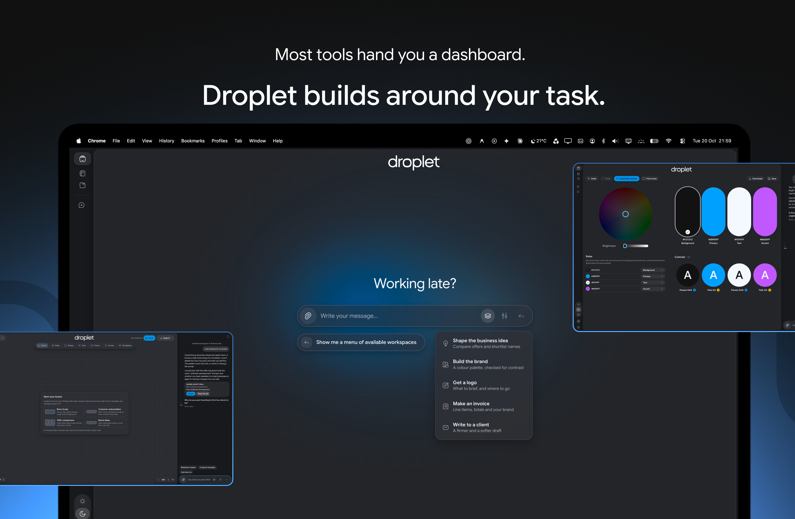
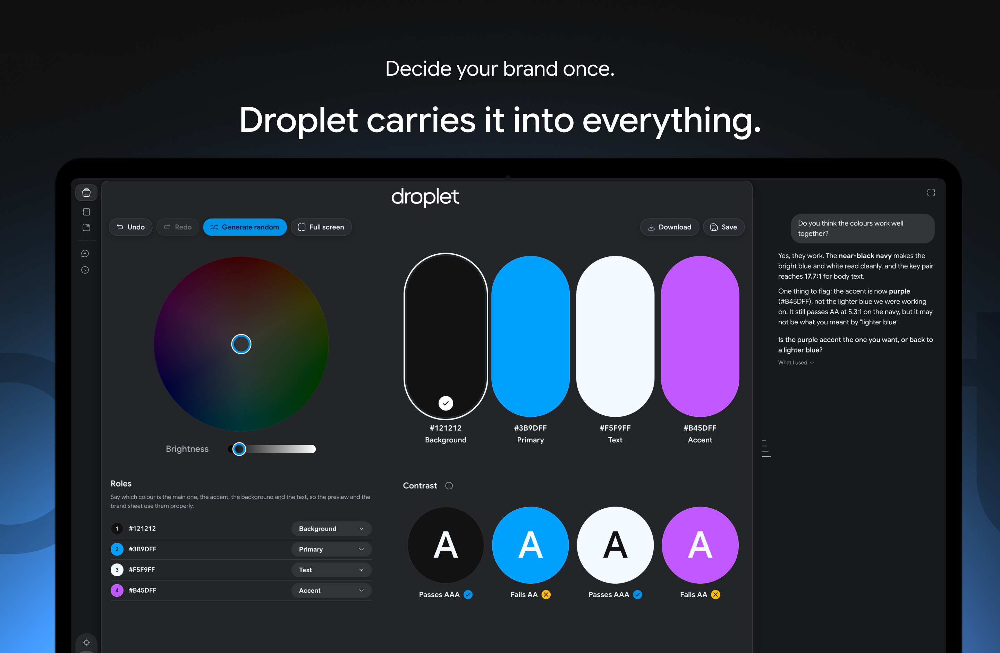
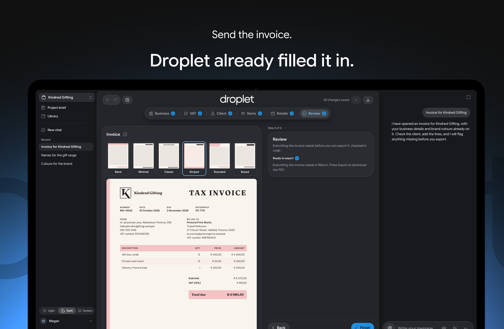
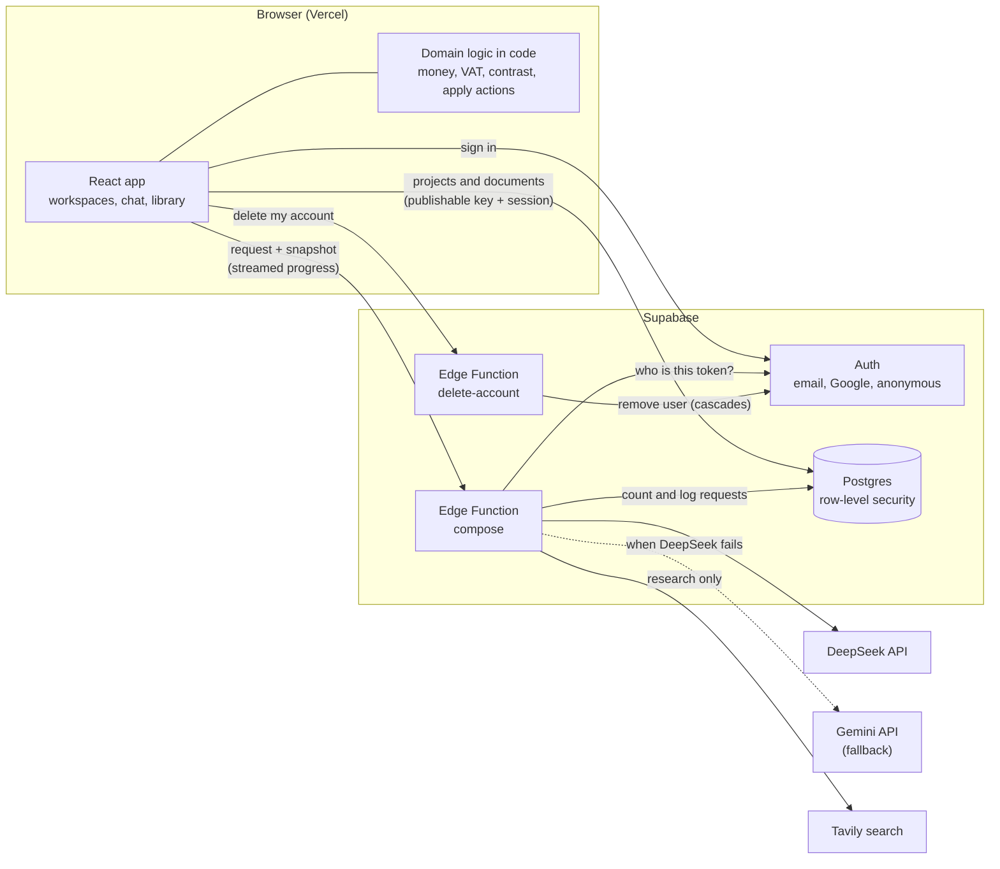
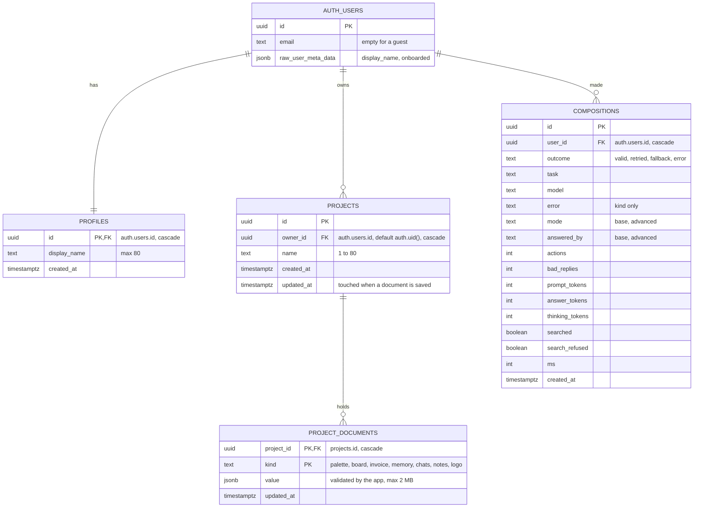
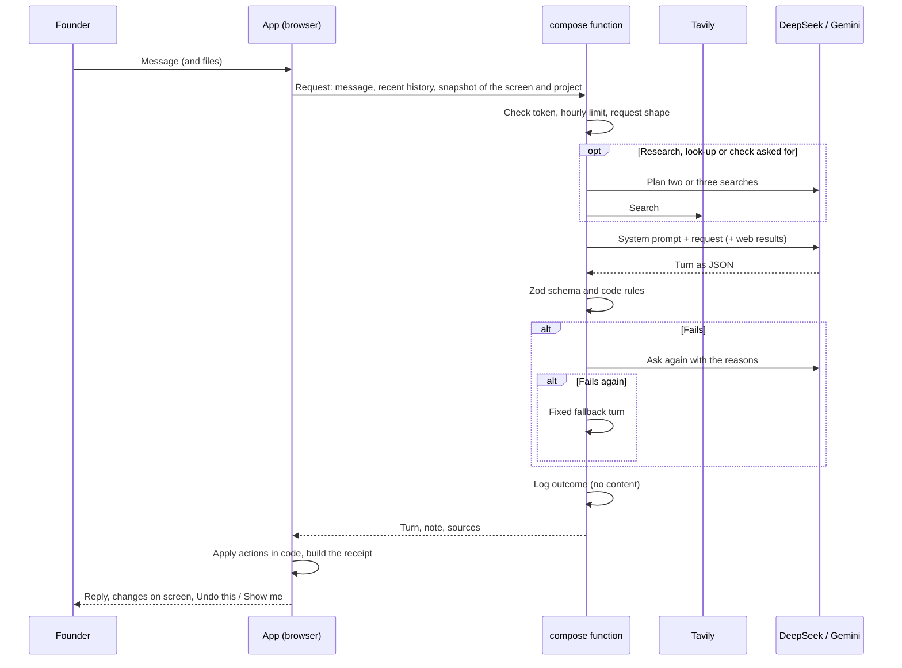

# Droplet

**Most tools hand you a dashboard. Droplet builds around your task.**

Droplet is an AI workspace for small business owners. The founder says what they are trying to do, and Droplet assembles the interface for it from a fixed library of tested components: a board for shaping the business idea, a brand palette, and an invoice. The model decides what to show and what to change; the app's own code draws it, checks it and does the sums.

**Live:** https://droplet-tan.vercel.app

**Demo video (walkthrough):** https://youtu.be/bKIY1x4bgFI

**Promo video:** https://youtu.be/WLlGiDC9sms



| Decide your brand once. Droplet carries it into everything. | Send the invoice. Droplet already filled it in. |
|---|---|
|  |  |

## Contents

- [How it works](#how-it-works)
- [Features](#features)
- [Changes from the proposal](#changes-from-the-proposal)
- [Tech stack](#tech-stack)
- [Reasoning behind frameworks and tools](#reasoning-behind-frameworks-and-tools)
- [Architecture](#architecture)
- [Data model (ERD)](#data-model-erd)
- [Key API endpoints](#key-api-endpoints)
- [The AI contract](#the-ai-contract)
- [Security and privacy](#security-and-privacy)
- [Setup](#setup)
- [Environment variables](#environment-variables)
- [Scripts](#scripts)
- [Testing](#testing)
- [Deploying](#deploying)
- [Project layout](#project-layout)
- [Highlights](#highlights)
- [Known limits](#known-limits)
- [Potential improvements](#potential-improvements)

## How it works

1. The founder signs in (or opens a guest account) and lands in a chat for their project.
2. They say what they need: "I need an invoice for Karoo Candles", "help me choose colours", "who are my competitors?".
3. The request goes to the `compose` Edge Function with a short snapshot of what is on screen and what the project holds. Private details are left out.
4. The model answers with a **turn**: a message, and actions from a fixed list (open the invoice, add a line, set a colour). It never returns markup or layout.
5. The function checks the turn against Zod schemas and code rules, asks once more with the reasons if it fails, and uses a fixed fallback if it fails again.
6. The app applies the actions in code, lists what changed under the reply (with Undo this and Show me), and opens the workspace beside the chat.
7. Nothing is saved until the founder presses Save or Remember.

## Features

### Conversation
- **Chat first.** The founder says what they need in their own words. Droplet answers like an assistant until it is asked to build something.
- **Workspaces open from the chat**, or from the workspaces menu in the message bar. The chat moves to a side panel beside the workspace and can be made full screen again.
- **Blocks in the chat:** comparison tables, plans whose steps have Open buttons and tick off as the project progresses, logo briefs, and drafts of emails and WhatsApp messages in a box with a Copy button.
- **Web research.** Asking Droplet to research, look up or check something (competitors, going rates, whether a name is taken) searches the web on the server. The searches and sources are listed under the reply.
- **Attachments:** up to three pictures, PDFs or text files per message. They are read for that message only and never stored.
- **Receipts:** every change Droplet makes is listed under its reply, with Undo this and Show me.
- **Proposed edits:** Droplet asks before changing or deleting the founder's own notes on the board.
- **Message bar hints:** suggestions based on what is on screen and selected.
- **Stop, retry and edit:** a reply can be stopped while it is being made, retried, or the last message edited and sent again.
- **Chat history:** up to 40 chats per project, which can be pinned and deleted. A short memory of each chat that was left helps later ones, and can be read, edited or switched off.

### Workspaces
- **Business idea board:** sticky notes, shapes, text, frames and connectors, templates (such as a brain dump, or customer and problem), and Droplet's own notes in pink until the founder keeps them. Exports as PDF or PNG.
- **Brand:** a colour palette with live contrast checks, colour roles (text, background, primary, accent), harmony suggestions, colours from an image, named palettes, a typeface pair and voice words. Exports a brand sheet PDF.
- **Invoice and quote:** business, VAT, client, line items, details and a review checklist. Totals and 15% VAT are worked out in code in whole cents, never by the model. Six templates (Band, Minimal, Classic, Striped, Rounded, Boxed), the brand's colours and fonts, and the founder's logo. Exports a PDF once nothing required is missing.
- **Guide mode and Workspace mode:** one step at a time with Continue and Finish, or every tool at once.
- **Fixed frame:** the work on the left (three fifths) and the tools panel on the right (two fifths), the same in every workspace, with Undo, Redo, Save and Export in the header.

### Saving and memory
- **Nothing is saved without the founder's say.** Before work would be lost (closing a workspace, opening another, switching project, opening the account page, signing out) Droplet asks in a dialog in the middle of the screen, with a button to save each thing.
- **Project memory:** business details, clients, invoices, the business name and offer, and facts about the business (stage, what it does, who for, where, values, pricing and more). Droplet proposes a fact; it is kept only when the founder presses Remember.
- **Project notes:** after a save, Droplet keeps an index of what each workspace holds and a short digest, so later chats can refer back. They can be read, edited and switched off in the project brief.
- **Project brief:** what Droplet knows about the project, in one place, to read and correct.
- **Library:** everything made in the project (brand, logo, board, invoices, clients, business details, notes) with its status, Open and Export.

### Logo
- Droplet does not make images. The logo card hands off to Canva or Adobe Express in a new tab, with a copyable spec (palette hex codes, fonts, files to ask for).
- The finished PNG or SVG (up to 1 MB) is added back on the card, and is then used on the invoice page and PDF and shown as made in the library.

### Accounts and projects
- Email and password, Google, or a guest account for assessors with no sign-up, kept until they sign out.
- An introduction on first sign-in, which names the first project.
- Several projects per founder, made and renamed from the project switcher.
- Light and dark themes.
- Deleting the account removes the account and everything in it.

## Changes from the proposal

| Change | Why |
|---|---|
| The model is DeepSeek (V4.1 Flash) instead of Google Gemini | Lower cost per request, and better performance: I have access to DeepSeek's bigger models. |
| Gemini kept as an automatic fallback | If DeepSeek cannot answer (a timeout, no balance, a server error), Gemini's Quick model answers instead, checked by the same rules, so the founder is not left without a reply. |
| Web search through Tavily on the server instead of Google Search in the model | DeepSeek has no built-in search. Searching on the server works with either model and keeps the founder's private details out of every query. |
| No Advanced mode while DeepSeek runs | Advanced was the stronger Gemini model with Google Search. With one DeepSeek model and server-side search it has nothing to add. |
| Supabase (Postgres, Auth, Edge Functions) instead of MongoDB, Express and Node | Row-level security keeps each founder's data theirs with one ownership check, and the model keys stay in Edge Functions, never in the browser. |
| Project data kept as validated JSON documents, one per project and kind | Each workspace saves and loads as a whole, and the app checks every document with Zod when it reads it, so the schema can grow without a migration for every field. |
| The composition log keeps no prompts or replies | People will not hand an AI their client or financial details if they are stored. The log needs only the outcome, model, timing and token counts. |
| A fixed workspace frame instead of movable, resizable windows | In testing, people did not find the drag gestures, and the moving grid was the main source of layout instability. A fixed frame is predictable. |
| The save question is a dialog in the middle of the screen, not a message in the chat | Testers missed it in the side panel and lost work. |
| The logo is handed off and imported, not designed in Droplet | Droplet does not make images. A free design tool does it better, so Droplet gives it everything it needs and takes the file back. |
| Drafts in the chat instead of a client email workspace | Time went to the three core workspaces. A draft with a Copy button covers writing to a client. |
| A guest account on the sign-in screen | Assessors can try Droplet without making an account. |

## Tech stack

### Frontend

| Technology | Version | Purpose |
|---|---|---|
| React | 19.3.0 | Component-based interface |
| TypeScript | 6.0.3 | Type-safe code across the app, the server and the Edge Functions |
| Vite | 8.3.2 | Dev server (which also serves `/api/compose`) and production build |
| React Router DOM | 7.18.4 | Routing: sign-in, introduction, Home, account |
| Zustand | 5.0.15 | Client state: the session, the theme, Guide or Workspace mode |
| Framer Motion | 14.0.0 | Workspace transitions, dialogs, the message rising into the chat |
| Zod | 4.6.5 | Schemas for every AI turn and every saved document |
| @react-pdf/renderer | 4.9.0 | Invoice, brand sheet and board PDFs, drawn in the browser |
| Solar Icons | 2.3.2 | Icon set (linear) |
| Google Sans (Fontsource) | 5.3.1 | Interface typeface, weights 400 to 700 |
| Fontsource brand fonts | 5.x | The typeface pairs a founder can choose for their brand and invoice (Fraunces, Inter, Lora, Playfair Display, Space Grotesk, DM Sans) |

### Backend

| Technology | Version | Purpose |
|---|---|---|
| Supabase Postgres | - | Relational database with row-level security |
| Supabase Auth | hosted | Email and password, Google, and anonymous (guest) sign-in |
| Supabase Edge Functions | Deno (hosted) | `compose` (the only place a model is called) and `delete-account` |
| @supabase/supabase-js | 2.117.2 | Auth and data access from the browser |
| Supabase CLI | 2.122.0 | Secrets and function deploys |
| Rolldown (with Vite) | bundled | Bundles the Edge Functions from the shared `server/` code |

### AI and services

| Technology | Version | Purpose |
|---|---|---|
| DeepSeek API | V4.1 Flash | The model that answers every message |
| Google Gemini API | Flash Lite | Automatic fallback when DeepSeek cannot answer |
| Tavily | API | Web search for research, look-ups and name checks |

### Testing and tooling

| Technology | Version | Purpose |
|---|---|---|
| Vitest | 5.0.3 | Unit, component and server tests |
| Testing Library (React) | 16.3.3 | Component tests through roles and labels, as a person uses the app |
| Testing Library (user-event) | 14.6.7 | Realistic typing, clicking and keyboard use |
| jest-dom | 7.0.1 | Readable DOM assertions |
| jsdom | 29.1.1 | Browser environment for tests |
| oxlint | 1.86.0 | Linting |
| Vercel | hosted | Hosting the app |

## Reasoning behind frameworks and tools

- **React + Vite:** Droplet assembles its interface from a fixed library of components, which is what React is built around. Each workspace, block and dialog is a component the model can ask for but never write. Vite gives fast reloads while working and, in development, also serves the compose service, so the whole app runs from one command.
- **TypeScript:** the same types run through the browser, the compose service and the Edge Functions. A turn, a saved invoice or a board item has one definition, and a mismatch between what the model may send and what the app applies is caught before it runs.
- **Zod:** the model's reply is untrusted input. Zod checks every turn against its schema and turns the schema into the JSON shape the model is asked for, so the contract is written once. The same approach checks every document read from the database, so a damaged or old save is treated as missing rather than breaking a workspace.
- **Zustand:** only a little state is global (the session, the theme, the work mode). Zustand keeps it small and readable without a provider tree; workspace state lives in reducers with undo and redo.
- **Framer Motion:** a workspace that opens beside the chat, a message that rises into place and a dialog that comes forward help the founder follow what changed. It respects reduced-motion settings.
- **Supabase (Postgres, Auth, Edge Functions):** one service covers accounts, data and server code. Row-level security means a founder's projects and documents are theirs with one ownership check in the database, not in every query. Edge Functions keep the model keys on the server and give the compose service a place to check the founder's token, count requests and log outcomes. Anonymous sign-in made the guest account possible without a separate system.
- **JSON documents per project:** each workspace saves and loads as a whole (a palette, a board, an invoice, the project memory, the chats), and the app validates each one with Zod when it reads it. This let the shape of a workspace grow during the build without a migration for every field, while the tables that need relations (users, projects, the composition log) stay relational.
- **DeepSeek, with Gemini as fallback:** DeepSeek costs less per request and, with access to its bigger models, performs better for composing turns. Gemini stays wired in behind it, so a DeepSeek outage, a timeout or an empty balance does not leave the founder without a reply.
- **Tavily:** search happens on the server, so it works with either model, the searches are written without the founder's private details, and the sources can be listed under the reply.
- **@react-pdf/renderer:** invoices, brand sheets and boards are drawn as PDFs in the browser from the same data as the screen, with the brand's own fonts. Nothing is uploaded to be rendered.
- **Solar Icons and Google Sans:** one consistent icon set and one interface typeface, with semantic colour tokens for light and dark themes, so every workspace looks like part of the same product.
- **Vitest + Testing Library:** Vitest runs on the same Vite setup as the app, so there is no second build config. Testing Library tests the interface the way a person uses it, by roles and labels.
- **oxlint:** fast enough to run on every change.

## Architecture



- **The browser** holds the interface and all the domain logic: sums, VAT, contrast, the rules for applying a turn. It reads and writes the founder's documents directly, with row-level security deciding what it may touch.
- **`compose`** is the only place a model is called. It checks the founder's token with Supabase Auth, holds them to an hourly limit counted from the `compositions` table, searches the web when asked, calls the model, validates the turn and logs the outcome. It streams the stage it is at (reading, searching, writing) so the chat can say what Droplet is doing.
- **`delete-account`** deletes the signed-in founder from `auth.users`; every table cascades from it.
- **In development** the Vite dev server serves the same compose service at `/api/compose`, from `server/`, with the same code the Edge Function runs.
- **Without Supabase** set up, the app runs on this device alone: a sample founder, and documents in the browser's local storage.

## Data model (ERD)



- **`profiles`** is made by a trigger when a user signs up, from the name they gave (or Google's, or the start of their email).
- **`projects`** gets its owner from the session (`default auth.uid()`), so the app never says whose a project is and cannot say someone else's.
- **`project_documents`** holds one JSON document per project and kind. The primary key `(project_id, kind)` means a save is an upsert of the whole document.
- **`compositions`** is written only by the `compose` function, with the service role key. It is the record of how the model did and what the hourly limit counts. It never holds what was asked or answered.
- **Cascades:** deleting a user removes their profile, projects, documents and compositions.

### What each document holds

Every document is checked with a Zod schema when it is read; one that does not fit is treated as missing.

| Kind | Holds | Schema |
|---|---|---|
| `palette` | The colours with names, rationale and roles, named palettes (up to 20), the typeface pair, voice words, when it was saved and exported | `src/lib/paletteSave.ts` |
| `board` | Notes, shapes, text, frames and connectors, with positions and authorship, when it was saved and exported | `src/lib/boardSave.ts` |
| `invoice` | The invoice being worked on: business, client, lines in cents, VAT, details and template | `src/lib/invoiceSave.ts` |
| `memory` | Business details, the idea (name and offer), facts by key, clients (up to 200), confirmed invoices, and the founder's settings for recall and notes | `src/lib/memorySave.ts` |
| `chats` | Up to 40 chats, each with up to 300 messages, title, pin, and its short memory | `src/lib/chatStore.ts` |
| `notes` | For each workspace, an index of what it holds and a short digest | `src/lib/notes.ts` |
| `logo` | The founder's logo as a data URL (PNG or SVG, up to 1 MB), its name and size | `src/lib/logoSave.ts` |

## Key API endpoints

Droplet has two Edge Functions of its own. Everything else goes through Supabase's Auth and REST APIs, guarded by row-level security.

### Edge Functions

| Endpoint | Method | Operations |
|---|---|---|
| `compose` | `POST` | Answer a message: validate the request, check the founder's token and hourly limit, search the web when asked, call the model (DeepSeek, then Gemini), validate the turn, log the outcome. With `Accept: text/event-stream` it streams the stage it is at, then the result. |
| `compose` | `POST` (background) | `summarise_chat`: a short memory of a chat that was left. `digest_workspace`: a short digest of a saved workspace for the project notes. Always the Quick model, never searches. |
| `compose` | `GET` | The founder's Advanced allowance (0 while DeepSeek runs). |
| `delete-account` | `POST` | Delete the signed-in founder from `auth.users`; every table cascades from it. |
| `/api/compose` | `GET`, `POST` | The same compose service, served by the Vite dev server in development. |

### Supabase Auth

| Operation | Used for |
|---|---|
| Sign up, sign in with password | Email accounts, with a confirmation link |
| Sign in with OAuth | Continue with Google |
| Sign in anonymously | The guest account for assessors |
| Update user | Marking the introduction as done |
| Sign out | Ending the session |

### Supabase REST (row-level security)

| Table | Operations |
|---|---|
| `projects` | List the founder's projects, make one, rename one |
| `project_documents` | Read, upsert or remove one document by project and kind |
| `compositions` | Read the founder's own rows; written only by `compose` with the service role key |

## The AI contract



- **A turn** is a message, a task, actions from a fixed vocabulary per workspace, and optionally a question, up to two blocks (table, checklist, logo brief, draft), facts to propose and a chat title. Its shape is in `src/compose/spec.ts`, `invoiceSpec.ts` and `boardSpec.ts`.
- **Rules in code** (`src/compose/rules.ts`) check what a schema cannot: a price must be one the founder wrote, a workspace opens only when the founder asked for it (the reply quotes their words), the palette keeps a readable text and background pair, a proposed fact holds no private detail, and a draft has no markers, placeholders or mentions of AI. There are no actions for totals or VAT at all.
- **The model never does the sums.** It says "add a line of 12 boxes at R85"; the app works out the totals and VAT in whole cents (`src/lib/money.ts`, `src/lib/invoice.ts`).
- **Memory needs confirmation.** The model can propose a fact; only the founder's Remember keeps it.
- **Fallback chain:** retry once with the reasons, then a fixed fallback turn. Separately, if DeepSeek cannot be reached, Gemini answers the same request.
- **Fixed test requests** (`src/compose/testRequests.ts`) cover every task and the hard cases. `npm run eval:compose` runs them against the configured model and reports the valid, retried and fallback rates.

## Security and privacy

- **Row-level security** on every table: a founder reads and writes only their own profile, projects and documents. The `anon` role has no access.
- **Model keys** live only in the Edge Function's secrets (and `.env` locally, which is git-ignored). Nothing starting with `VITE_` holds a secret.
- **Tokens are checked by Supabase Auth**, not decoded in the function, so an expired or forged token is turned away.
- **What reaches the model:** client and business names, line items and amounts, and whether an address, contact details and bank details are filled in. Never the addresses, email addresses, phone numbers or bank details themselves.
- **Web searches** are written from the request without private details, and a message with an email, phone number, address or bank detail in it is not searched.
- **Logs** keep outcomes, models, timings and token counts, never what the founder wrote or the model answered.
- **Attachments** are sent for one message and not stored.
- **Limits:** 60 requests an hour per founder by default; documents up to 2 MB; attachments up to 8 MB in all.

## Setup

Requires Node 22 or later.

```bash
npm install
cp .env.example .env
npm run dev
```

Fill in `.env` (see below). With no Supabase values the app runs on this device alone as a sample founder, which is enough to try every workspace.

To use accounts, set up a Supabase project and run the migrations in `supabase/migrations` in order: [docs/supabase-setup.md](docs/supabase-setup.md). For the guest account, switch on anonymous sign-ins in Supabase Auth.

## Environment variables

| Name | Where | Purpose |
|---|---|---|
| `AI_PROVIDER` | Server | `deepseek` to run on DeepSeek; unset or `gemini` for Gemini alone |
| `DEEPSEEK_API_KEY` | Server | DeepSeek key |
| `DEEPSEEK_MODEL` | Server | Default `deepseek-flash` |
| `DEEPSEEK_THINKING` | Server | `enabled` to let the model think first (slower); off by default |
| `GEMINI_API_KEY` | Server | Gemini key, used as the fallback behind DeepSeek |
| `GEMINI_BASE_MODEL` | Server | The fallback model, default `gemini-3.5-flash-lite` |
| `TAVILY_API_KEY` | Server | Web search for research; without it, research is answered from what the model knows, and it says so |
| `COMPOSE_LIMIT_PER_HOUR` | Server | Requests per founder per hour, default 60 |
| `VITE_SUPABASE_URL` | Browser | Supabase project URL |
| `VITE_SUPABASE_ANON_KEY` | Browser | Supabase publishable key (safe in the browser; row-level security decides access) |
| `VITE_COMPOSE_URL` | Browser | Optional: point the dev app at a deployed `compose` function |

Server values go in `.env` for development and as Supabase secrets for the deployed function. The full list, with the Gemini-only options, is in [.env.example](.env.example).

## Scripts

| Command | Purpose |
|---|---|
| `npm run dev` | Dev server, which also serves `/api/compose` |
| `npm run build` | Typecheck and production build |
| `npm run preview` | Serve the production build |
| `npm run typecheck` | Typecheck only |
| `npm run lint` | oxlint |
| `npm test` | Vitest, single run |
| `npm run test:watch` | Vitest, watching |
| `npm run eval:compose` | Run the fixed test requests against the configured model |
| `npm run build:edge` | Bundle the Edge Functions into `supabase/functions/` |
| `npm run deploy:compose` | Build and deploy the `compose` function |
| `npm run deploy:delete-account` | Build and deploy the `delete-account` function |

## Testing

- **Location:** next to the code they test (`*.test.ts` and `*.test.tsx` in `src/` and `server/`)
- **Framework:** Vitest 5, React Testing Library, user-event, jest-dom, jsdom
- **Tests:** 2,716 in 148 files, all passing

| Area | Files | Tests | Covers |
|---|---|---|---|
| `src/lib` | 69 | 1,156 | Money in cents, VAT, contrast, colour, harmony, board geometry and connectors, invoice readiness and templates, memory, chats, storage drivers |
| `src/compose` | 30 | 646 | Turn and block schemas, rules, prompts, applying actions to each workspace, receipts, search and query planning, the provider fallback |
| `src/components` | 32 | 490 | Workspaces, the chat thread, dialogs, the library, the logo handoff, the mobile notice |
| `src/pages` | 6 | 249 | Home flows (opening, switching and closing workspaces, the save dialog, chat history), sign-in, introduction, account |
| `server` | 7 | 125 | The compose service, rate limits, streaming, environment and providers, Edge Function handlers and bundles |
| `src/store` | 1 | 28 | Sessions, sign-in, the guest account, sign-out |
| `src/export` | 2 | 18 | Invoice and board PDFs |
| `src/hooks` | 1 | 4 | Loading saved documents |

No test calls a real model, database or search service: each takes its `fetch` or storage as a parameter.

Run from the repo root:

```bash
npm test             # all tests, once
npm run test:watch   # while working
npx tsc -b           # types
npx oxlint           # lint
```

Against a real model, the fixed test requests (`src/compose/testRequests.ts`) cover every task and the hard cases, and report the valid, retried and fallback rates:

```bash
npm run eval:compose
```

Visual and interactive behaviour is reviewed by hand.

## Deploying

- **App:** Vercel builds with `npm run build` and serves `dist/`; `vercel.json` sends every route to the app.
- **Functions:** `npm run deploy:compose` and `npm run deploy:delete-account`, with the server variables set as secrets (`npx supabase secrets set ...`).
- **Database:** run any new migration in the Supabase SQL editor before deploying the code that uses it.

Step by step: [docs/deploy.md](docs/deploy.md).

## Project layout

```
src/
  pages/        sign-in, introduction, Home, account
  components/   workspace shell, the three workspaces (board/, invoice/, brand), chat, sidebar, dialogs
  compose/      the AI contract: schemas, prompts, rules, search, providers, applying a turn
  lib/          domain logic with tests: money, VAT, contrast, colour, board, memory, storage drivers
  export/       invoice, brand sheet and board PDFs
  store/        Zustand stores: auth, theme, work mode
  styles/       tokens and global styles
server/         the compose service, shared by the dev server and the Edge Functions
  edge/         the Edge Function handlers and entry points
supabase/
  migrations/   schema and row-level security policies
scripts/        Edge Function bundler and the compose evaluation
docs/           setup, deployment, research and the build roadmap
```

## Highlights

- **A validated AI contract.** The model never writes interface or does sums. Every reply is checked by schema and code rules, retried once with the reasons, and replaced by a fixed fallback if it still fails. Invalid output never reaches the screen.
- **Money handled in code.** Totals and 15% VAT are worked out in whole cents, and a price can only be one the founder wrote.
- **Two model providers.** DeepSeek answers; Gemini takes over automatically when it cannot.
- **Nothing kept without the founder's say.** Memory needs Remember, saving needs Save, and leaving with unsaved work asks first.
- **Private by design.** Row-level security on every table, model keys only on the server, no addresses, phone numbers or bank details sent to the model, and no prompts or replies in the logs.
- **2,716 tests** across domain logic, the AI contract, the server and the interface.
- **A guest account** so anyone can try Droplet without signing up.

## Known limits

- Built for desktop. On a phone Droplet says so and lets the founder carry on.
- There is no client email workspace, and nothing is sent from Droplet: drafts are copied and sent by the founder.
- No payments or accounting links.
- A typeface or voice change that has not been saved is not counted as unsaved when leaving the brand.

## Potential improvements

### Short term

- Count unsaved typeface and voice choices in the save dialog, by keeping them with the palette's state.
- A phone layout for reviewing and exporting an invoice.
- Test coverage reports (`@vitest/coverage-v8`) and a CI run of typecheck, lint and tests on every push.
- Re-run the fixed test requests on the deployed function after each model change, and record the rates.

### Medium term

- A client email workspace, built on the drafts the chat already writes.
- Send an invoice from Droplet by email, and turn an accepted quote into an invoice.
- Keep logos in Supabase Storage instead of inside a JSON document.
- A second round of usability tests with founders outside the project.
